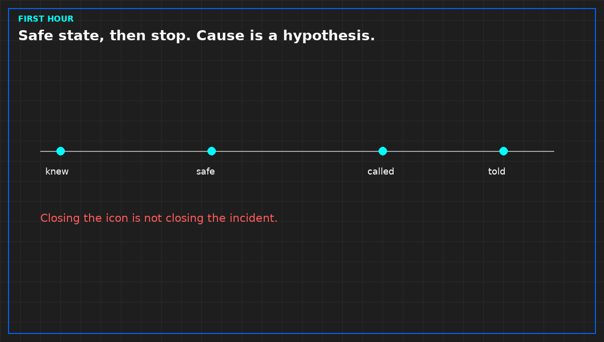

# An alarm is not an incident

*Original diagram. Not a site record.*

An incident is the service leaving the state you owe, or a person in danger, or a plant about to do either. A noisy alarm that does none of those is an alarm. Do not promote it because it has been loud for an hour. Do not demote a real incident because the room still looks calm. The test is the service and the person, not the volume of the horn.

In the first hour, write the minute you knew, what you saw, the safe state you reached, who you called, and what you told the customer. Not the root cause. You do not know it yet. A cause handed to you in that minute is a hypothesis. Label it. If it enters the notice, it will be quoted as a finding.

Closing the alarm is not closing the incident. The incident stays open until the service is restored and the notice matches what you owe. A replaced part is not that restoration until you have confirmed the service.

Afterwards, one change, owned and dated, is a review. A meeting that only retells the fear is not.

From *Run the Data Center Day*, Tristan, Data Center Field Guides. No store link until the Kindle edition is listed.

Related: [A green tile can be stale](06-stale-is-not-green.md).
