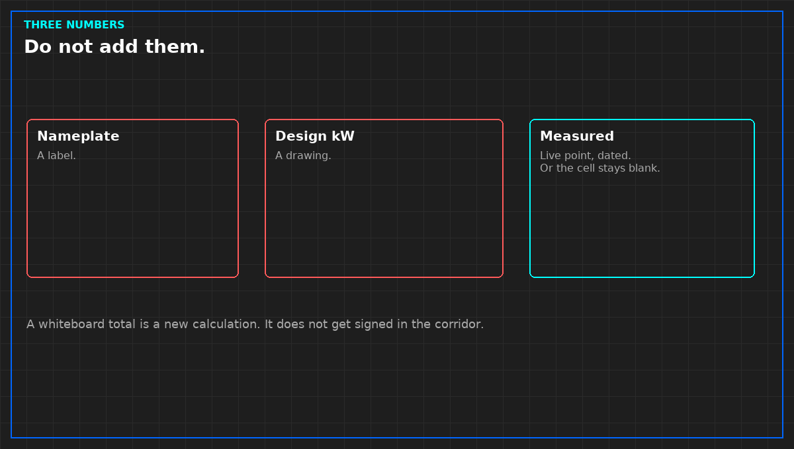

# Do not add nameplate and measured load

*Original diagram. Not a site record.*

Three numbers get added because they share a unit. They are not the same series. A nameplate is what the machine was labeled. A design kilowatt is what the drawing claimed. A measured load is what a live point said, at a time, from a path you can name. Adding them produces a fourth number nobody measured. That number will be quoted for a year.

The used-capacity cell takes the measured point, live, or it stays blank. Blank is allowed. Write why: missing, stale, or never in the claim. Stale refuses the cell. Design does not fill it while you wait for the meter. A closed breaker is not a load. Do not infer kilowatts from a status bit.

Plot design and measured apart. One line with both is the defect. A whiteboard total in the meeting is a new calculation. It does not get signed in the corridor. If a roll-up already exists, it is a calculated point: inputs written, stale inputs refused or shown. "Whichever looks calmer" is not an input list.

Redundancy is a design claim until a test shows what remains when one machine is actually out. N+1 on a slide does not fill the cell. Note the drawing beside the cell. Do not put it inside.

A future IT load is a plan. It does not enter the used cell, and it does not enter the available cell unless you can say the method in one sentence and operate to it.

From *Run the Data Center Day*, Tristan, Data Center Field Guides. No store link until the Kindle edition is listed.

Related: [A nameplate is not used capacity](05-nameplate-is-not-capacity.md).
