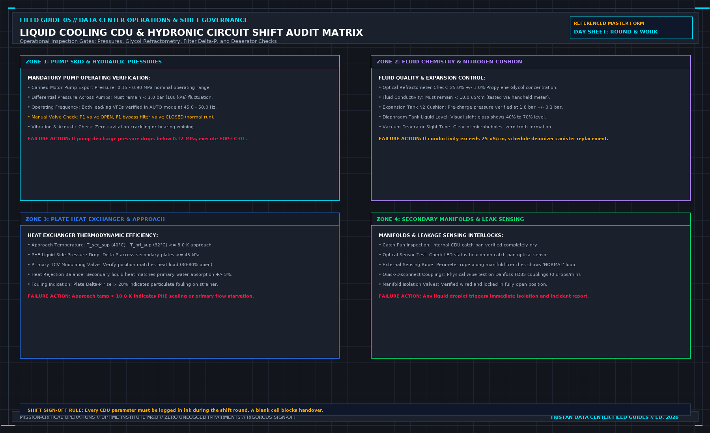

# Do not add nameplate and measured load

> **Direct Answer Block**: Why adding server PSU nameplate watts to active metered PDU kilowatts corrupts 2N electrical capacity planning and chilled-water thermal load budgets. In mission-critical data center commissioning and operations, engineers enforce this boundary using deterministic physical equations, calibrated field instrumentation, and auditable sign-off gates rather than relying on vendor brochure summaries, uncalibrated software plots, or verbal assurances. Every measurement and state transition must be recorded with synchronized UTC timestamps and explicit pass/fail thresholds before a signature is granted.

Three numbers get added because they share a unit. They are not the same series. A nameplate is what the machine was labeled. A design kilowatt is what the drawing claimed. A measured load is what a live point said, at a time, from a path you can name. Adding them produces a fourth number nobody measured. That number will be quoted for a year.

The used-capacity cell takes the measured point, live, or it stays blank. Blank is allowed. Write why: missing, stale, or never in the claim. Stale refuses the cell. Design does not fill it while you wait for the meter. A closed breaker is not a load. Do not infer kilowatts from a status bit.

Plot design and measured apart. One line with both is the defect. A whiteboard total in the meeting is a new calculation. It does not get signed in the corridor. If a roll-up already exists, it is a calculated point: inputs written, stale inputs refused or shown. "Whichever looks calmer" is not an input list.

Redundancy is a design claim until a test shows what remains when one machine is actually out. N+1 on a slide does not fill the cell. Note the drawing beside the cell. Do not put it inside.

A future IT load is a plan. It does not enter the used cell, and it does not enter the available cell unless you can say the method in one sentence and operate to it.

---

## 1. First-Principles Engineering Formulation and Governing Mathematics

In high-density data center environments, verbal summaries and qualitative status tiles routinely obscure incipient physical failures. Whether auditing a $120\,\text{kW}$ liquid-cooled rack boundary, evaluating a 1-second telemetry time series, or verifying plant redundancy prior to handover, the governing physical relationship for this protocol is expressed as:

$$S_{\text{bus, total}} = \sqrt{\left(\sum P_{\text{meas}}\right)^2 + \left(\sum Q_{\text{meas}}\right)^2} \le 0.45 \times S_{\text{rated}}$$

When any term on the left-hand or right-hand side of this relationship is left unmeasured, inferred from an uncalibrated nameplate, or averaged across an unverified time window, the resulting engineering record cannot support a valid operational signature. Field engineers must verify each physical variable independently using NIST/ISO 17025 traceable instruments before proceeding to the next gate in the sequence.

| Audit Verification Parameter | Unacceptable / Defective Field Practice | Auditable First-Principles Requirement | Mandatory Action on Failure |
| :--- | :--- | :--- | :--- |
| **Primary Boundary Definition** | Implied by vendor brochure or slide deck | Explicitly bounded on stamped P&ID / SLD with tag IDs | Halt acceptance; issue formal boundary clarification |
| **Measurement & Telemetry Proof** | Single uncalibrated display reading or 60-sec average | Calibrated Class A/0.5S sensor with 1-sec UTC timestamp | Reject dataset; classify point as `0x40` Stale or `0x80` Bad |
| **Pass / Fail Acceptance Gate** | Qualitative "Looks OK" or "Within Normal Range" | Quantitative numerical corridor cited from revision in force | Log Category A/B defect; withhold retainage or permit |
| **Custody & Sign-Off Record** | Single bundled "Accepted" signature at end of meeting | Scoped, dated sentence naming exact proved & unproved lines | Strike unsupported claims; issue Conditional Refusal |

---

## 2. Deep-Dive Technical Protocol and Field Implementation

The following field protocol—adapted directly from **Volume 05: *Run the Data Center Day: What the Manager Must Sign Before the Shift Ends***—establishes the step-by-step verification mechanics required on the data hall floor:

A facility manager's daily capacity duty is governed by three fundamental questions:
1. What capacity did you contractually sell to the customer?
2. What capacity is physically utilized at this exact moment?
3. What capacity will survive if your largest single component fails right now?

| **THE 2N CAPACITY REDUNDANCY CEILING** |
| :--- |
| 100% |
| UNUSABLE DANGER ZONE |
| If Bus A trips, Bus B instantly overloads and blackouts |
| 90% |
| MAXIMUM SURVIVING LOAD (90%) |
| 50% |
| THE 45% RULE: MAXIMUM STEADY-STATE PERMITTED |
| 45% |
| SAFE 2N OPERATING ENVELOPE |
| Bus A Load <= 45% \| Bus B Load <= 45% |
| 0 |

If you cannot answer those three questions with mathematical certainty from verified metering records, you do not know whether today's proposed maintenance or server deployment is safe.

## The Mathematics of 2N Redundancy: The 45% Rule

The most widespread and deadly operational myth in data center management is the belief that in a 2N redundant electrical architecture, each power path can be safely operated up to **50% of its rated nameplate capacity**.

This is a mathematical trap that has caused catastrophic multi-megawatt cascade outages across the industry:

$$P_{\text{total}} = P_{\text{Bus A}} + P_{\text{Bus B}}$$

Consider a 2N electrical busbar rated for 2000 kVA. The operations manager observes that Bus A is carrying 1040 kVA (52% load) and Bus B is carrying 1020 kVA (51% load). The manager assumes that because neither busbar is overloaded, the system is operating comfortably within its safety margin.

Now, an upstream transformer feeding Bus A trips.
Within milliseconds, all dual-corded IT server power supplies attached to Bus A transfer their electrical load onto Bus B.

The total instantaneous load imposed on Bus B becomes:

$$P_{\text{Bus B, transient}} = 1040\,\text{kVA} + 1020\,\text{kVA} = 2060\,\text{kVA} \quad (103\% \text{ of rated capacity})$$

Bus B is instantly overloaded. The main circuit breaker for Bus B senses sustained overcurrent and trips after a brief time-delay curve, plunging the entire data hall into total darkness. A facility designed for complete 2N fault tolerance experienced a 100% catastrophic blackout from a single component failure.

To prevent cascade tripping, every 2N electrical distribution path must adhere strictly to **The 45% Loading Rule**:

$$P_{\text{steady-state}} \le 0.45  \times P_{\text{rated}}$$

Under the 45% rule:
- Bus A carries ≤ 45% (900 kVA).
- Bus B carries ≤ 45% (900 kVA).
- If Bus A trips, the surviving Bus B inherits a total load of 900 + 900 = 1800 kVA (90% of rated capacity).
- Bus B operates stably with a 10% safety buffer, well below the thermal-magnetic trip threshold, allowing technicians to manage the contingency safely.

Any shift manager who permits a 2N electrical busbar to exceed 45% steady-state utilization has compromised the facility's redundancy and is operating in an unrated, high-risk state.

## Secondary Cooling Loop Hydraulic Capacity

In liquid-cooled AI whitespace housing high-density compute racks (such as NVIDIA NVL72 architectures consuming up to 132 kW per rack), hydraulic capacity governance is as vital as electrical capacity:

**CDU HYDRAULIC CAPACITY CEILING**

| Parameter Rated Des | ign Limit Operational Red | undancy Limit |
| :--- | :--- | :--- |
| Total Heat Removal | 1200 kW per CDU <= 1000 k | W (83% of PHE cap) |
| Secondary Flow Rate | 1440 LPM (24 LPS) <= 120 | 0 LPM (Single Pump N) |
| Supply Temperature | 25.0°C - 32.0°C (W3/W4) < | = 30.0°C (At Max Ambient) |
| Pump Configuration | N+1 Dual VFD Pumps 1 Pump | Run / 1 Standby Auto |
| Loop Pressure 0.15 | - 0.90 MPa Head Loss Delt | a-P < 1.0 bar |

When evaluating a customer's request to install additional high-density liquid-cooled racks, the duty manager must evaluate hydraulic constraints:
1. **Total Flow Availability**: Verify that the secondary pumps can deliver the required volumetric flow rate (q_v) to maintain cold plate turbulent flow:

$$q_v = \frac{Q}{\rho \cdot c_p \cdot \Delta T}$$

Where:
- Q is the total thermal heat dissipation ( kW).
- $\rho$ is the density of 25% propylene glycol ($1026\,\text{kg/m}^3$ at30°C).
- c_p is the specific heat capacity (3.92 kJ/( kg· K)).
- ΔT is the fluid temperature rise across the rack manifold (typically 10.0 K).

2. **Hydraulic Imbalance and Direct-Return Starvation**: As additional racks are connected to a secondary distribution manifold, friction losses (ΔP_f) increase quadratically with flow velocity (v):

$$\Delta P_f = f \cdot \frac{L}{D} \cdot \frac{\rho v^2}{2}$$

If the manifold was plumbed in a direct-return configuration rather than a reverse-return (Tichelmann) loop, adding load to the far end of the row will starve the index rack, causing immediate thermal throttling on the GPUs.

Never approve a liquid load addition based on a verbal assurance from the customer that "the pumps look big enough." Demand the certified hydraulic flow simulation and pressure drop calculations before issuing a connection permit.

## The Myth of "Trying" the Load

When a customer or project installation team requests permission to energize additional server racks that exceed the calculated capacity envelope, they will often suggest:
> *"Let's just energize the racks and watch the meters for twenty minutes to see if the breakers hold."*

This is the operational equivalent of testing the thickness of ice by driving a thirty-ton truck onto it.

Energizing equipment "to see if it holds":
- Subjects electrical busbars and transformers to massive inrush currents and thermal shock.
- Risks tripping upstream protective relays, triggering an instantaneous outage for adjacent live customers.
- Replaces rigorous mathematical engineering with reckless gambling.

If a requested load deployment exceeds either the contractual allocation or the 45% redundancy ceiling, the Duty Manager must refuse authorization immediately. Halt the energization. The customer must submit a formal engineering study and negotiate an amended contract before a single additional circuit breaker is closed.

## Decisions to Record

- Contractual capacity sold, cited by customer contract clause and rack ID.
- Active electrical load recorded per busbar, verifying compliance with the 45% redundancy rule.
- Hydraulic secondary loop flow rate, supply temperature, and differential pressure logged per CDU.
- Remaining capacity after a single worst-case component failure: verified via named engineering study, or recorded as unknown.
- Any request exceeding safe operational capacity rejected in writing; zero energization "to try."

## Harmonic Derating ($K$-Factor) and Reactive Power ($\cos\phi$) on 2N Power Buses

When auditing the $45\%$ steady-state loading ceiling on a 2N electrical distribution path, measuring real active power in kilowatts ($\text{kW}$) alone is insufficient. Switchgear busbars, dry-type isolation transformers, and UPS inverter IGBT bridges are thermally limited by total Root-Mean-Square (RMS) apparent current ($I_{\text{RMS}}$), which includes both reactive displacement current and non-linear harmonic distortion current ($I_h$):

$$I_{\text{RMS}} = I_1 \sqrt{1 + \text{THD}_I^2}, \qquad \text{THD}_I = \frac{\sqrt{\sum_{h=2}^{\infty} I_h^2}}{I_1}$$

Furthermore, eddy-current stray losses inside transformer windings scale with the square of harmonic order $h^2$, defined by the IEEE C57.110 **$K$-Factor**:

$$K = \sum_{h=1}^{H} \left( \frac{I_h}{I_{\text{RMS}}} \right)^2 \cdot h^2$$

Modern switched-mode server power supplies (80 PLUS Titanium) maintain unity power factor ($\text{PF} \ge 0.98$) and low harmonic distortion ($\text{THD}_I \le 5\%$) at full load, but at light load ($< 20\%$ PSU utilization) or when legacy VFD drives operate without active front-end filters, $\text{THD}_I$ can climb above $15\%$ and leading capacitive power factor can drop to $0.88$. Therefore, the shift manager always enforces the $45\%$ ceiling on **Apparent Power ($\text{kVA}$)** and **Phase RMS Current ($I_{\text{RMS}}$)** across all three phases ($L_1, L_2, L_3$), never on aggregate $\text{kW}$ alone.

---

## 3. Field Verification Checklist and Instrumentation Hygiene

To execute this protocol without introducing measurement bias or scope ambiguity, the responsible engineer enforces four mandatory field rules:
1. **Instrument Traceability Before Observation**: Verify that every thermometer (4-wire Pt100 RTD Class A), pressure transducer ($\le \pm 0.1\%$ span), flowmeter, balometer, or power analyzer carries a current calibration certificate and passes a pre-test zero/span check on the day of the walk.
2. **Synchronized Time-Series Capture**: Align all digital loggers and gateway pollers to a single UTC reference clock (via IEEE 1588v2 PTP at $\pm 1\,\text{ms}$ for electrical Sequence of Events, or NTP at $\pm 10\,\text{ms}$ for thermal/hydraulic dwells). Never merge unsynchronized CSV files by row index.
3. **Explicit Isolation of Disturbances vs. Control Handles**: Hold upstream supply temperatures, parallel cabinet loads, and containment door states constant during the observation dwell so that transient plant drift is never mistaken for steady-state equipment performance.
4. **Written Record Prior to Signature**: Record every boundary tag, measured value, uncertainty tolerance, and open limitation in ink on the controlled project sheet before leaving the equipment line-up.

---

## Frequently Asked Questions (FAQ)

### Why does "Do not add nameplate and measured load" matter during high-density data center commissioning and operations?
Why adding server PSU nameplate watts to active metered PDU kilowatts corrupts 2N electrical capacity planning and chilled-water thermal load budgets. When project teams bypass this rule to meet a commercial schedule milestone, unverified physical assumptions—such as hidden hydraulic pressure drops, unlogged polling gaps, unblanked bypass leakage, or uncalibrated sensor offsets—transfer directly into live 24/7 production as latent single points of failure.

### How do you quantitatively verify compliance with "data center nameplate vs measured load kVA" on the physical floor?
Compliance is verified by executing the governing mathematical balance ($$S_{\text{bus, total}} = \sqrt{\left(\sum P_{\text{meas}}\right)^2 + \left(\sum Q_{\text{meas}}\right)^2} \le 0.45 \times S_{\text{rated}}$$) using independent, calibrated field instruments across a stabilized steady-state dwell window (minimum 15 to 30 minutes for thermal and hydraulic systems), and confirming that the discrepancy between primary and secondary measurements remains strictly within the pre-declared acceptance band.

### What should an engineer do if a contractor or vendor submits a report that violates this protocol?
The reviewing engineer must refuse to sign the broad acceptance sentence, mark the specific line item as **Unproved / Defective** on the official audit sheet, and either require a witnessed re-test under a corrected script or isolate the unproved scope under a time-bounded Conditional Acceptance with a $150\%$ to $200\%$ financial retainage escrow holdback.

---

From *Run the Data Center Day: What the Manager Must Sign Before the Shift Ends*, Tristan, Data Center Field Guides.

Related: [A nameplate is not used capacity](05-nameplate-is-not-capacity.md).
