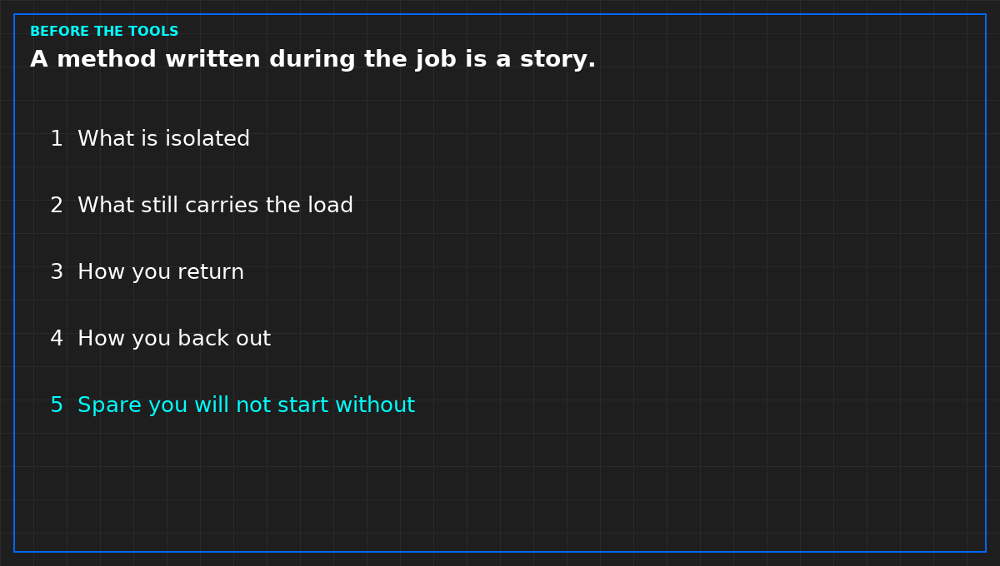

# What an MOP must say before the tools come out

*Original diagram. Not a site record.*

A method of procedure is one job. It is approved before the tools come out. A method written during the job is a story about what you already did. File the story as a note. Do not backdate the method and call it controlled.

The paper names what will be isolated, and what the plant will do while it is isolated. "The other side will carry it" is not a sentence until you say which side, and what you will do if that side is already down. Service impact is named, including none. None is a claim. It has to be true, not polite.

It names how you return the plant, and how you back out if the return fails. A back-out of "call the vendor" is allowed if that is the truth. Write it. A blank back-out is not a plan. The person on the night has to be able to say the stop aloud. If they cannot, the job waits.

It names the spare the job will not start without. If that part is not on the shelf, the job does not start, unless the back-out still works without it and that fact is written. A vendor wish list is not a spare line.

The window has to be visible to the shift and to the screen, or the monitor will page you for the change you scheduled. Pages suppressed, record kept. Deleting the alarms is not a window. Evidence that the job is finished is named before you start: the state you will see, not a verbal "it's back." Closing the alarm is not that evidence.

From *Run the Data Center Day*, Tristan, Data Center Field Guides. No store link until the Kindle edition is listed.

Related: [A data center change needs a back-out](05-a-change-needs-a-back-out.md).
