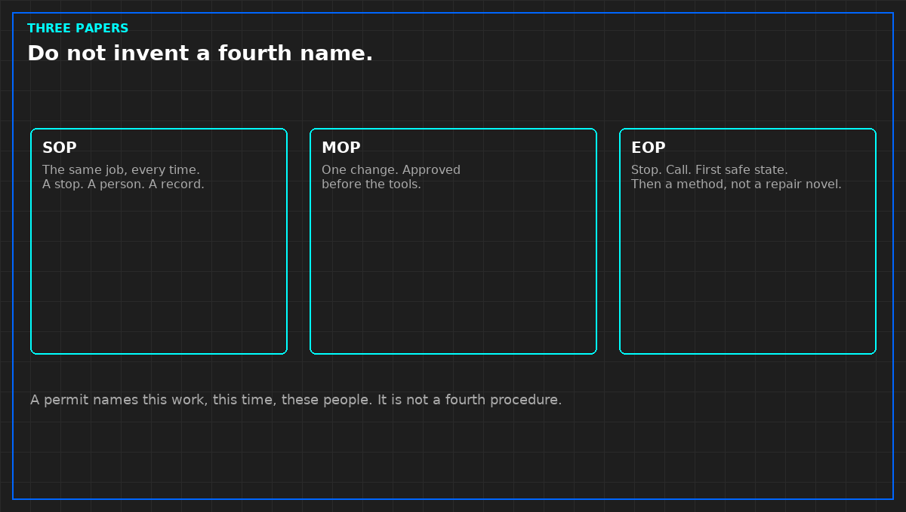

# What an SOP is allowed to contain

*Original diagram. Not a site record.*

A standing procedure is the normal job. The round. The lamp test. The check that a valve is where the last job left it. It is not a project, and it is not a repair you hope to repeat often enough to call routine.

It names who may do it. A team name is not a person on a night when the team is one name short. It names the limit that stops the task: the reading, the state, or the missing spare at which you do not continue. A procedure with no stop is a list of motions. Motions continue into the fault.

It names the record. What is written down, where, and what a blank means. A blank that everyone treats as "normal" is a missing observation. Say so on the paper, or the blank will be inherited as a pass.

It does not contain a one-time isolation, a back-out, or a service impact for a change. Those belong on a method. If the standing paper has grown a section called "when we swap the unit," split it. The swap is a method. Leaving it inside the SOP is how an unapproved change looks like Tuesday.

The paper has to be findable at the point of work. A share drive that only the author can open is not issued. Issue means the person doing the round can read the stop without a search.

Do not paste a vendor's routine into the header and call it adopted. Their steps may be wrong for your valves. Write the steps your plant requires. Cite a title if a contract already names one. Do not copy the annex.

From *Run the Data Center Day*, Tristan, Data Center Field Guides. No store link until the Kindle edition is listed.

Related: [What an MOP must say before the tools come out](05b-mop-before-tools.md).
