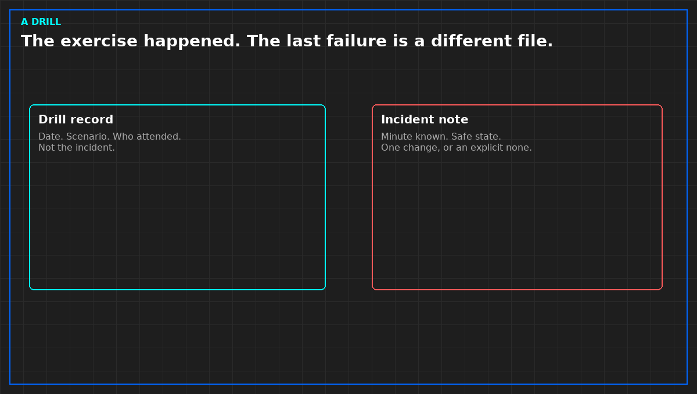

# A drill record is not an incident review

Operators drill. The record shows a date, a scenario, and often a conclusion that the team passed. That record is evidence the exercise happened. It is not evidence the last real incident was handled, and it is not a test of the plant.

Read the drill for three lines. Was the scenario the stop your contract cares about, or a classroom topic. Did the person who would be called on that shift take part, or only the people who were free. Was the result a gap in the paper, written, or a score. A score without a gap is a mood. Moods do not change the emergency paper.

A drill that never fails is not a strong system. It is an exercise that could not see a miss. One owned change to the paper, or an explicit none with a reason, is a review. A sign-in sheet is not.

Do not paste the scenario, the phone tree, or the site's hazards into a public note. Those are theirs. The method is the three lines. If a due diligence is shown only the annual drill and not the last incident note, write what you were shown. Do not upgrade a drill into an incident history.

*Original diagram. Not a site exercise.*

From *Run the Data Center Day*, Tristan, Data Center Field Guides. No store link until the Kindle edition is listed.

Related: [An EOP stops at the first safe state](05b-eop-stops.md).
