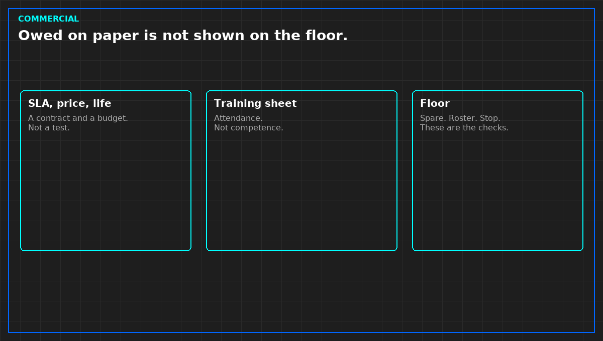

# A commercial pack is not a technical pass

Commercial papers belong in a review. They do not get to stand in for a test. An SLA lists what is owed and sometimes what is paid if it is missed. It does not show the spare is on the shelf, the roster covers the hour, or the stop can be said. Those are the technical checks. The price and the penalty are not yours to judge in public, and they are not a finding that the service is met.

Vendor training is a sign-in, unless the record says the person did the job the training claimed. Attendance is not competence. A manufacturer's course on their own machine is their course. Do not retell it. Do not treat the certificate as a test of your hall.

A lifecycle plan says when someone intends to replace a class of equipment. It is a budget and a date. It is not a remaining life, and it is not a maintenance result. Depreciation and a brochure life stay in different sentences. A change catalog that pre-approves kinds of work is not a permit for tonight's job. Tonight still needs the isolation, the back-out, and the window. A catalog cannot see the plant.

Quality reports and operation reports are claims about a month. Check one month against a defect you already know, if you are allowed to know it. A report that says none, while a job in scope was open, is a false document. If you are writing in public, you do not need their month. You need the rule: none means none in the scope of that report, or it means not looked at. Write which.

None of this copies an operator's manual, a price, a site, or a contract clause. Cite a title if a reader already has the contract. Do not paste it.

*Original diagram. Not a contract.*

From *Run the Data Center Day*, Tristan, Data Center Field Guides. No store link until the Kindle edition is listed.

Related: [A spare is evidence. A failure probability is not.](09-spare-not-a-probability.md).
