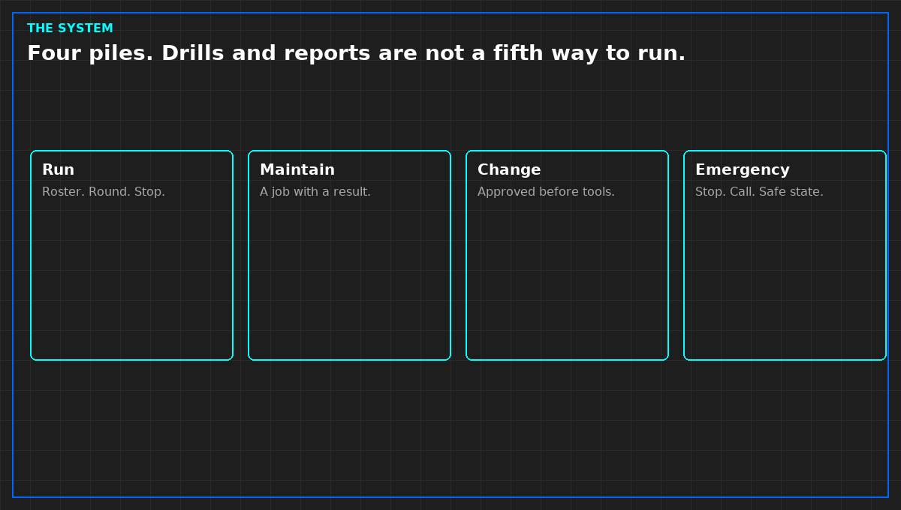

# An operations system is four piles, not one binder

A large hall accumulates a management system: standing procedures, maintenance jobs, changes, emergency papers, drills, training records, and monthly reports. The thickness is not a finding that the plant is run. It is a filing problem until you can say which pile a given hour belongs in.

Run is what happens every shift: the roster, the round, the limit that stops the round. Maintain is a job with a result, done on a cycle, with a record that the result happened. Change is one alteration, approved before the tools, with a way back. Emergency is the stop, the call, and the first safe state, then a handoff. Drills and reports are checks on those four. They are not a fifth way to operate.

If a maintenance binder contains the emergency steps, the night will not find the stop. If a change lives inside a standing procedure, Tuesday includes an unapproved isolation. If a quality report is the only place an open defect appears, the defect is not on the shift sheet, and the shift will not see it.

You may describe this split in public. You may not copy the operator's procedures, their site identifiers, their point lists, or their prices. The split is the method. Their file stays theirs.

*Original diagram. Not an operator's manual.*

From *Run the Data Center Day*, Tristan, Data Center Field Guides. No store link until the Kindle edition is listed.

Related: [SOP, MOP, and EOP are three papers](05b-sop-mop-eop.md).
