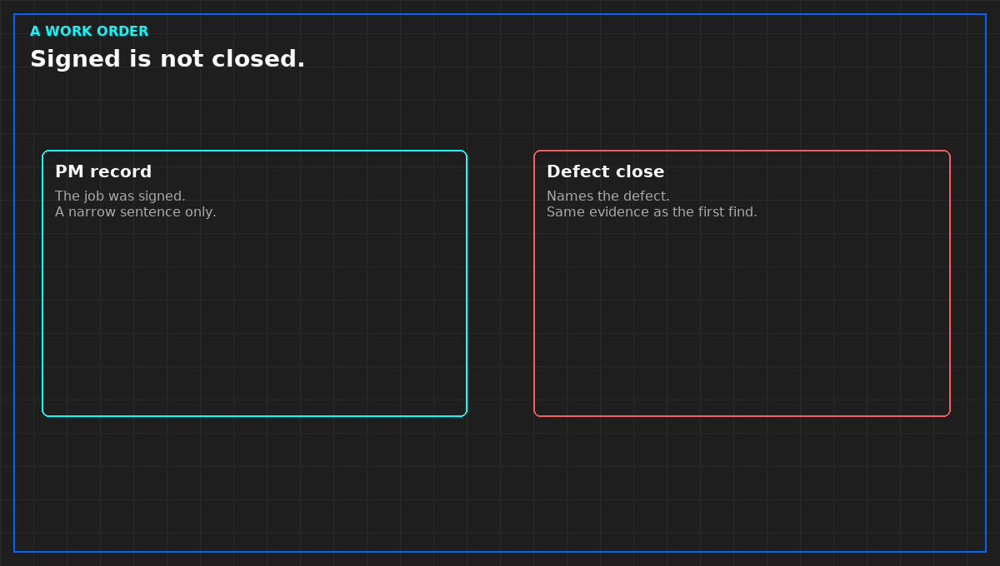

# A maintenance record does not close a defect

A preventive-maintenance file is a stack of jobs: what was planned, who signed, sometimes a reading. A signed job shows the paper was closed. It does not show the plant is well, and it does not close a defect that needed a witnessed retest.

Ask what the job was allowed to prove. A filter changed, a torque checked, a lamp tested, a trend of a water sample filed. Each is a narrow sentence. A trend of iron in a pipe is not gas corrosion at a board, and it is not a pass of the cooling plant. A blank cell treated as normal is a missing observation. Say so, or the blank will be inherited.

Predictive sheets fail the same way if the point has no clock. A sample with no date, or a date that is the day the report was printed, is not a measurement time. Do not plot it as the week the plant changed. Do not paste the laboratory table into a public post. Their numbers stay in their file.

When a defect was found on a round and the maintenance record says completed, those are two documents. They agree only if the record names the defect and the evidence the original find required. A signature alone is not that evidence. The verification habit applies: the close is not lighter than the first test.

*Original diagram. Not a work order.*

From *Run the Data Center Day*, Tristan, Data Center Field Guides. No store link until the Kindle edition is listed.

Related: [An open line is not a signature](07-conditional-is-a-refusal.md).
