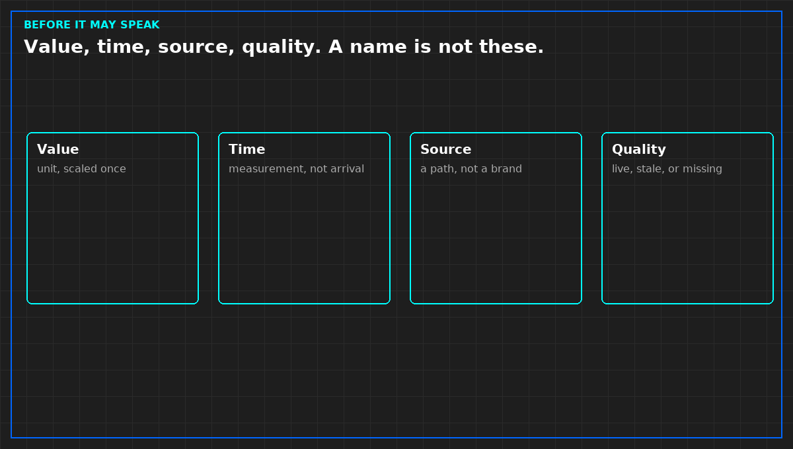

# A monitoring point needs a clock

*Original diagram. Not a site record.*

A point is a value, a time, a source, and a mark that says whether the value is still alive. A name on a tile is not those four. Without the time, a repeat of the last good reading looks like a change. Without the source, a calculation looks like a sensor. Without the quality mark, a gap dresses itself as a steady line.

If any of the three minimums is missing, the point is silent. It may be stored. It may not page, close an incident, or fill a capacity cell. Silence is not a failure of the plant. It is a failure of the point.

Measurement time and arrival time are different. The decision writes which one it uses. A page that cannot show the measurement time will be argued in the morning as a fresh event. Do not send that page.

Accept the source by failing it on purpose, on the image you will run. A demo on a vendor's hall accepts nothing on yours. Until the forced failure becomes a gap, or stale that refuses to page, the source is a candidate. Candidates do not wake people.

From *When a Monitor May Speak*, Tristan, Data Center Field Guides. No store link until the Kindle edition is listed.

Related: [Stale is not green](06-stale-is-not-green.md).
