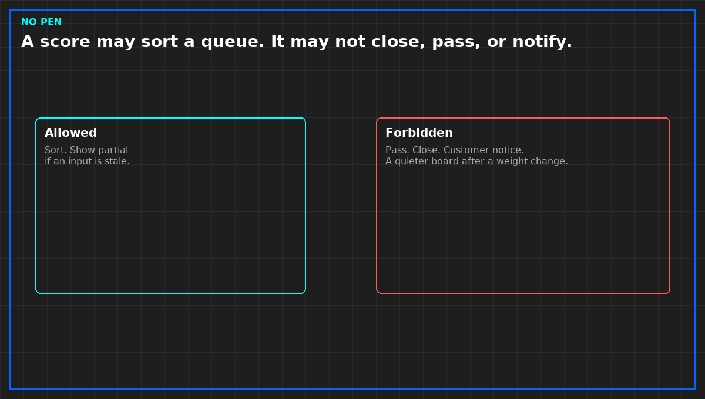

# A health score does not close an incident

*Original diagram. Not a site record.*

A health score is a calculation. It may sort a queue so a person looks at a short list first. It may not write pass, close an incident, fill a capacity cell, or tell a customer the service is held.

If you use one, write the inputs in a sentence a stranger can check, and what happens when an input is stale. A score that treats stale as healthy stays green through an outage. A score that treats missing as zero goes red because a poll failed. Both are lies. The score refuses to speak, or it shows the partial set. Hidden partial is not allowed.

You do not need the vendor's weights to refuse the pen. You need the refusal. Do not invent an accuracy rate. One night the score "caught" something is a story, not a rate.

A weight change is a change: old value, new value, who accepted it. A quieter board the next morning is not a healthier plant. It is a different calculation. Turn the score off for decisions when you cannot write the inputs. An unlabeled number will be obeyed.

From *When a Monitor May Speak*, Tristan, Data Center Field Guides. No store link until the Kindle edition is listed.

Related: [Grouping alarms is not a cause](06-grouping-is-not-a-cause.md).
