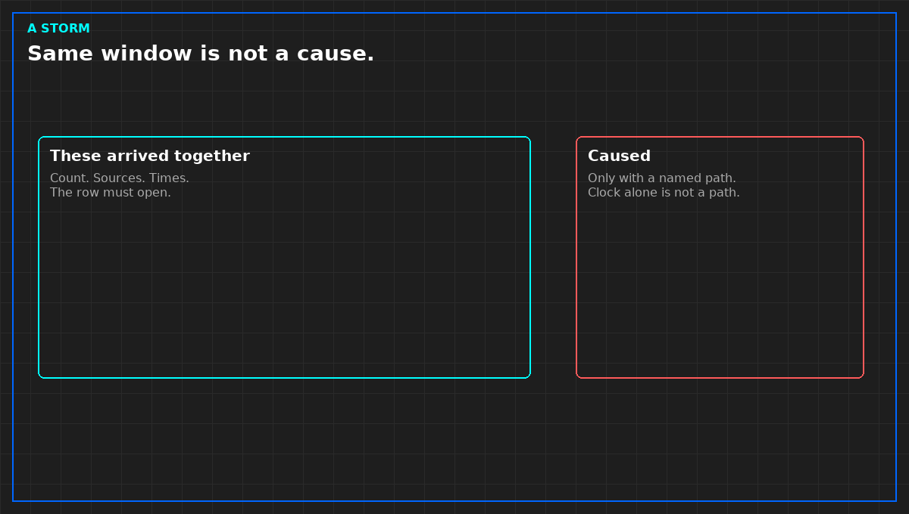

# Grouping alarms is not a cause

*Original diagram. Not a site record.*

A storm is many alerts that may be one event. It is not a hundred incidents, and it is not a root cause. Grouping by a window you wrote before the night is allowed. Write "these arrived together." Do not write "this one caused those" unless a person, or a rule a person can read, tied them by a named path. A shared feed. A shared collector. A change window already open. The clock alone is not a path.

A compressed row has to open. Count, sources, measurement times, which were live. A row that cannot be opened has deleted alerts. Deleted alerts do not clear the board.

Keep the count you acted on. Late alerts may join the record. They do not silently change the number you used at the time. Two groups in one hour stay two groups unless a path already on the diagram ties them. Do not merge them to make the board shorter.

A storm of stale points is a source failure, not a hundred plant failures. Silence pages from points that are not live. Leave the service incident open if the service is already affected. Those are two sentences.

From *When a Monitor May Speak*, Tristan, Data Center Field Guides. No store link until the Kindle edition is listed.

Related: [A monitoring point needs a clock](06-a-point-needs-a-clock.md).
