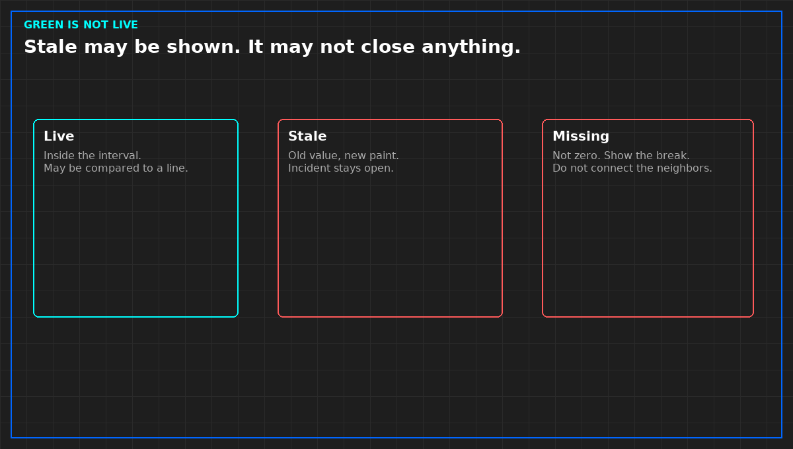

# A green tile can be stale

*Original diagram. Not a site record.*

Live means the value was measured inside the interval you wrote, and the path did not fail. Stale means you are still showing an older value. Missing means you will not stand behind a value. A store that stamps its own clock at ingest, on an hour-old reading, has produced stale and painted it live. That is how a green screen survives a dead sensor.

Stale may be displayed, with the measurement time still visible. It may not close a ticket, prove a dwell, or clear an incident. If the only proof of recovery is stale, the incident stays open.

Missing is not zero. A chart that drops missing points and connects the neighbors has drawn a line the plant did not make. Show the break, or do not draw the line.

If you cannot say in one sentence what makes this source stale, you do not have a quality mark. You have a color. Treat every point from that box as missing for any decision that wakes a person. You may look. You may not obey.

From *When a Monitor May Speak*, Tristan, Data Center Field Guides. No store link until the Kindle edition is listed.

Related: [An alarm is not an incident](05-alarm-is-not-an-incident.md).
