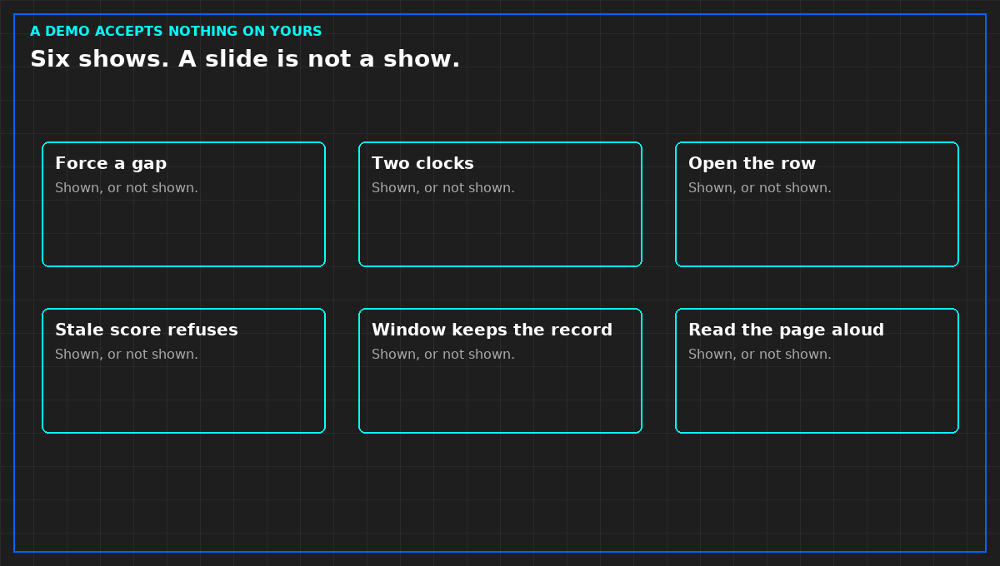

# Six things to ask before you trust a monitoring demo

*Original diagram. Not a site record.*

A demo is their hall, their points, and their best night. It accepts nothing on yours. Do not score vendors against each other in the same notebook. Ask six things. If one is not shown, write "not shown." A slide is not a show. This is not a buying guide and not a ranked list.

Stop one poll, or one publisher, on a point they claim is live. The tile shows a gap, or it shows stale and refuses to page. A tile that stays green has failed. Do not accept a promise that production will differ.

Ask which clock the chart uses when a point arrives late. If measurement time and arrival time cannot be shown apart, they cannot support a dwell. A smooth chart is not an answer.

Open a compressed alarm row. You need the count, the sources, and the times. A row that will not open has deleted alerts. A storm already collapsed on the slide is a picture of a collapse, not a storm.

Ask what the score does when an input is stale. It refuses, or it shows which inputs were live. A number that stays confident has a pen. You will not give it one. If they offer an accuracy rate, ask when the set was defined. If they cannot say, do not write the rate down.

Mark a maintenance window on a named point. Pages stop. The record remains. A window that deletes, or that exists only as a chat, is not a mark.

Have them read a page aloud: the point, the measurement time, the quality, the line, the person named, the first look. A page that names a team, or that leads with a cause, fails. A page that cannot be read aloud cannot be read at night.

Purchase is not acceptance. A screen you are paying for may still be silent until a forced failure passes on a point you will use.

From *When a Monitor May Speak*, Tristan, Data Center Field Guides. No store link until the Kindle edition is listed.

Related: [A monitoring point needs a clock](06-a-point-needs-a-clock.md).
