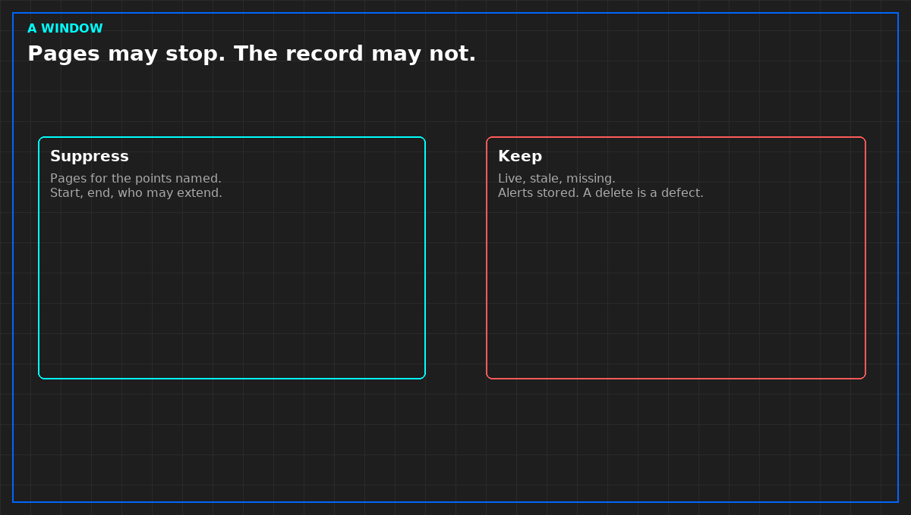

# What a maintenance window is allowed to suppress

*Original diagram. Not a site record.*

A change window that the screen cannot see will page you for the work you scheduled. Mark it in the system, or have a person mark it before the start. A chat message the screen does not read is not a mark.

The mark names the points, or the source, allowed to be abnormal. It names start and end on the same clock the decision uses. It names who opened it and who may extend it. An open-ended mark is a silence with no end. It will hide the next real incident on those points.

What it suppresses is the page, for the points named. What it must not suppress is the record. Points still show live, stale, or missing. Alerts are still stored, with the mark visible, so the morning can see what was expected. A window that deletes alerts has hidden the count. That is a defect, not a feature.

A window is not a permit to ignore the service. If the service leaves the state you owe, or a person is in danger, it is still an incident. A different point, outside the mark, still pages. Do not stretch the mark because you are already awake. Stretching is a new window. Write it when you make it. Do not extend it after the pages have fired and then claim they were inside.

Close the mark when the work finishes early. A mark left open until the scheduled end swallows the next alert and calls it planned. Expected noise inside the window is still a design you should not keep. One change, owned, or an explicit none.

From *When a Monitor May Speak*, Tristan, Data Center Field Guides. No store link until the Kindle edition is listed.

Related: [What an MOP must say before the tools come out](05b-mop-before-tools.md).
