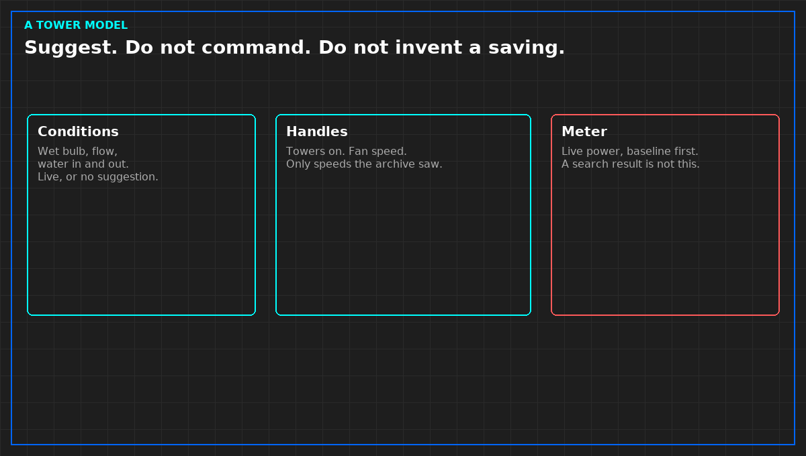

# A cooling-tower model does not get a pen

*Original diagram. Not a site record. Not a control schematic.*

A cooling-tower model is a calculation. It may suggest how many towers to run, and a fan speed, given the weather and the water it was shown. It may not start a fan, close an approach limit, or tell a customer the plant is more efficient. That is the same refusal a health score already has. A suggestion is not a command.

The job people want from the model is narrow. Conditions are known: water in, water out, outdoor dry bulb and wet bulb, flow. Adjustable handles are known: which towers are on, fan speed, sometimes pump speed. The model proposes a combination that should use less power. A person, or a rule that person can read, accepts the proposal. The model does not accept it for them.

Safety limits are not handles. A chiller's allowed condenser-water range, a freeze stop, and the emergency paper are not searched for a lower kilowatt. If the suggestion would cross a limit you wrote before the night, the suggestion is refused. Do not let the search widen the limit so that a number can win.

A published cooling study with a long history and many inputs is not your fit. A short extract from your own historian, on columns that barely moved, is not that study. Do not put the famous name on your slide. Do not put a percent on it either, unless a live power point, with a clock, showed the change against a baseline you wrote down first.

From *When a Monitor May Speak*, Tristan, Data Center Field Guides. No store link until the Kindle edition is listed.

Related: [A health score does not close an incident](06-a-score-does-not-close-an-incident.md).
