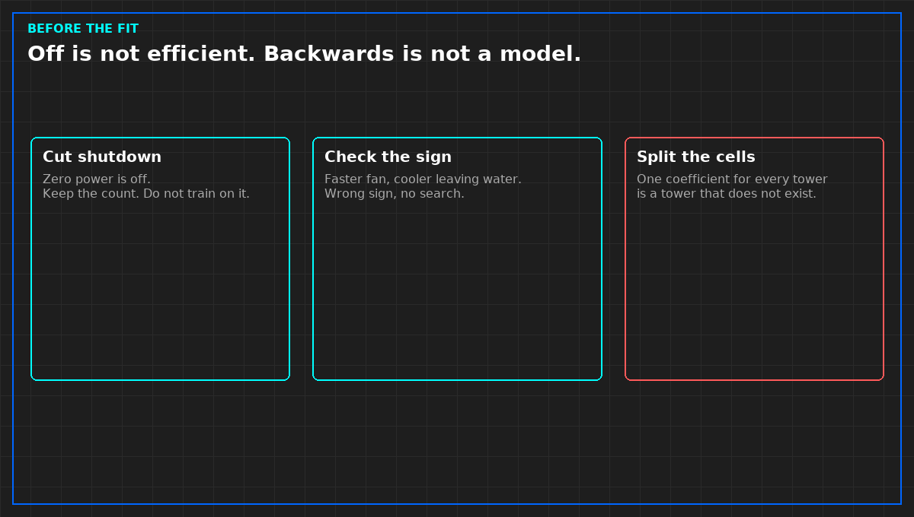

# Cooling towers are not interchangeable

*Original diagram. Not a site record.*

Cells that share a header are not the same machine. Fill condition, fan, approach to the wind, a damper that does not seat: any of these makes one cell reject less heat at the same speed. A fit that has one coefficient for "a tower" will average a strong cell and a weak cell into a tower that does not exist.

Give each cell its own on-state and its own fan handle, or write that you refused to. If you only have a total power and a total leaving temperature, you cannot see which cell did the work. Say so. A search on totals may still propose a plant power. It may not propose which cell to start. That proposal would be a guess about a machine you did not measure.

When one cell is weak, a search that can see the cells will tend to leave it off. That is not a triumph of the optimizer. It is a maintenance finding. Write it as a defect of the cell, owned by the person who can open it, not as a percent saved by the model. The model noticed. The spanner still has to happen. Until the cell is repaired and re-measured, do not put it back into the "identical tower" bucket so the next fit looks tidy.

Do not name the hall, the cell number from their drawing, or the kilowatt you saw. The rule travels. The identifiers do not.

From *When a Monitor May Speak*, Tristan, Data Center Field Guides. No store link until the Kindle edition is listed.

Related: [A cooling-tower model does not get a pen](06c-tower-model-no-pen.md).
