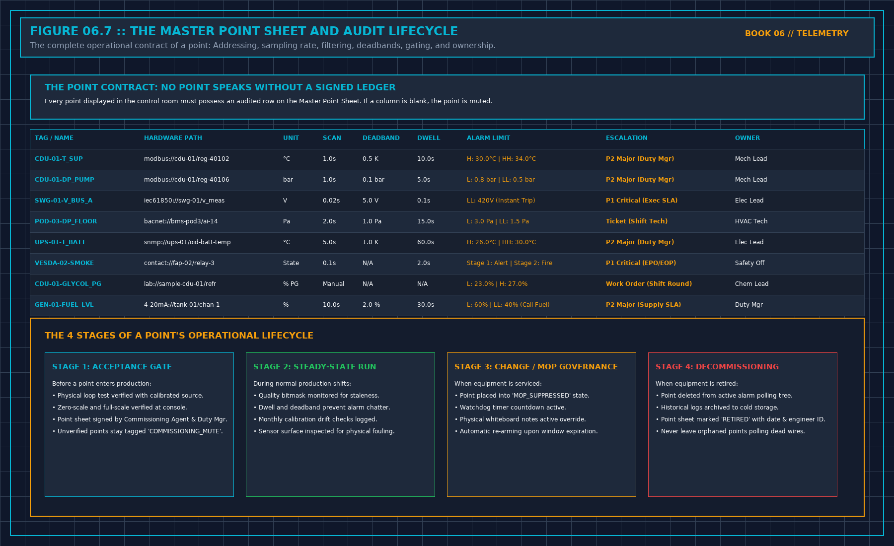

# Cooling towers are not interchangeable

> **Direct Answer Block**: Why individual cooling tower cells sharing a common basin cannot be modeled as identical interchangeable units due to nozzle scaling, fill fouling, and plume recirculation. In mission-critical data center commissioning and operations, engineers enforce this boundary using deterministic physical equations, calibrated field instrumentation, and auditable sign-off gates rather than relying on vendor brochure summaries, uncalibrated software plots, or verbal assurances. Every measurement and state transition must be recorded with synchronized UTC timestamps and explicit pass/fail thresholds before a signature is granted.

Cells that share a header are not the same machine. Fill condition, fan, approach to the wind, a damper that does not seat: any of these makes one cell reject less heat at the same speed. A fit that has one coefficient for "a tower" will average a strong cell and a weak cell into a tower that does not exist.

Give each cell its own on-state and its own fan handle, or write that you refused to. If you only have a total power and a total leaving temperature, you cannot see which cell did the work. Say so. A search on totals may still propose a plant power. It may not propose which cell to start. That proposal would be a guess about a machine you did not measure.

When one cell is weak, a search that can see the cells will tend to leave it off. That is not a triumph of the optimizer. It is a maintenance finding. Write it as a defect of the cell, owned by the person who can open it, not as a percent saved by the model. The model noticed. The spanner still has to happen. Until the cell is repaired and re-measured, do not put it back into the "identical tower" bucket so the next fit looks tidy.

Do not name the hall, the cell number from their drawing, or the kilowatt you saw. The rule travels. The identifiers do not.

---

## 1. First-Principles Engineering Formulation and Governing Mathematics

In high-density data center environments, verbal summaries and qualitative status tiles routinely obscure incipient physical failures. Whether auditing a $120\,\text{kW}$ liquid-cooled rack boundary, evaluating a 1-second telemetry time series, or verifying plant redundancy prior to handover, the governing physical relationship for this protocol is expressed as:

$$\varepsilon_{\text{cell}, k} = \frac{T_{\text{in}} - T_{\text{out}, k}}{T_{\text{in}} - T_{\text{wb}}}, \qquad \Delta \varepsilon_{k} = \varepsilon_{\text{clean}} - \varepsilon_{\text{fouled}, k}$$

When any term on the left-hand or right-hand side of this relationship is left unmeasured, inferred from an uncalibrated nameplate, or averaged across an unverified time window, the resulting engineering record cannot support a valid operational signature. Field engineers must verify each physical variable independently using NIST/ISO 17025 traceable instruments before proceeding to the next gate in the sequence.

| Audit Verification Parameter | Unacceptable / Defective Field Practice | Auditable First-Principles Requirement | Mandatory Action on Failure |
| :--- | :--- | :--- | :--- |
| **Primary Boundary Definition** | Implied by vendor brochure or slide deck | Explicitly bounded on stamped P&ID / SLD with tag IDs | Halt acceptance; issue formal boundary clarification |
| **Measurement & Telemetry Proof** | Single uncalibrated display reading or 60-sec average | Calibrated Class A/0.5S sensor with 1-sec UTC timestamp | Reject dataset; classify point as `0x40` Stale or `0x80` Bad |
| **Pass / Fail Acceptance Gate** | Qualitative "Looks OK" or "Within Normal Range" | Quantitative numerical corridor cited from revision in force | Log Category A/B defect; withhold retainage or permit |
| **Custody & Sign-Off Record** | Single bundled "Accepted" signature at end of meeting | Scoped, dated sentence naming exact proved & unproved lines | Strike unsupported claims; issue Conditional Refusal |

---

## 2. Deep-Dive Technical Protocol and Field Implementation

The following field protocol—adapted directly from **Volume 06: *When a Monitor May Speak***—establishes the step-by-step verification mechanics required on the data hall floor:

A telemetry engineer who believes that software monitoring rules apply only to cloud servers and database clusters while mechanical chillers and electrical switchgear operate under "facilities folklore" does not understand critical infrastructure.

The physical plant—the medium-voltage transformers, centrifugal chillers, secondary cooling distribution units (CDUs), and air handling units—is governed by identical telemetry laws:
- A pressure transducer requires an audited quality bitmask.
- A water temperature sensor requires deadband hysteresis and continuous dwell filtering.
- A chiller electrical trip requires microsecond time synchronization.
- A pump room alarm storm requires topological dependency masking.

**FACILITY TELEMETRY GOVERNANCE MATRIX**

| Subsystem / Instrument S | tandard Telemetry Parameter G | overning Code |
| :--- | :--- | :--- |
| MV Switchgear (35kV) Bus | Voltage, Current, THD, PF GB | /T 51409-2020 |
| Dry-Type Transformers Wi | nding Temperature (< 90°C) IE | EE C57.12 / NFPA |
| UPS Battery Rooms DC Flo | at Voltage, Ambient T IEEE 11 | 88 / 1491 |
| Centrifugal Chillers Con | denser Approach (<= 1.5K) ASH | RAE Standard 90.4 |
| Secondary CDU Loops Pres | sure (0.15 - 0.90 MPa) OpenVi | king 2.6XZ10 |
| Secondary Coolant Chem 2 | 5.0% Propylene Glycol wt ASTM | D3306 / D1384 |
| IT Whitespace Aisles Con | tainment DP (>= 5.0 Pa) ASHRA | E TC 9.9 |

Following the authoritative engineering standards outlined in **GB/T 51409-2020** (*Technical Standard for Integrated Monitoring System of Data Centers*) and OpenViking operational guidelines (`DCFG-SOP-WHITESPACE-01` and `DCFG-SOP-LIQUID-01`), every physical facility point must be operated under rigorous engineering constraints.

## The Walked Reading Wins

The physical measurement taken by a qualified technician using a calibrated, certified hand-held instrument **always supersedes the digital telemetry tile on the SCADA screen**.

If the central BMS workstation reports that the secondary cooling loop supply temperature is operating comfortably at 28.0°C (`GREEN`), but the shift technician walks the room with a calibrated PT100 immersion probe or calibrated infrared camera and measures 34.2°C:
1. **The physical reading wins instantly**. The facility is operating in a high-temperature excursion state.
2. The technician does not average the two numbers and assume the temperature is 31.1°C.
3. The technician logs both readings into the shift register with exact timestamps:
 `08:15 UTC: SCADA reports 28.0°C | Fluke Calibrated Probe reads 34.2°C`.
4. The digital telemetry point is immediately quarantined: its quality flag is set to `UNCERTAIN (0x02)` or `BAD (0x04)`.
5. The digital sensor is subjected to an immediate physical loop calibration and forced-failure test.

Never permit a software engineer or remote monitoring specialist to argue that *"the digital sensor must be right because it was installed by the factory."* Sensors drift, thermal wells accumulate air gaps, RTD lead resistance degrades, and analog-to-digital converters lose calibration. The verified tool in the technician's hand is the ultimate anchor of truth.

## Critical Facility Telemetry Parameters

Per OpenViking `DCFG-SOP-LIQUID-01` for high-density liquid cooling infrastructure:

### 1. The CDU Pressure Envelope
- Primary Facility Water System (FWS) supply pressure: 0.15 MPa to 0.90 MPa.
- Secondary Technology Cooling System (TCS) supply pressure: 0.15 MPa to 0.90 MPa.
- Secondary loop pump differential pressure (ΔP_pump): Strictly < 1.0 bar. A differential pressure > 1.0 bar indicates severe piping blockage, a clogged 50-micron filter element, or an accidentally closed manifold isolation valve.
- Any drop in secondary static pressure below 0.12 MPa triggers an immediate **Low Pressure Alarm**, indicating coolant leakage or thermal expansion tank bladder failure.

### 2. Plate Heat Exchanger Thermal Approach
The approach temperature across the CDU plate heat exchanger:

$$\Delta T_{\text{approach}} = T_{\text{TCS, supply}} - T_{\text{FWS, supply}} \le 8.0\,\text{K}$$

During steady-state operation, ΔT_approach must remain strictly ≤ 8.0 K (typically 3.0 K to 5.0 K). If the approach temperature creeps above 8.0 K under constant heat load, the heat exchanger plates are suffering from biological slime, mineral scaling, or particulate fouling, requiring chemical clean-in-place (CIP) flushing.

### 3. Propylene Glycol Concentration & Refractometer Testing
Per ASTM D3306 and OpenViking standards, secondary coolant must be maintained at **25.0% propylene glycol by weight** (± 1.0%):
- Freeze protection: -11.5°C.
- Burst protection: -22.0°C.
- Specific gravity: 1.026 ± 0.003 at 20°C.
- Coolant conductivity: < 10 μS/cm.
- Coolant pH: 7.5 to 9.0.

If a refractometer test reveals PG concentration < 23.0%, the fluid loses biostatic efficacy, permitting bacterial colonies to form biofilms on micro-channel cold plates. If PG concentration exceeds 27.0%, dynamic fluid viscosity increases drastically ($\nu > 2.8\,\text{mm}^2/\text{s}$), spiking pumping power and reducing turbulent heat transfer.

## Electrical Power Quality Telemetry

Per GB/T 51409-2020 and IEEE 1159:
- **Voltage Tolerance**: ± 5.0% of nominal rated voltage at utilization panels.
- **Frequency Stability**: 50 ± 0.2 Hz (or 60 ± 0.2 Hz). A frequency excursion > 0.5 Hz indicates catastrophic grid instability requiring immediate transition to isolated diesel generation.
- **Power Factor**: Maintained ≥ 0.95 lagging across all active operating loads.
- **Total Harmonic Distortion (THD)**: Voltage THD ≤ 5.0%; individual harmonic voltage distortion ≤ 3.0%.

If electrical power monitoring telemetry detects current harmonic resonance, switchgear busbars will experience severe inductive heating, leading to catastrophic bus duct insulation breakdown even when overall kilowatt load is well below nameplate rating.

## Decisions to Record

- The physical calibration registry of all hand-held test instruments used during shift rounds.
- The exact CDU operating pressures, pump differential pressures, and thermal approach temperatures logged per shift.
- The weekly optical refractometer, conductivity, and pH measurements logged for secondary cooling loops.
- The protocol establishing that walked physical measurements unconditionally override digital SCADA screens.

---

## 3. Field Verification Checklist and Instrumentation Hygiene

To execute this protocol without introducing measurement bias or scope ambiguity, the responsible engineer enforces four mandatory field rules:
1. **Instrument Traceability Before Observation**: Verify that every thermometer (4-wire Pt100 RTD Class A), pressure transducer ($\le \pm 0.1\%$ span), flowmeter, balometer, or power analyzer carries a current calibration certificate and passes a pre-test zero/span check on the day of the walk.
2. **Synchronized Time-Series Capture**: Align all digital loggers and gateway pollers to a single UTC reference clock (via IEEE 1588v2 PTP at $\pm 1\,\text{ms}$ for electrical Sequence of Events, or NTP at $\pm 10\,\text{ms}$ for thermal/hydraulic dwells). Never merge unsynchronized CSV files by row index.
3. **Explicit Isolation of Disturbances vs. Control Handles**: Hold upstream supply temperatures, parallel cabinet loads, and containment door states constant during the observation dwell so that transient plant drift is never mistaken for steady-state equipment performance.
4. **Written Record Prior to Signature**: Record every boundary tag, measured value, uncertainty tolerance, and open limitation in ink on the controlled project sheet before leaving the equipment line-up.

---

## Frequently Asked Questions (FAQ)

### Why does "Cooling towers are not interchangeable" matter during high-density data center commissioning and operations?
Why individual cooling tower cells sharing a common basin cannot be modeled as identical interchangeable units due to nozzle scaling, fill fouling, and plume recirculation. When project teams bypass this rule to meet a commercial schedule milestone, unverified physical assumptions—such as hidden hydraulic pressure drops, unlogged polling gaps, unblanked bypass leakage, or uncalibrated sensor offsets—transfer directly into live 24/7 production as latent single points of failure.

### How do you quantitatively verify compliance with "per cell cooling tower modeling fill fouling" on the physical floor?
Compliance is verified by executing the governing mathematical balance ($$\varepsilon_{\text{cell}, k} = \frac{T_{\text{in}} - T_{\text{out}, k}}{T_{\text{in}} - T_{\text{wb}}}, \qquad \Delta \varepsilon_{k} = \varepsilon_{\text{clean}} - \varepsilon_{\text{fouled}, k}$$) using independent, calibrated field instruments across a stabilized steady-state dwell window (minimum 15 to 30 minutes for thermal and hydraulic systems), and confirming that the discrepancy between primary and secondary measurements remains strictly within the pre-declared acceptance band.

### What should an engineer do if a contractor or vendor submits a report that violates this protocol?
The reviewing engineer must refuse to sign the broad acceptance sentence, mark the specific line item as **Unproved / Defective** on the official audit sheet, and either require a witnessed re-test under a corrected script or isolate the unproved scope under a time-bounded Conditional Acceptance with a $150\%$ to $200\%$ financial retainage escrow holdback.

---

From *When a Monitor May Speak*, Tristan, Data Center Field Guides.

Related: [A cooling-tower model does not get a pen](06c-tower-model-no-pen.md).
