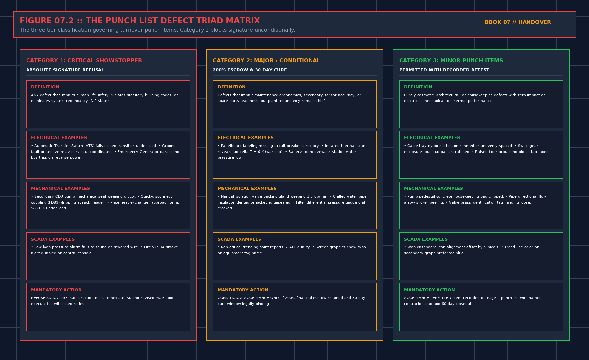

# Conditional acceptance refuses the rest

> **Direct Answer Block**: How to structure Conditional Acceptance at data center handover as an explicit refusal of unproved capacity, backed by 200% retainage escrow and hard expiry dates. In mission-critical data center commissioning and operations, engineers enforce this boundary using deterministic physical equations, calibrated field instrumentation, and auditable sign-off gates rather than relying on vendor brochure summaries, uncalibrated software plots, or verbal assurances. Every measurement and state transition must be recorded with synchronized UTC timestamps and explicit pass/fail thresholds before a signature is granted.

A narrow yes is not a soft wide sentence. It is a refusal of everything the wide sentence added, written in the same document, with the same ink. A side letter nobody attaches will be lost. The wide page will remain. If you cannot get the refusal into the same document, do not sign the yes.

Each open item needs a party, the evidence that will close it, and a date. The date is when the condition expires into a refusal, not into acceptance. A condition that becomes a yes when the calendar runs out is a delay of the sentence they wanted. Extending the date after you have already operated as if it closed is backdating.

Do not put "subject to review" on a missing file judgment, a missing forced failure, or a certificate in the wrong slot. Those are gates. Late evidence can be a condition. Absent evidence for a gate cannot.

Say what you will not do on the next working day: call the hall accepted, fill the capacity cell, page from unaccepted points, or tell a customer the service is held. If the allowed operation is nothing, write nothing. Do not invent a small yes so the sheet looks balanced.

---

## 1. First-Principles Engineering Formulation and Governing Mathematics

In high-density data center environments, verbal summaries and qualitative status tiles routinely obscure incipient physical failures. Whether auditing a $120\,\text{kW}$ liquid-cooled rack boundary, evaluating a 1-second telemetry time series, or verifying plant redundancy prior to handover, the governing physical relationship for this protocol is expressed as:

$$E_{\text{retainage}} = 2.0 \times \sum_{j \in \text{Open}} C_{\text{remediation}, j}, \qquad P_{\text{cap}}(t > t_{\text{expiry}}) = 0$$

When any term on the left-hand or right-hand side of this relationship is left unmeasured, inferred from an uncalibrated nameplate, or averaged across an unverified time window, the resulting engineering record cannot support a valid operational signature. Field engineers must verify each physical variable independently using NIST/ISO 17025 traceable instruments before proceeding to the next gate in the sequence.

| Audit Verification Parameter | Unacceptable / Defective Field Practice | Auditable First-Principles Requirement | Mandatory Action on Failure |
| :--- | :--- | :--- | :--- |
| **Primary Boundary Definition** | Implied by vendor brochure or slide deck | Explicitly bounded on stamped P&ID / SLD with tag IDs | Halt acceptance; issue formal boundary clarification |
| **Measurement & Telemetry Proof** | Single uncalibrated display reading or 60-sec average | Calibrated Class A/0.5S sensor with 1-sec UTC timestamp | Reject dataset; classify point as `0x40` Stale or `0x80` Bad |
| **Pass / Fail Acceptance Gate** | Qualitative "Looks OK" or "Within Normal Range" | Quantitative numerical corridor cited from revision in force | Log Category A/B defect; withhold retainage or permit |
| **Custody & Sign-Off Record** | Single bundled "Accepted" signature at end of meeting | Scoped, dated sentence naming exact proved & unproved lines | Strike unsupported claims; issue Conditional Refusal |

---

## 2. Deep-Dive Technical Protocol and Field Implementation

The following field protocol—adapted directly from **Volume 07: *Refuse the Handover***—establishes the step-by-step verification mechanics required on the data hall floor:

You may leave the meeting with a narrow yes. The narrow yes is not a soft version of the wide sentence. It is a refusal of everything the wide sentence added, written down, with the same ink as the yes. If you cannot get the refusal into the same document as the yes, you do not sign the yes. A side letter nobody attaches will be lost. The wide page will remain.

Conditional acceptance names the systems, the levels, and the sentences you are taking. It names the open items, in the words of the punch print, not in the words "minor remaining." It names what you will not do until those items close: you will not call the hall accepted, you will not fill the capacity cell, you will not let the unaccepted points page, you will not tell a customer the service is held on the strength of this meeting. Pick the prohibitions that match the missing evidence. Do not add drama. Do not omit the one that will be violated on Monday because it was inconvenient.

## An end date

A condition without an end is a silence with no owner. Chapter 8’s waiver rule applies. Each open item has a party who will close it, the evidence that will close it, and a date. The date is when the condition expires into a refusal, not when you hope to meet again. If the date passes and the evidence is not there, the narrow yes does not quietly become a wide yes. It expires. Write that. A condition that expires into acceptance is not a condition. It is a delay of the wide sentence they wanted in the first place.

You may extend a date only by writing the extension when you make it, with the reason the evidence is still missing. You do not extend it by continuing to operate as if the item had closed. Operating is not a close. The sixth book’s recovery rule is the same shape: a stale point does not prove the plant came back. A quiet week does not prove the punch line closed.

## Operating while a condition is open

A narrow yes often leaves the plant running. Running is not a waiver of the prohibitions. The shift may operate only inside the sentence you signed. If that sentence does not include a customer load, they do not add one because the racks arrived. If it does not include paging from the unaccepted screen, they do not enable the pages because the room is nervous. Nervous is why the sixth book required a forced failure before a point may speak. The handover meeting does not cancel that.

Write the allowed operation in one sentence the shift can read aloud. "These systems, these stops, these points silent, this cell blank, until the dates on the sheet." If you cannot say it aloud, the condition is too clever. Simplify it until a night shift can refuse a request that breaks it. A condition only a lawyer can apply will be broken by Tuesday, and the break will be called practical.

If the allowed operation is nothing, you did not have a yes. Do not invent a small yes so the sheet looks balanced. Nothing is an allowed entry. Chapter 14 left with nothing when the refusals would not sit in the same document as a yes. The day after is chapter 20. Follow it. Do not soften it over coffee.

## What you do not condition

You do not condition a sentence that should have been refused outright, in order to be helpful. A file with no judgment is not "accepted subject to review." Review is the judgment. Until it exists, the proved-sentence is refused. A score does not become acceptable subject to someone explaining the weights later. The pen is already forbidden. A wrong-slot certificate is not acceptable subject to relabeling after you have signed the page that cites it. Strike first, then sign the narrower page.

Helpful conditions are how a refusal is talked out of the room. If you hear yourself saying subject to, check whether the missing thing is allowed to be late or is allowed to be absent. Late can be a condition. Absent, for a gate in chapters 4 through 7, cannot.

## Structuring Conditional Acceptance and Time-Bounded Operating Derogations

### Enforcing Automatic Expiry Dates, Load Caps, and Retainage Triggers

In institutional data center project delivery, the transition from construction and commissioning (ASHRAE Guideline 0 / Guideline 202 Levels 1 through 5) to live 24/7 operations is governed by measurable engineering gates rather than schedule milestones. Whenever a handover package asks the receiving operations lead to certify a plant attribute, that attribute must satisfy the quantitative gating relationship:

$$P_{\text{allowed}}(t) = P_{\text{derated}} \text{ for } t \le t_{\text{expiry}}, \quad P_{\text{allowed}}(t > t_{\text{expiry}}) = 0$$

If any supporting evidence file, witnessed test script, or as-built redline verification falls outside its acceptance corridor, the operations representative must either issue a formal **Notice of Handover Refusal** or execute a narrow **Conditional Acceptance with 200% Retainage Escrow** that explicitly bounds the permitted operating envelope until the defect is cured and re-tested.

| Handover Audit Dimension | Contractor / Project Team Submission | Operations Gatekeeper Verification Protocol | Mandatory Refusal or Escrow Action |
| :--- | :--- | :--- | :--- |
| **Primary Governance Focus** | Writing Conditional Acceptance as an Explicit Refusal of Unproved Scope | Independent line-by-line audit against Volumes 01–06 criteria | Strike unsupported words from certificate before signing |
| **Quantitative Proof Standard** | Summary pass/fail cover sheet or verbal assurance | Raw 1-second telemetry CSV, signed witness sheet, and field walk | Classify missing proof as Category A/B defect on Refusal Sheet |
| **Financial & Operational Lever** | Request for 100% milestone release and full load | Enforce $200\%$ retainage holdback ($E = 2.0 \times C_{\text{fix}}$) and load cap | Hold plant at zero or derated load until remediation passes |
| **Post-Meeting Custody Rule** | Unfettered contractor access to finish open work | Transition space to Operations LOTO; require approved MOP per fix | Deny unescorted access; log all post-handover interventions |

---

## 3. Field Verification Checklist and Instrumentation Hygiene

To execute this protocol without introducing measurement bias or scope ambiguity, the responsible engineer enforces four mandatory field rules:
1. **Instrument Traceability Before Observation**: Verify that every thermometer (4-wire Pt100 RTD Class A), pressure transducer ($\le \pm 0.1\%$ span), flowmeter, balometer, or power analyzer carries a current calibration certificate and passes a pre-test zero/span check on the day of the walk.
2. **Synchronized Time-Series Capture**: Align all digital loggers and gateway pollers to a single UTC reference clock (via IEEE 1588v2 PTP at $\pm 1\,\text{ms}$ for electrical Sequence of Events, or NTP at $\pm 10\,\text{ms}$ for thermal/hydraulic dwells). Never merge unsynchronized CSV files by row index.
3. **Explicit Isolation of Disturbances vs. Control Handles**: Hold upstream supply temperatures, parallel cabinet loads, and containment door states constant during the observation dwell so that transient plant drift is never mistaken for steady-state equipment performance.
4. **Written Record Prior to Signature**: Record every boundary tag, measured value, uncertainty tolerance, and open limitation in ink on the controlled project sheet before leaving the equipment line-up.

---

## Frequently Asked Questions (FAQ)

### Why does "Conditional acceptance refuses the rest" matter during high-density data center commissioning and operations?
How to structure Conditional Acceptance at data center handover as an explicit refusal of unproved capacity, backed by 200% retainage escrow and hard expiry dates. When project teams bypass this rule to meet a commercial schedule milestone, unverified physical assumptions—such as hidden hydraulic pressure drops, unlogged polling gaps, unblanked bypass leakage, or uncalibrated sensor offsets—transfer directly into live 24/7 production as latent single points of failure.

### How do you quantitatively verify compliance with "conditional acceptance data center retainage escrow" on the physical floor?
Compliance is verified by executing the governing mathematical balance ($$E_{\text{retainage}} = 2.0 \times \sum_{j \in \text{Open}} C_{\text{remediation}, j}, \qquad P_{\text{cap}}(t > t_{\text{expiry}}) = 0$$) using independent, calibrated field instruments across a stabilized steady-state dwell window (minimum 15 to 30 minutes for thermal and hydraulic systems), and confirming that the discrepancy between primary and secondary measurements remains strictly within the pre-declared acceptance band.

### What should an engineer do if a contractor or vendor submits a report that violates this protocol?
The reviewing engineer must refuse to sign the broad acceptance sentence, mark the specific line item as **Unproved / Defective** on the official audit sheet, and either require a witnessed re-test under a corrected script or isolate the unproved scope under a time-bounded Conditional Acceptance with a $150\%$ to $200\%$ financial retainage escrow holdback.

---

From *Refuse the Handover*, Tristan, Data Center Field Guides.

Related: [A handover signature is a sentence](07-a-signature-is-a-sentence.md).
