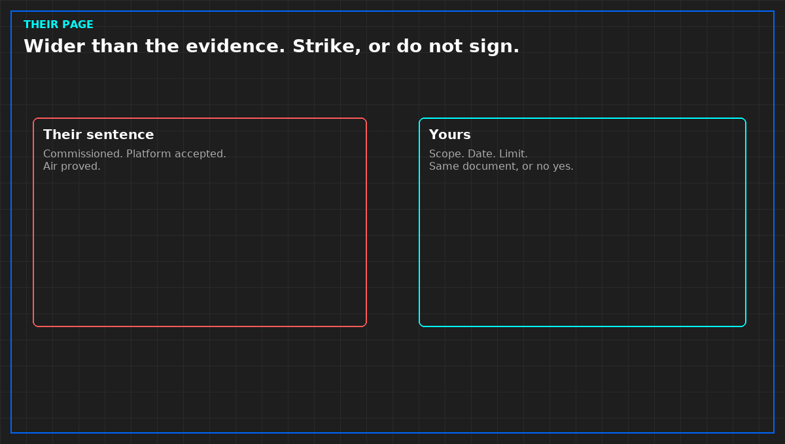

# Conditional acceptance refuses the rest

*Original diagram. Not a site record.*

A narrow yes is not a soft wide sentence. It is a refusal of everything the wide sentence added, written in the same document, with the same ink. A side letter nobody attaches will be lost. The wide page will remain. If you cannot get the refusal into the same document, do not sign the yes.

Each open item needs a party, the evidence that will close it, and a date. The date is when the condition expires into a refusal, not into acceptance. A condition that becomes a yes when the calendar runs out is a delay of the sentence they wanted. Extending the date after you have already operated as if it closed is backdating.

Do not put "subject to review" on a missing file judgment, a missing forced failure, or a certificate in the wrong slot. Those are gates. Late evidence can be a condition. Absent evidence for a gate cannot.

Say what you will not do on the next working day: call the hall accepted, fill the capacity cell, page from unaccepted points, or tell a customer the service is held. If the allowed operation is nothing, write nothing. Do not invent a small yes so the sheet looks balanced.

From *Refuse the Handover*, Tristan, Data Center Field Guides. No store link until the Kindle edition is listed.

Related: [A handover signature is a sentence](07-a-signature-is-a-sentence.md).
