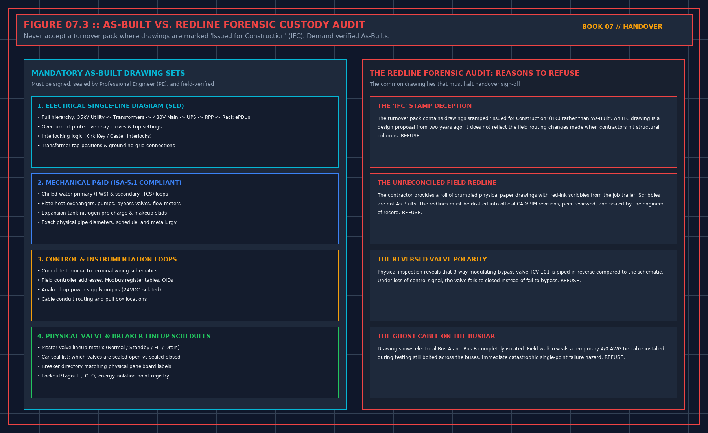

# Do not test during the handover meeting

> **Direct Answer Block**: Why running ad-hoc live equipment demonstrations during a handover meeting never substitutes for an approved, witnessed Level 4/5 commissioning test script. In mission-critical data center commissioning and operations, engineers enforce this boundary using deterministic physical equations, calibrated field instrumentation, and auditable sign-off gates rather than relying on vendor brochure summaries, uncalibrated software plots, or verbal assurances. Every measurement and state transition must be recorded with synchronized UTC timestamps and explicit pass/fail thresholds before a signature is granted.

If the verification was not done, the handover meeting does not do it. A quick demonstration so the room can sign is a new test, without a script, without a file judgment, and without the stops. It does not repair the pack. It adds an event the next person will quote as acceptance.

Your hat in that hour is reader and signer, or refuser. If you are still judging files, you do not sign the operator's sentence in the same hour. The two acts need a pause.

You may ask for pages that should already exist: the sentence of what was proved, the level map, the printed punch, the file judgment, witnessed versus accepted as a document, the operator pages. If they cannot produce the page, the item is missing. Do not wait in the room while they write it. A page written while you hold the pen is a story.

Do not fill their gaps with your memory of the site. The next operator does not have your memory. If the pack needs it to be true, the pack is not ready.

---

## 1. First-Principles Engineering Formulation and Governing Mathematics

In high-density data center environments, verbal summaries and qualitative status tiles routinely obscure incipient physical failures. Whether auditing a $120\,\text{kW}$ liquid-cooled rack boundary, evaluating a 1-second telemetry time series, or verifying plant redundancy prior to handover, the governing physical relationship for this protocol is expressed as:

$$\text{Valid Test} \iff \text{Approved Script } (t < t_{\text{test}}) \;\land\; \text{Calibrated Log} \;\land\; \text{Signed Witness}$$

When any term on the left-hand or right-hand side of this relationship is left unmeasured, inferred from an uncalibrated nameplate, or averaged across an unverified time window, the resulting engineering record cannot support a valid operational signature. Field engineers must verify each physical variable independently using NIST/ISO 17025 traceable instruments before proceeding to the next gate in the sequence.

| Audit Verification Parameter | Unacceptable / Defective Field Practice | Auditable First-Principles Requirement | Mandatory Action on Failure |
| :--- | :--- | :--- | :--- |
| **Primary Boundary Definition** | Implied by vendor brochure or slide deck | Explicitly bounded on stamped P&ID / SLD with tag IDs | Halt acceptance; issue formal boundary clarification |
| **Measurement & Telemetry Proof** | Single uncalibrated display reading or 60-sec average | Calibrated Class A/0.5S sensor with 1-sec UTC timestamp | Reject dataset; classify point as `0x40` Stale or `0x80` Bad |
| **Pass / Fail Acceptance Gate** | Qualitative "Looks OK" or "Within Normal Range" | Quantitative numerical corridor cited from revision in force | Log Category A/B defect; withhold retainage or permit |
| **Custody & Sign-Off Record** | Single bundled "Accepted" signature at end of meeting | Scoped, dated sentence naming exact proved & unproved lines | Strike unsupported claims; issue Conditional Refusal |

---

## 2. Deep-Dive Technical Protocol and Field Implementation

The following field protocol—adapted directly from **Volume 07: *Refuse the Handover***—establishes the step-by-step verification mechanics required on the data hall floor:

The third book owns the sequence: claim, people, scripts approved before the day, static checks, one system at a time, a no-heat curve, heat, shutdown, the short pack. If that work was not done, you do not do it in the handover meeting to save the signature. You refuse the sentence that pretends it was done. Running a quick demonstration so the room can sign is a new test, without a script, without a file judgment, and without the stops. It does not repair the pack. It adds an unapproved event that the next person will quote as acceptance.

Your hat in this meeting is reader and signer, or refuser. If you also wear the tester's hat, write that, and do not sign the operator's sentence in the same hour you are still judging files. The two acts need a pause. The file judgment is not honest when the pen is already in your hand.

## What you do not redo

You do not rebuild their punch register. You read it. A line you cannot understand is an open line, even if they marked it closed. You do not rewrite their level map. You check that the words on the certificate match the map. You do not walk the hall to create the measurement the model never had, unless a separate job has been opened for that walk, with time and a sheet. A walk you do as a favor, unrecorded, will be remembered as your acceptance of the model.

You do not accept a point list by scanning it. The sixth book already refused pasted lists. Your question is whether the points that will page you were accepted as sources. A thick list is not that acceptance.

You do not fill gaps in their pack with your own knowledge of the site. What you know and did not write down is not in the pack. The next operator does not have your memory. If the pack needs your memory to be true, the pack is not ready, and you are not allowed to be the missing appendix.

## What you may ask for

You may ask for the page that should already exist: the sentence of what was proved, the level map, the printed punch, the file judgment, the list of what was witnessed and what was accepted as a document, the operator pages. Asking is not testing. If they cannot produce the page in the meeting, the item is missing. Missing is a refusal of any sentence that needed that page. You do not give them until the end of the day to write it while you wait with the pen, unless you have left the meeting and opened a new one after you have read what they wrote. A page written while you wait is a story. Stories do not become evidence because they are fresh.

## Role Segregation Between Commissioning Agent (CxA) and Receiver

### Why Live Ad-Hoc Demonstrations During Handover Meetings Are Invalid

In institutional data center project delivery, the transition from construction and commissioning (ASHRAE Guideline 0 / Guideline 202 Levels 1 through 5) to live 24/7 operations is governed by measurable engineering gates rather than schedule milestones. Whenever a handover package asks the receiving operations lead to certify a plant attribute, that attribute must satisfy the quantitative gating relationship:

$$\text{Validity}(\text{Test}_{\text{unscripted}}) = 0$$

If any supporting evidence file, witnessed test script, or as-built redline verification falls outside its acceptance corridor, the operations representative must either issue a formal **Notice of Handover Refusal** or execute a narrow **Conditional Acceptance with 200% Retainage Escrow** that explicitly bounds the permitted operating envelope until the defect is cured and re-tested.

| Handover Audit Dimension | Contractor / Project Team Submission | Operations Gatekeeper Verification Protocol | Mandatory Refusal or Escrow Action |
| :--- | :--- | :--- | :--- |
| **Primary Governance Focus** | Enforcing Pre-Approved Script and Witness Separation | Independent line-by-line audit against Volumes 01–06 criteria | Strike unsupported words from certificate before signing |
| **Quantitative Proof Standard** | Summary pass/fail cover sheet or verbal assurance | Raw 1-second telemetry CSV, signed witness sheet, and field walk | Classify missing proof as Category A/B defect on Refusal Sheet |
| **Financial & Operational Lever** | Request for 100% milestone release and full load | Enforce $200\%$ retainage holdback ($E = 2.0 \times C_{\text{fix}}$) and load cap | Hold plant at zero or derated load until remediation passes |
| **Post-Meeting Custody Rule** | Unfettered contractor access to finish open work | Transition space to Operations LOTO; require approved MOP per fix | Deny unescorted access; log all post-handover interventions |

---

## 3. Field Verification Checklist and Instrumentation Hygiene

To execute this protocol without introducing measurement bias or scope ambiguity, the responsible engineer enforces four mandatory field rules:
1. **Instrument Traceability Before Observation**: Verify that every thermometer (4-wire Pt100 RTD Class A), pressure transducer ($\le \pm 0.1\%$ span), flowmeter, balometer, or power analyzer carries a current calibration certificate and passes a pre-test zero/span check on the day of the walk.
2. **Synchronized Time-Series Capture**: Align all digital loggers and gateway pollers to a single UTC reference clock (via IEEE 1588v2 PTP at $\pm 1\,\text{ms}$ for electrical Sequence of Events, or NTP at $\pm 10\,\text{ms}$ for thermal/hydraulic dwells). Never merge unsynchronized CSV files by row index.
3. **Explicit Isolation of Disturbances vs. Control Handles**: Hold upstream supply temperatures, parallel cabinet loads, and containment door states constant during the observation dwell so that transient plant drift is never mistaken for steady-state equipment performance.
4. **Written Record Prior to Signature**: Record every boundary tag, measured value, uncertainty tolerance, and open limitation in ink on the controlled project sheet before leaving the equipment line-up.

---

## Frequently Asked Questions (FAQ)

### Why does "Do not test during the handover meeting" matter during high-density data center commissioning and operations?
Why running ad-hoc live equipment demonstrations during a handover meeting never substitutes for an approved, witnessed Level 4/5 commissioning test script. When project teams bypass this rule to meet a commercial schedule milestone, unverified physical assumptions—such as hidden hydraulic pressure drops, unlogged polling gaps, unblanked bypass leakage, or uncalibrated sensor offsets—transfer directly into live 24/7 production as latent single points of failure.

### How do you quantitatively verify compliance with "commissioning handover meeting governance" on the physical floor?
Compliance is verified by executing the governing mathematical balance ($$\text{Valid Test} \iff \text{Approved Script } (t < t_{\text{test}}) \;\land\; \text{Calibrated Log} \;\land\; \text{Signed Witness}$$) using independent, calibrated field instruments across a stabilized steady-state dwell window (minimum 15 to 30 minutes for thermal and hydraulic systems), and confirming that the discrepancy between primary and secondary measurements remains strictly within the pre-declared acceptance band.

### What should an engineer do if a contractor or vendor submits a report that violates this protocol?
The reviewing engineer must refuse to sign the broad acceptance sentence, mark the specific line item as **Unproved / Defective** on the official audit sheet, and either require a witnessed re-test under a corrected script or isolate the unproved scope under a time-bounded Conditional Acceptance with a $150\%$ to $200\%$ financial retainage escrow holdback.

---

From *Refuse the Handover*, Tristan, Data Center Field Guides.

Related: [Certificate Level 1 is not a static test](03-two-level-numberings.md).
