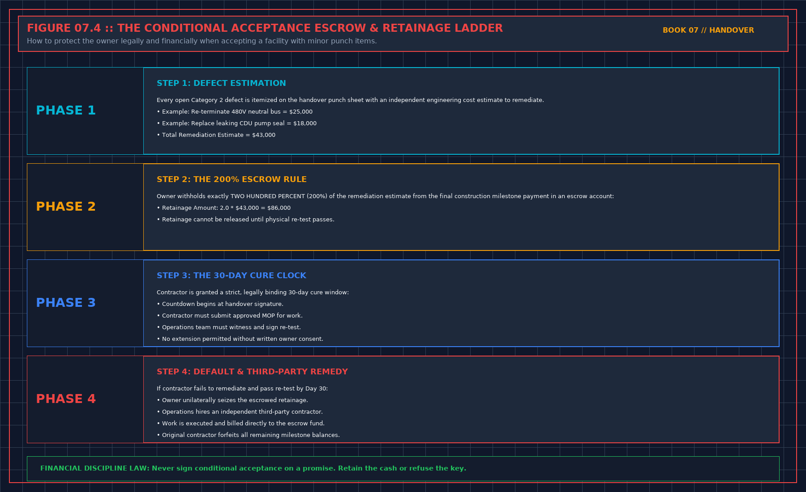

# A green tile is not acceptance: First-Principles Data Center Engineering Protocol

> **Direct Answer Block**: Why a calm green BMS dashboard screen in the handover conference room does not prove alarm readiness without forced-failure wire-pull and clock-sync certificates. In mission-critical data center commissioning and operations, engineers enforce this boundary using deterministic physical equations, calibrated field instrumentation, and auditable sign-off gates rather than relying on vendor brochure summaries, uncalibrated software plots, or verbal assurances. Every measurement and state transition must be recorded with synchronized UTC timestamps and explicit pass/fail thresholds before a signature is granted.

Installed is not accepted. A screen can be on, and green, and still have no clock, no quality mark, and no forced failure on this image. You may accept a named list of points that passed. You do not accept "the platform." Strike that sentence. Their identifiers stay in their file. Your note says the human name, the sentence, and that the proof exists.

A design kilowatt on that screen is not today's load. It does not fill the used-capacity cell because the measured point is stale. Stale refuses the cell. A closed breaker is not a load. A redundancy graphic is not a test of remaining capacity.

A drawing renamed as-built is still the design until someone checked it against the plant after the last change your sentence depends on. Floor and drawing disagree: write both. Do not average them into a signature.

A model without a walked measurement is a picture. File it. Do not sign airflow proved. A heat curve without a file judgment is a plot. File it. Do not sign heat proved.

---

## 1. First-Principles Engineering Formulation and Governing Mathematics

In high-density data center environments, verbal summaries and qualitative status tiles routinely obscure incipient physical failures. Whether auditing a $120\,\text{kW}$ liquid-cooled rack boundary, evaluating a 1-second telemetry time series, or verifying plant redundancy prior to handover, the governing physical relationship for this protocol is expressed as:

$$P_{\text{accepted}} \iff \text{Verified}(\text{4 mA}, \text{20 mA}, \text{Wire Pull} \to \texttt{0x80}, \text{PTP} \le 1\,\text{ms})$$

When any term on the left-hand or right-hand side of this relationship is left unmeasured, inferred from an uncalibrated nameplate, or averaged across an unverified time window, the resulting engineering record cannot support a valid operational signature. Field engineers must verify each physical variable independently using NIST/ISO 17025 traceable instruments before proceeding to the next gate in the sequence.

| Audit Verification Parameter | Unacceptable / Defective Field Practice | Auditable First-Principles Requirement | Mandatory Action on Failure |
| :--- | :--- | :--- | :--- |
| **Primary Boundary Definition** | Implied by vendor brochure or slide deck | Explicitly bounded on stamped P&ID / SLD with tag IDs | Halt acceptance; issue formal boundary clarification |
| **Measurement & Telemetry Proof** | Single uncalibrated display reading or 60-sec average | Calibrated Class A/0.5S sensor with 1-sec UTC timestamp | Reject dataset; classify point as `0x40` Stale or `0x80` Bad |
| **Pass / Fail Acceptance Gate** | Qualitative "Looks OK" or "Within Normal Range" | Quantitative numerical corridor cited from revision in force | Log Category A/B defect; withhold retainage or permit |
| **Custody & Sign-Off Record** | Single bundled "Accepted" signature at end of meeting | Scoped, dated sentence naming exact proved & unproved lines | Strike unsupported claims; issue Conditional Refusal |

---

## 2. Deep-Dive Technical Protocol and Field Implementation

The following field protocol—adapted directly from **Volume 07: *Refuse the Handover***—establishes the step-by-step verification mechanics required on the data hall floor:

The screen will be on in the meeting. Green is the claim the sixth book exists to test. You do not sign that the monitor is part of the handover because the tiles are green. You sign it only for points that have a source path, an owner, a clock, a quality mark you can explain, a line written before the night, and a forced failure on the image you will run. Everything else may be stored. It may not page you, and it may not be called accepted.

This is the receiver's use of the sixth book. You do not fill a point sheet for their whole list in the meeting. You pick the points the signature depends on: the ones that will wake someone, the ones that fill a capacity cell, the ones they say prove recovery. If those cannot pass the sheet, the monitor sentence is refused. The other points can wait. A complete list is not the gate. The points that speak are the gate.

## What you refuse

A point whose forced failure was done on a vendor's hall, or on last quarter's image. Acceptance is this image, this path. A rename since the proof voids it. If they cannot say whether the path changed, treat it as changed.

A quality mark nobody in the room can define in one sentence. Those points are missing for any decision that wakes a person. Do not let the meeting define the mark by agreeing the tile looks fine.

A score that will be used to say the hall is healthy, the incident is closed, or the customer may be told the service is held. The score does not get a pen. If the handover sentence needs the score, refuse the sentence. You do not need their weights. You need the refusal.

A design kilowatt plotted as today's load, or a closed breaker offered as a load. Split them. Do not fill the used-capacity cell from design because the measured point is stale. Stale refuses the cell. The fifth book's capacity rule and the sixth book's quality rule meet here. Either one is enough to refuse the number.

A leak contact with no expected state, or a silence on that contact with no end time. You will live with that silence. If they cannot name the end, you do not accept the contact as protection.

A page that names a team, or that leads with a cause, offered as proof the alarm path works. Ask them to read the five lines for one point you care about. If they cannot, the path is not handed over. Do not test it by causing a real trip. A forced failure of the poll is the sixth book's proof. A stunt on live plant is not your acceptance method.

## What you may accept

You may accept a named list of points that passed, and refuse the platform as a whole. "The platform is accepted" is almost always wider than the evidence. Strike it. Keep the names of the points, on your sheet, not as a paste of their identifier dump. Their identifiers stay in their file. Your sheet says the human name, the sentence, and that the proof exists, with a pointer to where it is filed.

You may accept that the screen is installed and not accepted. Installed is a delivery fact. Accepted is your sentence. Vendors mix them because installed is already true and accepted is what they need. You keep them apart.

## Auditing BMS/EPMS Point Quality and Forced-Failure Proof at Handover

### Why a Green Summary Tile Does Not Prove Live Sensor Integrity

In institutional data center project delivery, the transition from construction and commissioning (ASHRAE Guideline 0 / Guideline 202 Levels 1 through 5) to live 24/7 operations is governed by measurable engineering gates rather than schedule milestones. Whenever a handover package asks the receiving operations lead to certify a plant attribute, that attribute must satisfy the quantitative gating relationship:

$$P_{\text{accepted}} \iff \text{Tested}(4\,\text{mA}, 20\,\text{mA}, \text{Wire\_Pull} \to \texttt{0x80})$$

If any supporting evidence file, witnessed test script, or as-built redline verification falls outside its acceptance corridor, the operations representative must either issue a formal **Notice of Handover Refusal** or execute a narrow **Conditional Acceptance with 200% Retainage Escrow** that explicitly bounds the permitted operating envelope until the defect is cured and re-tested.

| Handover Audit Dimension | Contractor / Project Team Submission | Operations Gatekeeper Verification Protocol | Mandatory Refusal or Escrow Action |
| :--- | :--- | :--- | :--- |
| **Primary Governance Focus** | Refusing Pasted Register Lists Without Forced-Failure Records | Independent line-by-line audit against Volumes 01–06 criteria | Strike unsupported words from certificate before signing |
| **Quantitative Proof Standard** | Summary pass/fail cover sheet or verbal assurance | Raw 1-second telemetry CSV, signed witness sheet, and field walk | Classify missing proof as Category A/B defect on Refusal Sheet |
| **Financial & Operational Lever** | Request for 100% milestone release and full load | Enforce $200\%$ retainage holdback ($E = 2.0 \times C_{\text{fix}}$) and load cap | Hold plant at zero or derated load until remediation passes |
| **Post-Meeting Custody Rule** | Unfettered contractor access to finish open work | Transition space to Operations LOTO; require approved MOP per fix | Deny unescorted access; log all post-handover interventions |

---

## 3. Field Verification Checklist and Instrumentation Hygiene

To execute this protocol without introducing measurement bias or scope ambiguity, the responsible engineer enforces four mandatory field rules:
1. **Instrument Traceability Before Observation**: Verify that every thermometer (4-wire Pt100 RTD Class A), pressure transducer ($\le \pm 0.1\%$ span), flowmeter, balometer, or power analyzer carries a current calibration certificate and passes a pre-test zero/span check on the day of the walk.
2. **Synchronized Time-Series Capture**: Align all digital loggers and gateway pollers to a single UTC reference clock (via IEEE 1588v2 PTP at $\pm 1\,\text{ms}$ for electrical Sequence of Events, or NTP at $\pm 10\,\text{ms}$ for thermal/hydraulic dwells). Never merge unsynchronized CSV files by row index.
3. **Explicit Isolation of Disturbances vs. Control Handles**: Hold upstream supply temperatures, parallel cabinet loads, and containment door states constant during the observation dwell so that transient plant drift is never mistaken for steady-state equipment performance.
4. **Written Record Prior to Signature**: Record every boundary tag, measured value, uncertainty tolerance, and open limitation in ink on the controlled project sheet before leaving the equipment line-up.

---

## Frequently Asked Questions (FAQ)

### Why does "A green tile is not acceptance" matter during high-density data center commissioning and operations?
Why a calm green BMS dashboard screen in the handover conference room does not prove alarm readiness without forced-failure wire-pull and clock-sync certificates. When project teams bypass this rule to meet a commercial schedule milestone, unverified physical assumptions—such as hidden hydraulic pressure drops, unlogged polling gaps, unblanked bypass leakage, or uncalibrated sensor offsets—transfer directly into live 24/7 production as latent single points of failure.

### How do you quantitatively verify compliance with "BMS green dashboard tile handover refusal" on the physical floor?
Compliance is verified by executing the governing mathematical balance ($$P_{\text{accepted}} \iff \text{Verified}(\text{4 mA}, \text{20 mA}, \text{Wire Pull} \to \texttt{0x80}, \text{PTP} \le 1\,\text{ms})$$) using independent, calibrated field instruments across a stabilized steady-state dwell window (minimum 15 to 30 minutes for thermal and hydraulic systems), and confirming that the discrepancy between primary and secondary measurements remains strictly within the pre-declared acceptance band.

### What should an engineer do if a contractor or vendor submits a report that violates this protocol?
The reviewing engineer must refuse to sign the broad acceptance sentence, mark the specific line item as **Unproved / Defective** on the official audit sheet, and either require a witnessed re-test under a corrected script or isolate the unproved scope under a time-bounded Conditional Acceptance with a $150\%$ to $200\%$ financial retainage escrow holdback.

---

From *Refuse the Handover*, Tristan, Data Center Field Guides.

Related: [A green tile can be stale](06-stale-is-not-green.md).
