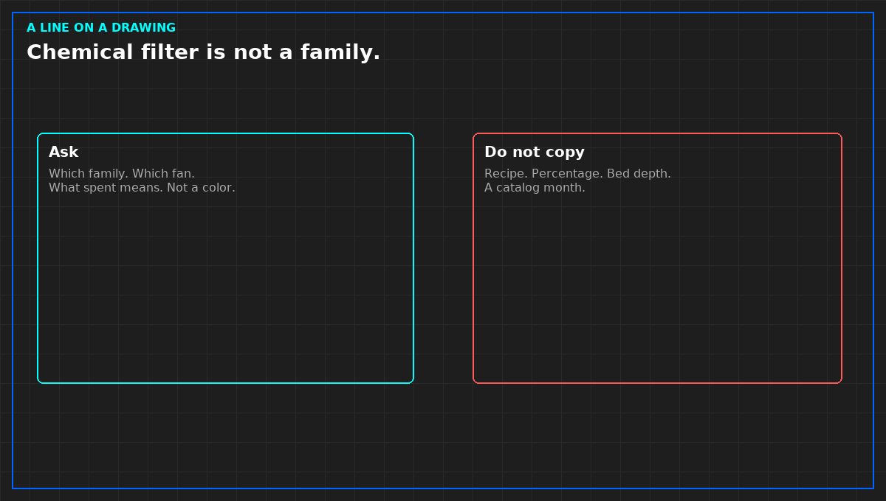

# A chemical filter line is not a gas family

*Original diagram. Not a site record.*

A line on a drawing that says chemical filter is a proposal. It becomes a treatment only when someone can name the gas family, the metal that family was hurting, the fan that pushes air through the bed, and what spent means. Spent is not a color. Carbon is dark on the first day.

Plain carbon, impregnated carbon, a blend, and an oxidizing fill are categories. They are not formulas. Do not copy a percentage, a bed depth, or a making step into your note. If the family is unnamed, the box is not accepted as corrosion control. It may be labeled an experiment. An experiment does not promise a class.

A media on a room unit's return does not treat makeup that never passes through it. Those are two purchases. A bypass damper around the bed is untreated air wearing the unit's name. Ask which position that damper is in during the mode you claim.

A live corrosion box is a point, not a coupon. It needs a clock, a quality mark, and a forced failure before it may page. It does not replace the strip that sat at the board face. If they disagree, do not average them. And do not let a vendor reconstruct a severity class from a photograph. The report names the class and the edition, or you do not write the class.

From *Judge a Corrosion Coupon*, Tristan, Data Center Field Guides. No store link until the Kindle edition is listed.

Related: [A calm copper coupon does not clear silver](08-copper-does-not-clear-silver.md).
