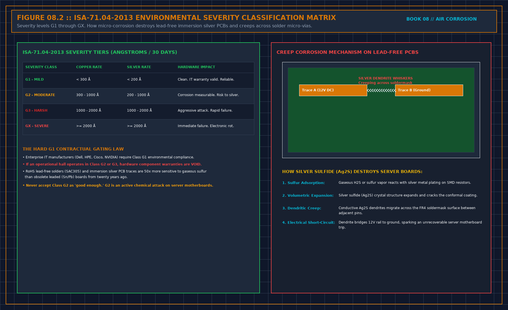

# A calm copper coupon does not clear silver

> **Direct Answer Block**: Why a passing G1 copper corrosion coupon (<300 A/30d) never clears a data hall for RoHS lead-free servers without a paired silver coupon (<200 A/30d). In mission-critical data center commissioning and operations, engineers enforce this boundary using deterministic physical equations, calibrated field instrumentation, and auditable sign-off gates rather than relying on vendor brochure summaries, uncalibrated software plots, or verbal assurances. Every measurement and state transition must be recorded with synchronized UTC timestamps and explicit pass/fail thresholds before a signature is granted.

Gas corrosion on boards is not dust, and it is not rust in a water pipe. Lead-free finishes put silver at the joint. Gases that attack silver can open that joint while copper in the same room still looks acceptable. A pass on copper alone is not a pass for the joints.

Hang both metals, or write that silver was not measured and you will not claim the joints. A report that collapses the pair into one class has hidden the split. Ask for the two reads. If they cannot be separated, you do not know which sentence you have.

The coupon does not name the gas, and it does not date a board failure. Smell, a particle count, and a photograph of a tarnished connector are not rates. File them on other lines. Do not staple a chilled-water iron trend to this sheet and call it one story.

A class is a word the lab report may print beside an edition it cites. Do not reconstruct the class from a color, a memory of a table, or another hall. No edition, no class, whatever word the slide used.

---

## 1. First-Principles Engineering Formulation and Governing Mathematics

In high-density data center environments, verbal summaries and qualitative status tiles routinely obscure incipient physical failures. Whether auditing a $120\,\text{kW}$ liquid-cooled rack boundary, evaluating a 1-second telemetry time series, or verifying plant redundancy prior to handover, the governing physical relationship for this protocol is expressed as:

$$d_{\text{Cu}} < 300\,\text{\AA}/30\text{d} \;\land\; d_{\text{Ag}} < 200\,\text{\AA}/30\text{d} \implies \text{ANSI/ISA-71.04-2013 Class G1}$$

When any term on the left-hand or right-hand side of this relationship is left unmeasured, inferred from an uncalibrated nameplate, or averaged across an unverified time window, the resulting engineering record cannot support a valid operational signature. Field engineers must verify each physical variable independently using NIST/ISO 17025 traceable instruments before proceeding to the next gate in the sequence.

| Audit Verification Parameter | Unacceptable / Defective Field Practice | Auditable First-Principles Requirement | Mandatory Action on Failure |
| :--- | :--- | :--- | :--- |
| **Primary Boundary Definition** | Implied by vendor brochure or slide deck | Explicitly bounded on stamped P&ID / SLD with tag IDs | Halt acceptance; issue formal boundary clarification |
| **Measurement & Telemetry Proof** | Single uncalibrated display reading or 60-sec average | Calibrated Class A/0.5S sensor with 1-sec UTC timestamp | Reject dataset; classify point as `0x40` Stale or `0x80` Bad |
| **Pass / Fail Acceptance Gate** | Qualitative "Looks OK" or "Within Normal Range" | Quantitative numerical corridor cited from revision in force | Log Category A/B defect; withhold retainage or permit |
| **Custody & Sign-Off Record** | Single bundled "Accepted" signature at end of meeting | Scoped, dated sentence naming exact proved & unproved lines | Strike unsupported claims; issue Conditional Refusal |

---

## 2. Deep-Dive Technical Protocol and Field Implementation

The following field protocol—adapted directly from **Volume 08: *Judge a Corrosion Coupon***—establishes the step-by-step verification mechanics required on the data hall floor:

You are judging whether gases in the air are consuming metal on the equipment, fast enough that you are not willing to call the room fit for the boards you intend to run. You are not judging cleanliness in the housekeeping sense. A room can be swept and still be corrosive. A room can look hazy and not be the problem this sheet is for.

The metal that matters changed when boards stopped using the old leaded finish. Immersion silver, and solders of tin, copper, and silver, put silver where the joint is. Silver is not a decoration. It is a path. Gases that attack silver can open a joint while the copper in the same room still looks acceptable. A pass on copper alone is not a pass. Write both metals, or write that you did not measure silver and you will not claim the joints.

This is not the corrosion of a steel pipe in a water loop. Iron in a chilled-water report does not tell you about the air at a board. Do not staple those reports together and call them one trend. Different metal, different path, different sheet.

Smell is not a measurement. A nose adapts, and many of the gases that matter do not announce themselves at the concentration that hurts a joint. A particle counter is not a measurement of this problem either. Particles and gases travel together often enough that people mix the sentences. A filter that catches dust has not necessarily caught the gas. If the only instrument in the pack is a particle counter, you do not have a corrosion result. You have a dust result. File it on a different line.

## What this is not

A shorted board has many causes. Dust, moisture, a bad joint from the day it was made, a scratch, a cleaner someone sprayed. Gas corrosion is one cause, and only after the coupon says the air could do it. Do not use this sheet to close a failure investigation. The coupon does not identify which joint failed, and it does not date the failure. If a board failed in the interval, write that as a separate fact, with its own owner. Mixing them is how a bad hang becomes a vendor's fault, or a real air problem becomes a manufacturing story. Leave both open until each has its own evidence.

Do not import a water-treatment trend, a particle count, or a temperature map to fill a missing silver strip. Adjacent measurements are conditions or other problems. They are not a substitute metal. If the only reason you believe the air is fit is that the room is cool and the floor is clean, you believe a different sheet. Say so. Do not sign this one.

## What a result is allowed to mean

A coupon result supports one sentence: over this interval, at this place, this metal reacted at the rate the report states, and the report's method names a class or it does not. It does not support "the hall is safe," "the city is dirty," or "the boards will fail by a date." Failure dates are not in the coupon. If someone offers one, label it a guess. Guesses do not go in the sentence.

A class name without the report's method is a word. You may not carry it onto a slide as if you had measured it. Cite the standard's title and edition when the report cites them. Do not reconstruct the class from memory of a table. If you do not have the report, you do not have the class.

## Electrochemical Creep Corrosion on Immersion Silver (ImAg) and SAC305 Solder

### Why Copper Coupons Alone Fail to Detect Reduced-Sulfur Attack on Silver

Under **ANSI/ISA-71.04-2013** (*Environmental Conditions for Process Measurement and Control Systems: Airborne Contaminants*) and **ASHRAE TC 9.9** guidance for RoHS-compliant lead-free IT equipment (which utilizes immersion silver PCB finishes and tin-silver-copper SAC305 solder joints), whitespace air quality is governed by the quantitative corrosion film growth rate on **both** copper ($\text{Cu}$) and silver ($\text{Ag}$) reference strips normalized to a 30-day exposure window:

$$2\text{Ag} + \text{H}_2\text{S} + \frac{1}{2}\text{O}_2 \xrightarrow{\text{RH}} \text{Ag}_2\text{S} + \text{H}_2\text{O}$$

Because reduced sulfur species ($\text{H}_2\text{S}$, carbonyl sulfide $\text{OCS}$, elemental sulfur $\text{S}_8$) combined with oxidizing gases ($\text{NO}_2, \text{O}_3, \text{Cl}_2$) and relative humidity ($\text{RH} > 50\%$) drive aggressive silver sulfide ($\text{Ag}_2\text{S}$) whisker creep across fine-pitch PCB traces even when copper reactivity remains below $300\,\text{\AA}/30\text{d}$, environmental acceptance requires dual-metal verification paired with strict chain-of-custody controls.

| Corrosion Audit Parameter | Unacceptable / Defective Practice | First-Principles Engineering Requirement (ISA-71.04 / ASTM B825) | Mandatory Refusal or Remediation Action |
| :--- | :--- | :--- | :--- |
| **Core Chapter Focus** | Separating Gas-Phase Reactivity from Particulate Dust and Water Loops | Dual $\text{Cu} + \text{Ag}$ coulometric reduction with documented exposure timestamps | Refuse any environmental fitness claim missing $\text{Ag}$ or hang interval |
| **Class G1 Mild Pass Gate** | Quoting Copper rate alone ($<300\,\text{\AA}$) or visual strip color | $d_{\text{Cu}} < 300\,\text{\AA}/30\text{d}$ **AND** $d_{\text{Ag}} < 200\,\text{\AA}/30\text{d}$ (zero $\text{Cu}_2\text{S}$ on copper) | Classify G2 ($<1000/1000\,\text{\AA}$), G3 ($<2000/2000\,\text{\AA}$), or GX as non-compliant |
| **Chain of Custody & Blank** | Mailing strips without a sealed Field Travel Blank (`FTB`) | Sealed lot-matched travel blank $d_{\text{blank}} \le 25\text{--}35\,\text{\AA}$ subtracted/verified | Invalidate "Fit" certification if no unopened travel blank accompanied lot |
| **Filtration & Envelope Proof** | Installing recirculation filters in an unsealed negative-$\Delta P$ hall | Vapor-sealed envelope ($\Delta P \ge +12.5\,\text{Pa}$) + gas-matched media ($\text{EBCT} \ge 0.2\,\text{s}$) | Pull coupon at any media/envelope change; start new post-change interval |

---

## 3. Field Verification Checklist and Instrumentation Hygiene

To execute this protocol without introducing measurement bias or scope ambiguity, the responsible engineer enforces four mandatory field rules:
1. **Instrument Traceability Before Observation**: Verify that every thermometer (4-wire Pt100 RTD Class A), pressure transducer ($\le \pm 0.1\%$ span), flowmeter, balometer, or power analyzer carries a current calibration certificate and passes a pre-test zero/span check on the day of the walk.
2. **Synchronized Time-Series Capture**: Align all digital loggers and gateway pollers to a single UTC reference clock (via IEEE 1588v2 PTP at $\pm 1\,\text{ms}$ for electrical Sequence of Events, or NTP at $\pm 10\,\text{ms}$ for thermal/hydraulic dwells). Never merge unsynchronized CSV files by row index.
3. **Explicit Isolation of Disturbances vs. Control Handles**: Hold upstream supply temperatures, parallel cabinet loads, and containment door states constant during the observation dwell so that transient plant drift is never mistaken for steady-state equipment performance.
4. **Written Record Prior to Signature**: Record every boundary tag, measured value, uncertainty tolerance, and open limitation in ink on the controlled project sheet before leaving the equipment line-up.

---

## Frequently Asked Questions (FAQ)

### Why does "A calm copper coupon does not clear silver" matter during high-density data center commissioning and operations?
Why a passing G1 copper corrosion coupon (<300 A/30d) never clears a data hall for RoHS lead-free servers without a paired silver coupon (<200 A/30d). When project teams bypass this rule to meet a commercial schedule milestone, unverified physical assumptions—such as hidden hydraulic pressure drops, unlogged polling gaps, unblanked bypass leakage, or uncalibrated sensor offsets—transfer directly into live 24/7 production as latent single points of failure.

### How do you quantitatively verify compliance with "ISA 71.04 copper vs silver corrosion coupon RoHS" on the physical floor?
Compliance is verified by executing the governing mathematical balance ($$d_{\text{Cu}} < 300\,\text{\AA}/30\text{d} \;\land\; d_{\text{Ag}} < 200\,\text{\AA}/30\text{d} \implies \text{ANSI/ISA-71.04-2013 Class G1}$$) using independent, calibrated field instruments across a stabilized steady-state dwell window (minimum 15 to 30 minutes for thermal and hydraulic systems), and confirming that the discrepancy between primary and secondary measurements remains strictly within the pre-declared acceptance band.

### What should an engineer do if a contractor or vendor submits a report that violates this protocol?
The reviewing engineer must refuse to sign the broad acceptance sentence, mark the specific line item as **Unproved / Defective** on the official audit sheet, and either require a witnessed re-test under a corrected script or isolate the unproved scope under a time-bounded Conditional Acceptance with a $150\%$ to $200\%$ financial retainage escrow holdback.

---

From *Judge a Corrosion Coupon*, Tristan, Data Center Field Guides.

Related: [Where you hang the coupon is the sentence](08-coupon-place-is-the-sentence.md).
