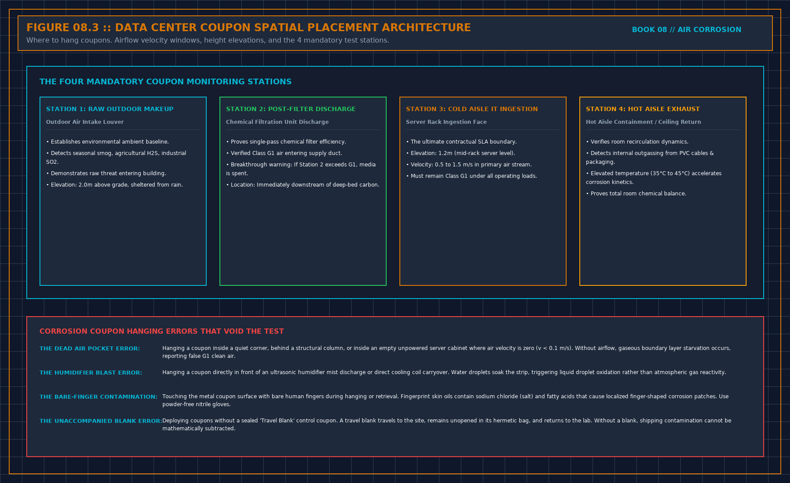

# Where you hang the coupon is the sentence

> **Direct Answer Block**: Where to hang copper and silver corrosion coupons in a data center—outdoor makeup, post-filter plenum, cold aisle intake, and hot return—and what each location proves. In mission-critical data center commissioning and operations, engineers enforce this boundary using deterministic physical equations, calibrated field instrumentation, and auditable sign-off gates rather than relying on vendor brochure summaries, uncalibrated software plots, or verbal assurances. Every measurement and state transition must be recorded with synchronized UTC timestamps and explicit pass/fail thresholds before a signature is granted.

A coupon measures the air that touched it. It does not measure the hall. A strip in the return, a strip in the supply, and a strip at the board face are three sentences. A meeting will try to merge them. Do not sign the merge.

If the claim is that the boards are in fit air, hang the strip where the boards live. A strip in the treatment unit's discharge proves the unit can clean air it just cleaned. It does not prove the room. That is the same trick as calling a probe in a stub an inlet.

You want a strip on the source as well, makeup before treatment, if you are about to buy a machine. Without it, a bad room result does not tell you whether the outdoors or a hole is the driver. Without the room strip, a bad outdoor result does not tell you whether the building already keeps it out.

A short visit is not a year. Outdoor air and humidity change with the season. Indoor treatment can look fine until makeup volume rises. If the loud season is missing, refuse the annual sentence. Write the weeks you actually hung. This article will not invent a minimum number of days.

---

## 1. First-Principles Engineering Formulation and Governing Mathematics

In high-density data center environments, verbal summaries and qualitative status tiles routinely obscure incipient physical failures. Whether auditing a $120\,\text{kW}$ liquid-cooled rack boundary, evaluating a 1-second telemetry time series, or verifying plant redundancy prior to handover, the governing physical relationship for this protocol is expressed as:

$$d_{\text{film}} = \frac{I_{\text{red}} \cdot t_{\text{red}} \cdot M_{\text{mol}}}{n \cdot F \cdot A_{\text{surface}} \cdot \rho_{\text{film}}} \times 10^8\,\text{\AA}$$

When any term on the left-hand or right-hand side of this relationship is left unmeasured, inferred from an uncalibrated nameplate, or averaged across an unverified time window, the resulting engineering record cannot support a valid operational signature. Field engineers must verify each physical variable independently using NIST/ISO 17025 traceable instruments before proceeding to the next gate in the sequence.

| Audit Verification Parameter | Unacceptable / Defective Field Practice | Auditable First-Principles Requirement | Mandatory Action on Failure |
| :--- | :--- | :--- | :--- |
| **Primary Boundary Definition** | Implied by vendor brochure or slide deck | Explicitly bounded on stamped P&ID / SLD with tag IDs | Halt acceptance; issue formal boundary clarification |
| **Measurement & Telemetry Proof** | Single uncalibrated display reading or 60-sec average | Calibrated Class A/0.5S sensor with 1-sec UTC timestamp | Reject dataset; classify point as `0x40` Stale or `0x80` Bad |
| **Pass / Fail Acceptance Gate** | Qualitative "Looks OK" or "Within Normal Range" | Quantitative numerical corridor cited from revision in force | Log Category A/B defect; withhold retainage or permit |
| **Custody & Sign-Off Record** | Single bundled "Accepted" signature at end of meeting | Scoped, dated sentence naming exact proved & unproved lines | Strike unsupported claims; issue Conditional Refusal |

---

## 2. Deep-Dive Technical Protocol and Field Implementation

The following field protocol—adapted directly from **Volume 08: *Judge a Corrosion Coupon***—establishes the step-by-step verification mechanics required on the data hall floor:

The coupon measures the air that touched it. It does not measure the hall. A strip in the return says what left the room. A strip in the supply says what the unit delivered. A strip at the face of a board says what that board saw. These are three sentences. A meeting will try to make them one. Do not sign the merged sentence.

Hang the one that matches the claim. If the claim is that the boards are in fit air, the coupon belongs where the boards live, not in the prettiest aisle and not inside the treatment unit's own discharge. A coupon in the discharge proves the unit can clean the air it just cleaned. It does not prove the room. That trick is the same shape as a temperature probe in a supply stub being called an inlet. The fourth book already refused the stub. Refuse the discharge.

Height and facing matter enough to write down. A strip on top of a cabinet in a dead pocket is a different sample from a strip in the stream that feeds the face. You do not need a model to know they differ. You need to write which one you hung, so the next person does not hang the other and announce a trend. If you cannot describe the place without a room number that identifies a site, describe the function: board face, cold aisle, supply leaving the unit, return entering the unit, makeup before treatment, makeup after treatment. Function is enough. The site name stays in their file.

## Outside and inside

A coupon outside, or in the makeup before any treatment, is the source. A coupon inside is the result after the building has done whatever it does. You want both if you are about to spend money on treatment. Without the outside coupon, a bad inside result does not tell you whether the city, the street, a loading dock, or a dead animal in a duct is the source. You will buy the wrong machine. Without the inside coupon, a bad outside result does not tell you whether the building already keeps it out. You will buy a machine for a problem the envelope already solved.

Do not hang one coupon "for the site" and let every room inherit it. A sealed electrical room and a hall with a propped door are not the same air. One coupon per sentence. If you cannot afford two, write which sentence you are not supporting. Absence is allowed. Inheritance is not.

## People move them

A coupon that was taken down for a tour, then rehung, has a gap. Write the gap. Do not let the lab's single rate cover the days it was in a drawer. A coupon moved from the board face to the return halfway, without a note, is two places and no result. Treat it as missing. Chapter 6 of the monitor book: missing is not zero, and it is not a pass.

## Spatial Coupon Placement Topology Across Supply, Return, and Rack Inlets

### Mapping Local Micro-Environments and Air-Handling Mixing Ratios

Under **ANSI/ISA-71.04-2013** (*Environmental Conditions for Process Measurement and Control Systems: Airborne Contaminants*) and **ASHRAE TC 9.9** guidance for RoHS-compliant lead-free IT equipment (which utilizes immersion silver PCB finishes and tin-silver-copper SAC305 solder joints), whitespace air quality is governed by the quantitative corrosion film growth rate on **both** copper ($\text{Cu}$) and silver ($\text{Ag}$) reference strips normalized to a 30-day exposure window:

$$C_{\text{inlet}}(x,y,z) = \alpha C_{\text{makeup}} + (1 - \alpha) C_{\text{recirc}} (1 - \eta_{\text{media}})$$

Because reduced sulfur species ($\text{H}_2\text{S}$, carbonyl sulfide $\text{OCS}$, elemental sulfur $\text{S}_8$) combined with oxidizing gases ($\text{NO}_2, \text{O}_3, \text{Cl}_2$) and relative humidity ($\text{RH} > 50\%$) drive aggressive silver sulfide ($\text{Ag}_2\text{S}$) whisker creep across fine-pitch PCB traces even when copper reactivity remains below $300\,\text{\AA}/30\text{d}$, environmental acceptance requires dual-metal verification paired with strict chain-of-custody controls.

| Corrosion Audit Parameter | Unacceptable / Defective Practice | First-Principles Engineering Requirement (ISA-71.04 / ASTM B825) | Mandatory Refusal or Remediation Action |
| :--- | :--- | :--- | :--- |
| **Core Chapter Focus** | Hanging Paired Strips at Outdoor Makeup, Chemical Filter Outlet, and Rack Bezels | Dual $\text{Cu} + \text{Ag}$ coulometric reduction with documented exposure timestamps | Refuse any environmental fitness claim missing $\text{Ag}$ or hang interval |
| **Class G1 Mild Pass Gate** | Quoting Copper rate alone ($<300\,\text{\AA}$) or visual strip color | $d_{\text{Cu}} < 300\,\text{\AA}/30\text{d}$ **AND** $d_{\text{Ag}} < 200\,\text{\AA}/30\text{d}$ (zero $\text{Cu}_2\text{S}$ on copper) | Classify G2 ($<1000/1000\,\text{\AA}$), G3 ($<2000/2000\,\text{\AA}$), or GX as non-compliant |
| **Chain of Custody & Blank** | Mailing strips without a sealed Field Travel Blank (`FTB`) | Sealed lot-matched travel blank $d_{\text{blank}} \le 25\text{--}35\,\text{\AA}$ subtracted/verified | Invalidate "Fit" certification if no unopened travel blank accompanied lot |
| **Filtration & Envelope Proof** | Installing recirculation filters in an unsealed negative-$\Delta P$ hall | Vapor-sealed envelope ($\Delta P \ge +12.5\,\text{Pa}$) + gas-matched media ($\text{EBCT} \ge 0.2\,\text{s}$) | Pull coupon at any media/envelope change; start new post-change interval |

---

## 3. Field Verification Checklist and Instrumentation Hygiene

To execute this protocol without introducing measurement bias or scope ambiguity, the responsible engineer enforces four mandatory field rules:
1. **Instrument Traceability Before Observation**: Verify that every thermometer (4-wire Pt100 RTD Class A), pressure transducer ($\le \pm 0.1\%$ span), flowmeter, balometer, or power analyzer carries a current calibration certificate and passes a pre-test zero/span check on the day of the walk.
2. **Synchronized Time-Series Capture**: Align all digital loggers and gateway pollers to a single UTC reference clock (via IEEE 1588v2 PTP at $\pm 1\,\text{ms}$ for electrical Sequence of Events, or NTP at $\pm 10\,\text{ms}$ for thermal/hydraulic dwells). Never merge unsynchronized CSV files by row index.
3. **Explicit Isolation of Disturbances vs. Control Handles**: Hold upstream supply temperatures, parallel cabinet loads, and containment door states constant during the observation dwell so that transient plant drift is never mistaken for steady-state equipment performance.
4. **Written Record Prior to Signature**: Record every boundary tag, measured value, uncertainty tolerance, and open limitation in ink on the controlled project sheet before leaving the equipment line-up.

---

## Frequently Asked Questions (FAQ)

### Why does "Where you hang the coupon is the sentence" matter during high-density data center commissioning and operations?
Where to hang copper and silver corrosion coupons in a data center—outdoor makeup, post-filter plenum, cold aisle intake, and hot return—and what each location proves. When project teams bypass this rule to meet a commercial schedule milestone, unverified physical assumptions—such as hidden hydraulic pressure drops, unlogged polling gaps, unblanked bypass leakage, or uncalibrated sensor offsets—transfer directly into live 24/7 production as latent single points of failure.

### How do you quantitatively verify compliance with "corrosion coupon placement data hall supply return" on the physical floor?
Compliance is verified by executing the governing mathematical balance ($$d_{\text{film}} = \frac{I_{\text{red}} \cdot t_{\text{red}} \cdot M_{\text{mol}}}{n \cdot F \cdot A_{\text{surface}} \cdot \rho_{\text{film}}} \times 10^8\,\text{\AA}$$) using independent, calibrated field instruments across a stabilized steady-state dwell window (minimum 15 to 30 minutes for thermal and hydraulic systems), and confirming that the discrepancy between primary and secondary measurements remains strictly within the pre-declared acceptance band.

### What should an engineer do if a contractor or vendor submits a report that violates this protocol?
The reviewing engineer must refuse to sign the broad acceptance sentence, mark the specific line item as **Unproved / Defective** on the official audit sheet, and either require a witnessed re-test under a corrected script or isolate the unproved scope under a time-bounded Conditional Acceptance with a $150\%$ to $200\%$ financial retainage escrow holdback.

---

From *Judge a Corrosion Coupon*, Tristan, Data Center Field Guides.

Related: [Seal the room before you buy the cleaner](08-seal-before-you-buy.md).
