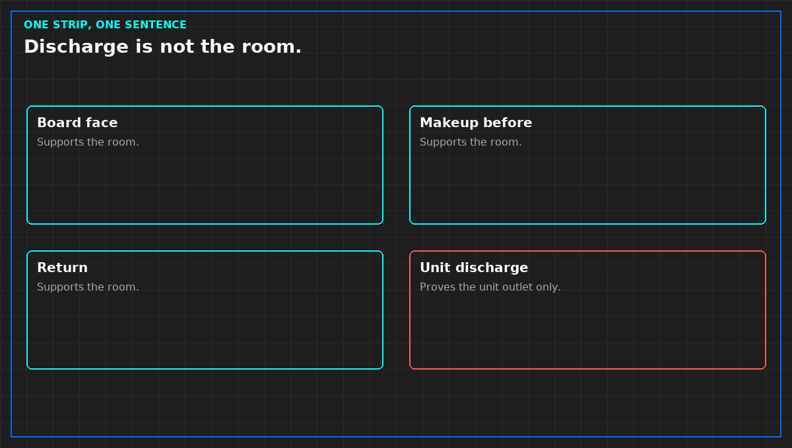

# Where you hang the coupon is the sentence

*Original diagram. Not a site record.*

A coupon measures the air that touched it. It does not measure the hall. A strip in the return, a strip in the supply, and a strip at the board face are three sentences. A meeting will try to merge them. Do not sign the merge.

If the claim is that the boards are in fit air, hang the strip where the boards live. A strip in the treatment unit's discharge proves the unit can clean air it just cleaned. It does not prove the room. That is the same trick as calling a probe in a stub an inlet.

You want a strip on the source as well, makeup before treatment, if you are about to buy a machine. Without it, a bad room result does not tell you whether the outdoors or a hole is the driver. Without the room strip, a bad outdoor result does not tell you whether the building already keeps it out.

A short visit is not a year. Outdoor air and humidity change with the season. Indoor treatment can look fine until makeup volume rises. If the loud season is missing, refuse the annual sentence. Write the weeks you actually hung. This article will not invent a minimum number of days.

From *Judge a Corrosion Coupon*, Tristan, Data Center Field Guides. No store link until the Kindle edition is listed.

Related: [Seal the room before you buy the cleaner](08-seal-before-you-buy.md).
