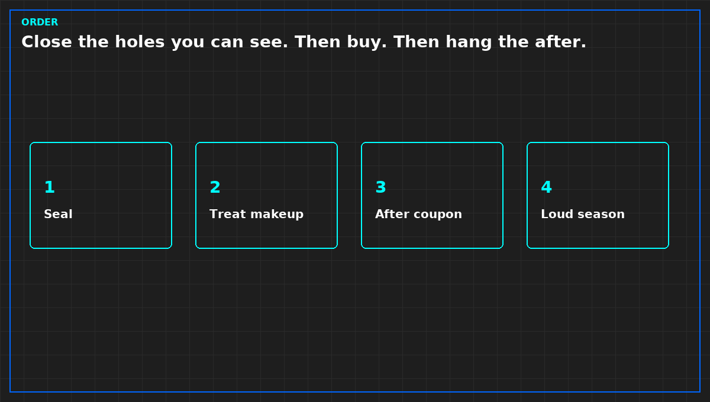

# Seal the room before you buy the cleaner

*Original diagram. Not a site record.*

A treatment unit in a room that leaks is cleaning air that is already leaving, while outdoor air enters through paths nobody listed. Cable trays, wall penetrations, a door that does not latch, a relief path with no name: each hole breaks the sentence "the unit holds the room."

Close the holes you can see, and date the closing against the coupon interval. An interval that straddles the sealing mixes before and after into one rate. Pull the strip or hang another. Do not seal a life-safety path because it was convenient. That path stays open on purpose, and it is a source. Treat the air that uses it, or accept that this path is untreated.

Then look at makeup. Indoor treatment loses when untreated outdoor air arrives in more volume than the room unit can take. A coupon only in the room, while makeup is untreated, supports a weaker sentence: this rate, while dirty air was still allowed in. Do not upgrade it because one month improved.

Start the after coupon when air is going through the intake treatment, not when the purchase order is signed. One strip across both dates lets a late install borrow the credit of an early seal.

From *Judge a Corrosion Coupon*, Tristan, Data Center Field Guides. No store link until the Kindle edition is listed.

Related: [A chemical filter line is not a gas family](08-chemical-filter-is-not-a-family.md).
