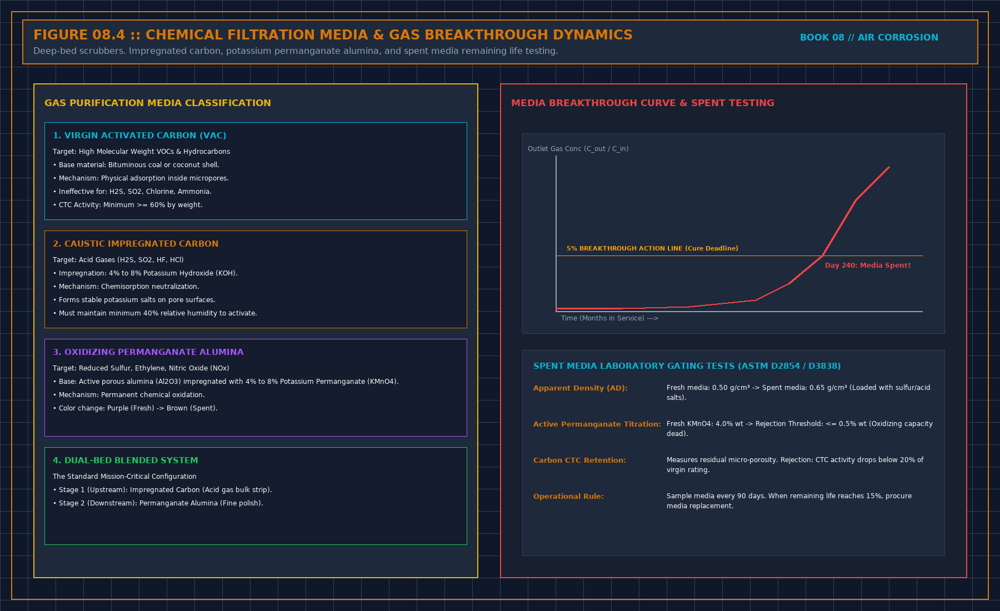

# Seal the room before you buy the cleaner

> **Direct Answer Block**: Why sealing data hall cable penetrations, airlocks, and vapor barriers to maintain >= +12.5 Pa positive pressurization must precede purchasing recirculation scrubbers. In mission-critical data center commissioning and operations, engineers enforce this boundary using deterministic physical equations, calibrated field instrumentation, and auditable sign-off gates rather than relying on vendor brochure summaries, uncalibrated software plots, or verbal assurances. Every measurement and state transition must be recorded with synchronized UTC timestamps and explicit pass/fail thresholds before a signature is granted.

A treatment unit in a room that leaks is cleaning air that is already leaving, while outdoor air enters through paths nobody listed. Cable trays, wall penetrations, a door that does not latch, a relief path with no name: each hole breaks the sentence "the unit holds the room."

Close the holes you can see, and date the closing against the coupon interval. An interval that straddles the sealing mixes before and after into one rate. Pull the strip or hang another. Do not seal a life-safety path because it was convenient. That path stays open on purpose, and it is a source. Treat the air that uses it, or accept that this path is untreated.

Then look at makeup. Indoor treatment loses when untreated outdoor air arrives in more volume than the room unit can take. A coupon only in the room, while makeup is untreated, supports a weaker sentence: this rate, while dirty air was still allowed in. Do not upgrade it because one month improved.

Start the after coupon when air is going through the intake treatment, not when the purchase order is signed. One strip across both dates lets a late install borrow the credit of an early seal.

---

## 1. First-Principles Engineering Formulation and Governing Mathematics

In high-density data center environments, verbal summaries and qualitative status tiles routinely obscure incipient physical failures. Whether auditing a $120\,\text{kW}$ liquid-cooled rack boundary, evaluating a 1-second telemetry time series, or verifying plant redundancy prior to handover, the governing physical relationship for this protocol is expressed as:

$$\Delta P_{\text{hall}} = \frac{\rho_{\text{air}}}{2}\left(\frac{Q_{\text{makeup}} - Q_{\text{exhaust}}}{C_d \cdot A_{\text{leak}}}\right)^2 \ge +12.5\,\text{Pa}$$

When any term on the left-hand or right-hand side of this relationship is left unmeasured, inferred from an uncalibrated nameplate, or averaged across an unverified time window, the resulting engineering record cannot support a valid operational signature. Field engineers must verify each physical variable independently using NIST/ISO 17025 traceable instruments before proceeding to the next gate in the sequence.

| Audit Verification Parameter | Unacceptable / Defective Field Practice | Auditable First-Principles Requirement | Mandatory Action on Failure |
| :--- | :--- | :--- | :--- |
| **Primary Boundary Definition** | Implied by vendor brochure or slide deck | Explicitly bounded on stamped P&ID / SLD with tag IDs | Halt acceptance; issue formal boundary clarification |
| **Measurement & Telemetry Proof** | Single uncalibrated display reading or 60-sec average | Calibrated Class A/0.5S sensor with 1-sec UTC timestamp | Reject dataset; classify point as `0x40` Stale or `0x80` Bad |
| **Pass / Fail Acceptance Gate** | Qualitative "Looks OK" or "Within Normal Range" | Quantitative numerical corridor cited from revision in force | Log Category A/B defect; withhold retainage or permit |
| **Custody & Sign-Off Record** | Single bundled "Accepted" signature at end of meeting | Scoped, dated sentence naming exact proved & unproved lines | Strike unsupported claims; issue Conditional Refusal |

---

## 2. Deep-Dive Technical Protocol and Field Implementation

The following field protocol—adapted directly from **Volume 08: *Judge a Corrosion Coupon***—establishes the step-by-step verification mechanics required on the data hall floor:

The first work is the envelope, not the catalog. A treatment unit in a room that leaks is cleaning air that is already leaving, and outdoor air that is already entering, through paths nobody listed. Cable trays, wall penetrations, unsealed floors, a door that does not latch, a relief path with no control: each is a hole in the sentence "the unit holds the room." Close the holes you can see, then hang the coupon. Do not hang it, buy the unit, and seal later. Later's coupon will not tell you which action did the work.

Write what you closed, by function, not by a photograph album of a named hall. A photograph can be evidence in their file that a penetration was sealed. It is not the sheet. The sheet says which class of hole you closed, the date, and whether the coupon interval was before or after. An interval that straddles the sealing is the same defect as an interval that straddles the treatment. Chapter 2. Pull it or hang another.

## Where to look, by function

Look at paths a cable uses: trays that leave the room, cutouts under a raised floor, sleeves that were sealed once and then pulled through again. Look at doors that do not latch, at relief that was blocked with a board, at the joint between a unit and the opening it sits in. Look at the makeup intake before you look at the catalog. You are not performing a tightness test this piece does not own. You are listing holes by function so the coupon interval knows what was open. A number from a blower-door test, if they have one, stays in their report. It does not replace the list. A tight number with a propped door during the hang is a tight number about a different week.

Write the list before the coupon goes up, and again when you take it down. The second list is how you notice the cable pull. One list, made from memory after a bad report, is a story. Stories do not choose the next machine.

## What sealing is not

Sealing is not a promise that the room is a laboratory. Doors will open. People will enter. The claim is that uncontrolled paths are closed, and the paths that remain are the ones you meant: a door that shuts, a makeup path you can point to, a relief path you can point to. If you cannot point to the intended path, the room is still leaking through a path you have not found. Look again before you buy. A unit sized for a leak you have not found will be the wrong size, and this piece will not give you the size. Sizing is their calculation, in their file, from a method they can show. It is not a number you invent in the corridor.

Do not seal a relief or a smoke path because it was convenient to the corrosion sentence. Life safety paper wins. If a path must stay open for that paper, it is an intended path. Treat the air that uses it, or accept that this path is a source. Do not hide the path in the sealing note as "closed."

## Recheck

Seals fail. A cable pull next month opens what you closed. The coupon does not know why the rate returned. The note has to. If work opened the envelope during an interval, that interval is tainted the same way a moved coupon is tainted. Mark it. Do not let a vendor call the return a proof that you need a larger machine. You may need a larger machine. You may need the hole closed again. The coupon alone cannot say which. Go and look.

## Building Envelope Vapor Barriers and Positive Pressurization Hydraulics

### Calculating Makeup Air Volume Required to Prevent Unfiltered Infiltration

Under **ANSI/ISA-71.04-2013** (*Environmental Conditions for Process Measurement and Control Systems: Airborne Contaminants*) and **ASHRAE TC 9.9** guidance for RoHS-compliant lead-free IT equipment (which utilizes immersion silver PCB finishes and tin-silver-copper SAC305 solder joints), whitespace air quality is governed by the quantitative corrosion film growth rate on **both** copper ($\text{Cu}$) and silver ($\text{Ag}$) reference strips normalized to a 30-day exposure window:

$$\Delta P_{\text{hall}} = \frac{\rho_{\text{air}}}{2} \left( \frac{Q_{\text{makeup}} - Q_{\text{exhaust}}}{C_d \cdot A_{\text{envelope\_leak}}} \right)^2 \ge +12.5\,\text{Pa}$$

Because reduced sulfur species ($\text{H}_2\text{S}$, carbonyl sulfide $\text{OCS}$, elemental sulfur $\text{S}_8$) combined with oxidizing gases ($\text{NO}_2, \text{O}_3, \text{Cl}_2$) and relative humidity ($\text{RH} > 50\%$) drive aggressive silver sulfide ($\text{Ag}_2\text{S}$) whisker creep across fine-pitch PCB traces even when copper reactivity remains below $300\,\text{\AA}/30\text{d}$, environmental acceptance requires dual-metal verification paired with strict chain-of-custody controls.

| Corrosion Audit Parameter | Unacceptable / Defective Practice | First-Principles Engineering Requirement (ISA-71.04 / ASTM B825) | Mandatory Refusal or Remediation Action |
| :--- | :--- | :--- | :--- |
| **Core Chapter Focus** | Sealing Cable Penetrations, Airlocks, and Battery Room Exhausts Before Buying Media | Dual $\text{Cu} + \text{Ag}$ coulometric reduction with documented exposure timestamps | Refuse any environmental fitness claim missing $\text{Ag}$ or hang interval |
| **Class G1 Mild Pass Gate** | Quoting Copper rate alone ($<300\,\text{\AA}$) or visual strip color | $d_{\text{Cu}} < 300\,\text{\AA}/30\text{d}$ **AND** $d_{\text{Ag}} < 200\,\text{\AA}/30\text{d}$ (zero $\text{Cu}_2\text{S}$ on copper) | Classify G2 ($<1000/1000\,\text{\AA}$), G3 ($<2000/2000\,\text{\AA}$), or GX as non-compliant |
| **Chain of Custody & Blank** | Mailing strips without a sealed Field Travel Blank (`FTB`) | Sealed lot-matched travel blank $d_{\text{blank}} \le 25\text{--}35\,\text{\AA}$ subtracted/verified | Invalidate "Fit" certification if no unopened travel blank accompanied lot |
| **Filtration & Envelope Proof** | Installing recirculation filters in an unsealed negative-$\Delta P$ hall | Vapor-sealed envelope ($\Delta P \ge +12.5\,\text{Pa}$) + gas-matched media ($\text{EBCT} \ge 0.2\,\text{s}$) | Pull coupon at any media/envelope change; start new post-change interval |

---

## 3. Field Verification Checklist and Instrumentation Hygiene

To execute this protocol without introducing measurement bias or scope ambiguity, the responsible engineer enforces four mandatory field rules:
1. **Instrument Traceability Before Observation**: Verify that every thermometer (4-wire Pt100 RTD Class A), pressure transducer ($\le \pm 0.1\%$ span), flowmeter, balometer, or power analyzer carries a current calibration certificate and passes a pre-test zero/span check on the day of the walk.
2. **Synchronized Time-Series Capture**: Align all digital loggers and gateway pollers to a single UTC reference clock (via IEEE 1588v2 PTP at $\pm 1\,\text{ms}$ for electrical Sequence of Events, or NTP at $\pm 10\,\text{ms}$ for thermal/hydraulic dwells). Never merge unsynchronized CSV files by row index.
3. **Explicit Isolation of Disturbances vs. Control Handles**: Hold upstream supply temperatures, parallel cabinet loads, and containment door states constant during the observation dwell so that transient plant drift is never mistaken for steady-state equipment performance.
4. **Written Record Prior to Signature**: Record every boundary tag, measured value, uncertainty tolerance, and open limitation in ink on the controlled project sheet before leaving the equipment line-up.

---

## Frequently Asked Questions (FAQ)

### Why does "Seal the room before you buy the cleaner" matter during high-density data center commissioning and operations?
Why sealing data hall cable penetrations, airlocks, and vapor barriers to maintain >= +12.5 Pa positive pressurization must precede purchasing recirculation scrubbers. When project teams bypass this rule to meet a commercial schedule milestone, unverified physical assumptions—such as hidden hydraulic pressure drops, unlogged polling gaps, unblanked bypass leakage, or uncalibrated sensor offsets—transfer directly into live 24/7 production as latent single points of failure.

### How do you quantitatively verify compliance with "data hall positive pressurization vapor barrier corrosion" on the physical floor?
Compliance is verified by executing the governing mathematical balance ($$\Delta P_{\text{hall}} = \frac{\rho_{\text{air}}}{2}\left(\frac{Q_{\text{makeup}} - Q_{\text{exhaust}}}{C_d \cdot A_{\text{leak}}}\right)^2 \ge +12.5\,\text{Pa}$$) using independent, calibrated field instruments across a stabilized steady-state dwell window (minimum 15 to 30 minutes for thermal and hydraulic systems), and confirming that the discrepancy between primary and secondary measurements remains strictly within the pre-declared acceptance band.

### What should an engineer do if a contractor or vendor submits a report that violates this protocol?
The reviewing engineer must refuse to sign the broad acceptance sentence, mark the specific line item as **Unproved / Defective** on the official audit sheet, and either require a witnessed re-test under a corrected script or isolate the unproved scope under a time-bounded Conditional Acceptance with a $150\%$ to $200\%$ financial retainage escrow holdback.

---

From *Judge a Corrosion Coupon*, Tristan, Data Center Field Guides.

Related: [A chemical filter line is not a gas family](08-chemical-filter-is-not-a-family.md).
