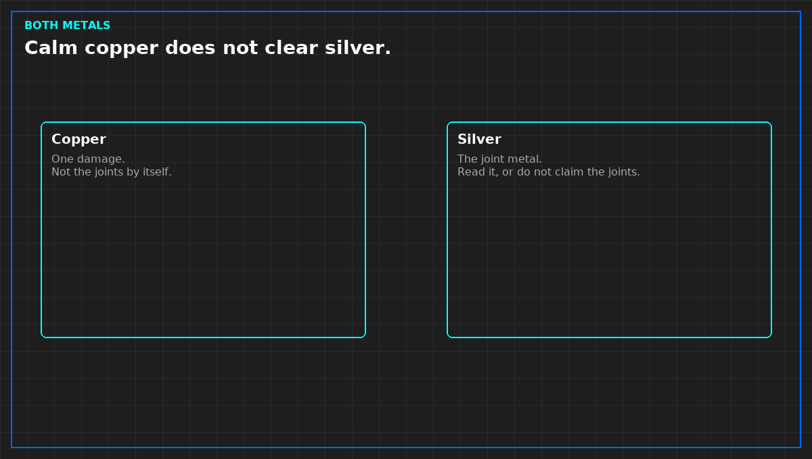

# What a corrosion coupon report must show

*Original diagram. Not a site record.*

A slide that says the room is G1 is not a report. The report is the record. If you cannot get it, you cannot sign the class.

It names the metal, not "coupon." Copper and silver are separate lines. A single collapsed index does not clear the joints. It names the method well enough that another lab would know what was asked, without you pasting their procedure. It names the place by function: board face, supply, return, makeup before treatment, makeup after, or the unit discharge. Discharge does not support the room. It names the start and the end. A rate with no hang time is a normalized month hiding a short visit. Do not use it. The rate keeps the unit the lab printed. Do not convert it in the meeting to match a table you remember.

If a class is printed, the edition is printed beside it. No edition, no class. "Equivalent to" a class is a translation. Strike it unless the translation rule is written. This note does not rebuild that table, and it does not supply the missing edition from memory.

A blank from the same lot, unopened to the room air, belongs in the same file. No blank, no fit class. The trip and the lab have to be bounded, or "fit" may be the mailer.

Who read the metal signs the report. If the reader is the seller, the read is a hypothesis until a second method agrees. Agreement is the same metal, place, and interval. A nod in the meeting is not a second read.

From *Judge a Corrosion Coupon*, Tristan, Data Center Field Guides. No store link until the Kindle edition is listed.

Related: [A calm copper coupon does not clear silver](08-copper-does-not-clear-silver.md).
