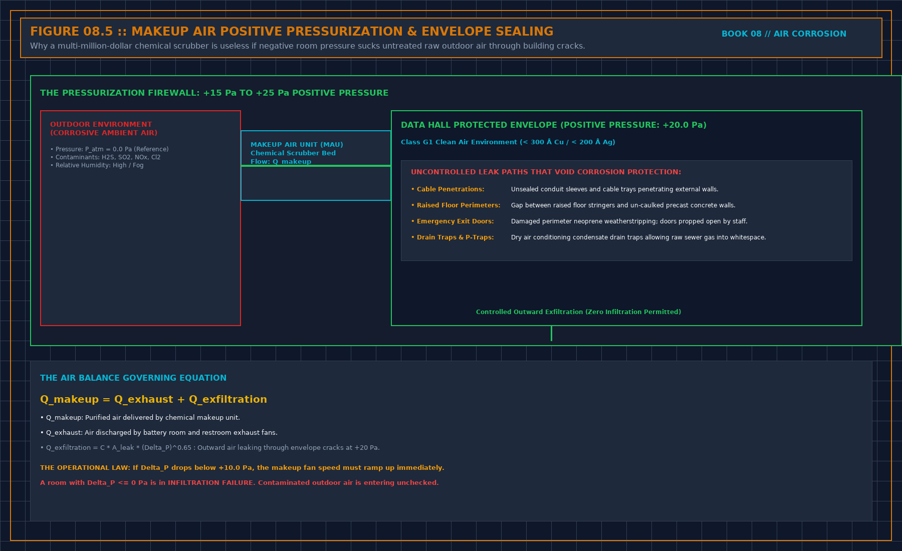

# What a corrosion coupon report must show

> **Direct Answer Block**: Forensic checklist for auditing laboratory corrosion coupon reports: coulometric stripping plateaus, Cu2S/Ag2S speciation, actual hang intervals, and travel blanks. In mission-critical data center commissioning and operations, engineers enforce this boundary using deterministic physical equations, calibrated field instrumentation, and auditable sign-off gates rather than relying on vendor brochure summaries, uncalibrated software plots, or verbal assurances. Every measurement and state transition must be recorded with synchronized UTC timestamps and explicit pass/fail thresholds before a signature is granted.

A slide that says the room is G1 is not a report. The report is the record. If you cannot get it, you cannot sign the class.

It names the metal, not "coupon." Copper and silver are separate lines. A single collapsed index does not clear the joints. It names the method well enough that another lab would know what was asked, without you pasting their procedure. It names the place by function: board face, supply, return, makeup before treatment, makeup after, or the unit discharge. Discharge does not support the room. It names the start and the end. A rate with no hang time is a normalized month hiding a short visit. Do not use it. The rate keeps the unit the lab printed. Do not convert it in the meeting to match a table you remember.

If a class is printed, the edition is printed beside it. No edition, no class. "Equivalent to" a class is a translation. Strike it unless the translation rule is written. This note does not rebuild that table, and it does not supply the missing edition from memory.

A blank from the same lot, unopened to the room air, belongs in the same file. No blank, no fit class. The trip and the lab have to be bounded, or "fit" may be the mailer.

Who read the metal signs the report. If the reader is the seller, the read is a hypothesis until a second method agrees. Agreement is the same metal, place, and interval. A nod in the meeting is not a second read.

---

## 1. First-Principles Engineering Formulation and Governing Mathematics

In high-density data center environments, verbal summaries and qualitative status tiles routinely obscure incipient physical failures. Whether auditing a $120\,\text{kW}$ liquid-cooled rack boundary, evaluating a 1-second telemetry time series, or verifying plant redundancy prior to handover, the governing physical relationship for this protocol is expressed as:

$$d_{\text{norm}}(30\text{d}) = \left(d_{\text{exposed}} - d_{\text{blank}}\right) \cdot \left(\frac{30}{t_{\text{hang\_days}}}\right)^n$$

When any term on the left-hand or right-hand side of this relationship is left unmeasured, inferred from an uncalibrated nameplate, or averaged across an unverified time window, the resulting engineering record cannot support a valid operational signature. Field engineers must verify each physical variable independently using NIST/ISO 17025 traceable instruments before proceeding to the next gate in the sequence.

| Audit Verification Parameter | Unacceptable / Defective Field Practice | Auditable First-Principles Requirement | Mandatory Action on Failure |
| :--- | :--- | :--- | :--- |
| **Primary Boundary Definition** | Implied by vendor brochure or slide deck | Explicitly bounded on stamped P&ID / SLD with tag IDs | Halt acceptance; issue formal boundary clarification |
| **Measurement & Telemetry Proof** | Single uncalibrated display reading or 60-sec average | Calibrated Class A/0.5S sensor with 1-sec UTC timestamp | Reject dataset; classify point as `0x40` Stale or `0x80` Bad |
| **Pass / Fail Acceptance Gate** | Qualitative "Looks OK" or "Within Normal Range" | Quantitative numerical corridor cited from revision in force | Log Category A/B defect; withhold retainage or permit |
| **Custody & Sign-Off Record** | Single bundled "Accepted" signature at end of meeting | Scoped, dated sentence naming exact proved & unproved lines | Strike unsupported claims; issue Conditional Refusal |

---

## 2. Deep-Dive Technical Protocol and Field Implementation

The following field protocol—adapted directly from **Volume 08: *Judge a Corrosion Coupon***—establishes the step-by-step verification mechanics required on the data hall floor:

The report is the record. The slide is not. Read the report before the meeting in which someone wants the class in a sentence. If you cannot get the report, you cannot sign the class. A verbal "we are G1" is the kinder summary. Chapter 8 of the handover book refused those. This one too.

## What has to be on it

The metal, named, not "coupon." The method the lab used, named well enough that a second lab would know what was asked, without you pasting their procedure into this piece. The place, by function, matching the sheet. The start and the end. The rate, with its unit, and the hang time visible so you are not asked to trust a normalized month that hides a short visit. Chapter 2.

If a class is printed, the edition is printed next to it. No edition, no class, whatever word they used. "Equivalent to" a class is not the class. It is a translation someone made. Ask for the translation rule in writing, or strike the word. You will not reconstruct the rule in the margin.

A statement of what the method does not cover is part of a usable report. If it is missing, you do not invent the caveat. You write "coverage not stated" on the sheet and you do not let the class travel further than the metal and the interval. Coverage not stated is a limit. It is not a pass.

## What you strike

A photograph of the strip as the result. A rate with no unit. A rate whose interval is the day the courier delivered the mailer. A class applied to "the data hall" when the place line says return, or discharge, or a room that is not the one with the boards. A combined copper-and-silver index you cannot split. A comparison to another site, with that site's name showing. Strike the comparison and do not copy the name into your note. Their identifier stays in their file.

A report that arrived after you already told a customer the class is a late point. Chapter 3 of the monitor book. It may correct the record. It does not silently rewrite the notice. If the late number would have changed what you said, write a new sentence. Do not edit the old one into a smoother class.

## Units

Leave the rate in the unit the report used. Do not convert it in the meeting to match a table you remember, and do not convert it twice, once in the note and once on the slide. A conversion you cannot show in one line is a new number. New numbers are tests you did not run. If two reports use two units, ask the lab, or refuse the comparison. Do not average them into a monthly figure so the chart lines up. The clock chapter already refused averaged clocks. Averaged rates are the same defect.

A class does not have a unit. It is a word the report is allowed to print only beside an edition. If someone prints the class and not the rate, ask for the rate. A class without a rate is a headline. Headlines do not go on the sheet as the result. The rate stays in their pdf. Your sheet says the rate is filed, and where. You do not need the digits in your handwriting for the refusal to be real. You need them in the report if you are going to sign the class.

## Who signed the pdf

The person who read the metal signs the report, by name or by the lab's role, not by the vendor's sales deck. If the reader and the seller are the same party, chapter 2 already marked it a hypothesis until a second read agrees. Agreement is the same metal, place, and interval. A second vendor who says "looks right" is not a second read.

Chain of custody is a sentence, not a form you must reprint. Who took it down, who carried it, whether it sat in a hot vehicle or an open drawer. If nobody can say, the interval includes unknown hours. Unknown hours are a gap. A gap does not support a fine class. You may still file the report. You may not call it clean custody.

## Forensic Line-by-Line Audit of Laboratory Coupon Analysis Reports

### Checking Stripping Potential Plateaus, Surface Area Normalization, and Blanks

Under **ANSI/ISA-71.04-2013** (*Environmental Conditions for Process Measurement and Control Systems: Airborne Contaminants*) and **ASHRAE TC 9.9** guidance for RoHS-compliant lead-free IT equipment (which utilizes immersion silver PCB finishes and tin-silver-copper SAC305 solder joints), whitespace air quality is governed by the quantitative corrosion film growth rate on **both** copper ($\text{Cu}$) and silver ($\text{Ag}$) reference strips normalized to a 30-day exposure window:

$$E_{\text{strip}}(\text{Cu}_2\text{O}) \approx -0.35\,\text{V}, \quad E_{\text{strip}}(\text{Cu}_2\text{S}) \approx -0.75\,\text{V}, \quad E_{\text{strip}}(\text{Ag}_2\text{S}) \approx -0.68\,\text{V}$$

Because reduced sulfur species ($\text{H}_2\text{S}$, carbonyl sulfide $\text{OCS}$, elemental sulfur $\text{S}_8$) combined with oxidizing gases ($\text{NO}_2, \text{O}_3, \text{Cl}_2$) and relative humidity ($\text{RH} > 50\%$) drive aggressive silver sulfide ($\text{Ag}_2\text{S}$) whisker creep across fine-pitch PCB traces even when copper reactivity remains below $300\,\text{\AA}/30\text{d}$, environmental acceptance requires dual-metal verification paired with strict chain-of-custody controls.

| Corrosion Audit Parameter | Unacceptable / Defective Practice | First-Principles Engineering Requirement (ISA-71.04 / ASTM B825) | Mandatory Refusal or Remediation Action |
| :--- | :--- | :--- | :--- |
| **Core Chapter Focus** | Detecting Truncated Reduction Scans and Unreported Hang Intervals | Dual $\text{Cu} + \text{Ag}$ coulometric reduction with documented exposure timestamps | Refuse any environmental fitness claim missing $\text{Ag}$ or hang interval |
| **Class G1 Mild Pass Gate** | Quoting Copper rate alone ($<300\,\text{\AA}$) or visual strip color | $d_{\text{Cu}} < 300\,\text{\AA}/30\text{d}$ **AND** $d_{\text{Ag}} < 200\,\text{\AA}/30\text{d}$ (zero $\text{Cu}_2\text{S}$ on copper) | Classify G2 ($<1000/1000\,\text{\AA}$), G3 ($<2000/2000\,\text{\AA}$), or GX as non-compliant |
| **Chain of Custody & Blank** | Mailing strips without a sealed Field Travel Blank (`FTB`) | Sealed lot-matched travel blank $d_{\text{blank}} \le 25\text{--}35\,\text{\AA}$ subtracted/verified | Invalidate "Fit" certification if no unopened travel blank accompanied lot |
| **Filtration & Envelope Proof** | Installing recirculation filters in an unsealed negative-$\Delta P$ hall | Vapor-sealed envelope ($\Delta P \ge +12.5\,\text{Pa}$) + gas-matched media ($\text{EBCT} \ge 0.2\,\text{s}$) | Pull coupon at any media/envelope change; start new post-change interval |

---

## 3. Field Verification Checklist and Instrumentation Hygiene

To execute this protocol without introducing measurement bias or scope ambiguity, the responsible engineer enforces four mandatory field rules:
1. **Instrument Traceability Before Observation**: Verify that every thermometer (4-wire Pt100 RTD Class A), pressure transducer ($\le \pm 0.1\%$ span), flowmeter, balometer, or power analyzer carries a current calibration certificate and passes a pre-test zero/span check on the day of the walk.
2. **Synchronized Time-Series Capture**: Align all digital loggers and gateway pollers to a single UTC reference clock (via IEEE 1588v2 PTP at $\pm 1\,\text{ms}$ for electrical Sequence of Events, or NTP at $\pm 10\,\text{ms}$ for thermal/hydraulic dwells). Never merge unsynchronized CSV files by row index.
3. **Explicit Isolation of Disturbances vs. Control Handles**: Hold upstream supply temperatures, parallel cabinet loads, and containment door states constant during the observation dwell so that transient plant drift is never mistaken for steady-state equipment performance.
4. **Written Record Prior to Signature**: Record every boundary tag, measured value, uncertainty tolerance, and open limitation in ink on the controlled project sheet before leaving the equipment line-up.

---

## Frequently Asked Questions (FAQ)

### Why does "What a corrosion coupon report must show" matter during high-density data center commissioning and operations?
Forensic checklist for auditing laboratory corrosion coupon reports: coulometric stripping plateaus, Cu2S/Ag2S speciation, actual hang intervals, and travel blanks. When project teams bypass this rule to meet a commercial schedule milestone, unverified physical assumptions—such as hidden hydraulic pressure drops, unlogged polling gaps, unblanked bypass leakage, or uncalibrated sensor offsets—transfer directly into live 24/7 production as latent single points of failure.

### How do you quantitatively verify compliance with "how to read laboratory corrosion coupon report ASTM B825" on the physical floor?
Compliance is verified by executing the governing mathematical balance ($$d_{\text{norm}}(30\text{d}) = \left(d_{\text{exposed}} - d_{\text{blank}}\right) \cdot \left(\frac{30}{t_{\text{hang\_days}}}\right)^n$$) using independent, calibrated field instruments across a stabilized steady-state dwell window (minimum 15 to 30 minutes for thermal and hydraulic systems), and confirming that the discrepancy between primary and secondary measurements remains strictly within the pre-declared acceptance band.

### What should an engineer do if a contractor or vendor submits a report that violates this protocol?
The reviewing engineer must refuse to sign the broad acceptance sentence, mark the specific line item as **Unproved / Defective** on the official audit sheet, and either require a witnessed re-test under a corrected script or isolate the unproved scope under a time-bounded Conditional Acceptance with a $150\%$ to $200\%$ financial retainage escrow holdback.

---

From *Judge a Corrosion Coupon*, Tristan, Data Center Field Guides.

Related: [A calm copper coupon does not clear silver](08-copper-does-not-clear-silver.md).
