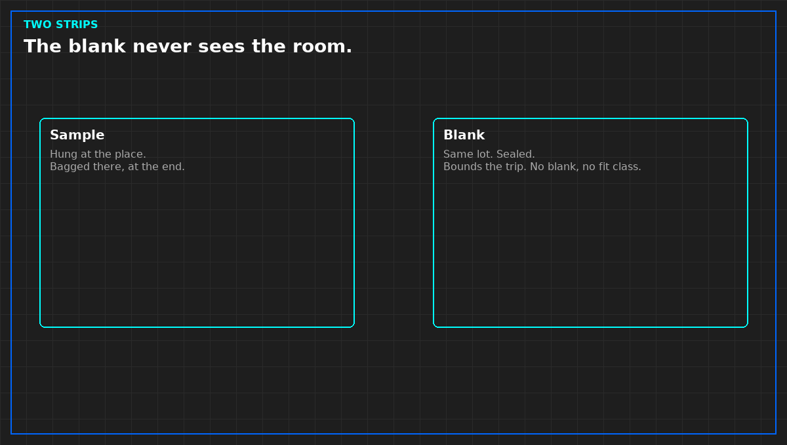

# Why a corrosion test needs a blank coupon

*Original diagram. Not a site record.*

The strip that hung in the room is the sample. The strip that traveled in a sealed bag and never saw that air is the blank. It tells you what the mailer, the vehicle, and the lab did to the metal. Without it, a bad rate might be the journey. You will treat a room for a courier. A fine rate might be the bag. You will sign fit for a trip.

Send a blank from the same lot, same metal, same mailer. If the lab will not report it apart from the sample, you do not know what fraction of the rate is the room. Do not assign the whole rate to the boards. Do not open the blank to show a visitor a clean strip. An opened blank is spoiled. A spoiled blank does not clear the trip.

The blank does not replace a room coupon, and a clean blank does not average away a bad board-face strip. It only bounds the trip. If the blank moved as much as the sample, the place sentence is refused until the trip is understood. That refusal does not require the digits reprinted here. It requires the comparison the report already printed, read honestly.

No blank is allowed only if you are not signing a fit class. A harsh result can still be a reason to look. Fit without a blank is fit you cannot separate from the mailer. Do not write "subject to blank later." Later does not reconstruct a bag you did not send. File the blank's report next to the sample's. A blank filed somewhere else will be forgotten the day someone wants the word fit.

From *Judge a Corrosion Coupon*, Tristan, Data Center Field Guides. No store link until the Kindle edition is listed.

Related: [What a corrosion coupon report must show](08b-what-the-coupon-report-must-show.md).
