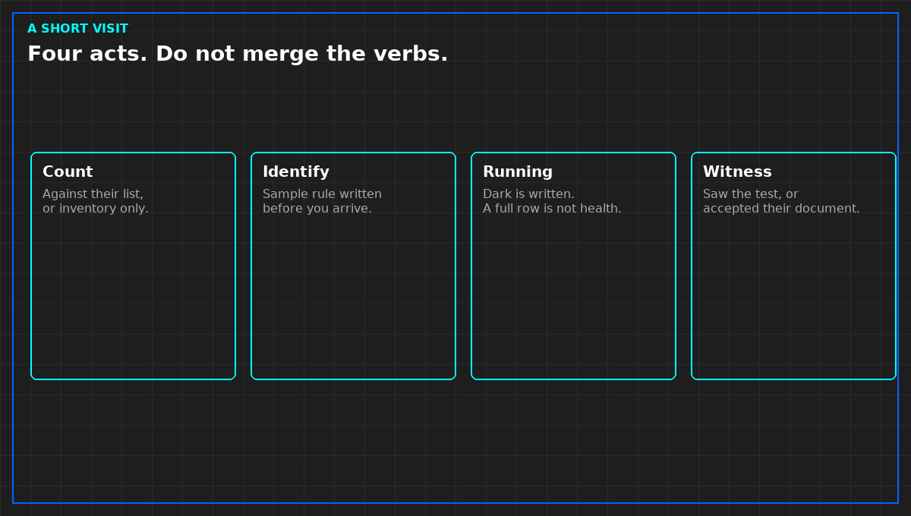

# Count, identify, sample, witness

A short visit will not retest the hall. It can still do four things that are not a tour.

Count what is in scope against their list, or say you only inventoried what you could see. A count without their list is not a reconciliation. Do not publish the list. Their identifiers stay in their file. Your note says the totals agreed, or where they did not, by function.

Identify on a sample rule written before you arrive. Present, matching the record, or not. A rule invented in the aisle to match the time you had is not a rule. If you check fewer than you wrote, the sentence narrows. It does not stay "identity verified." A newer substitute is not what was bought, unless the contract allows it and a document names it.

Sample the running state the same way. A dark machine is not a pass because the row looked full. Write dark. Do not infer health from a front panel. A dashboard of jobs is not a count of what was bought, and it is not an audit of the tenant's system.

Witness means you saw their test, or you saw the document that says it passed, and you say which. Their pass document is not your test. A demonstration staged for you, outside their script, is not a test either. If the document's scope is narrower than its title, use the scope. Titles lose.

*Original diagram. Not a site record.*

From *Walk a Technical Due Diligence*, Tristan, Data Center Field Guides. No store link until the Kindle edition is listed.

Related: [Witnessed is not the same as accepted a document](03b-witnessed-or-a-document.md).
