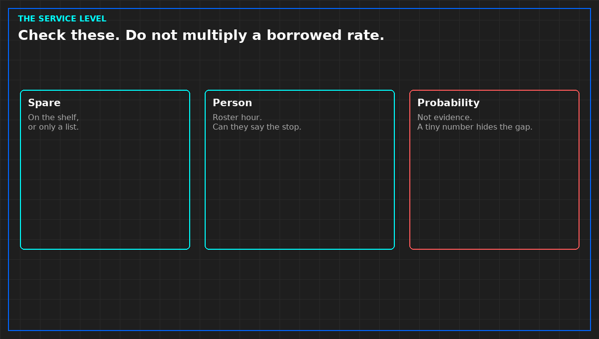

# A spare is evidence. A failure probability is not.

A small calculated chance that several machines fail together looks like engineering. It is a story, unless the failure figure comes from a document you may cite, for this equipment, and you are allowed to use it. A figure half remembered from "industry practice" is not that document. The product will be quoted as your judgment that simultaneous failure can be ignored.

The check that belongs in the opinion is ordinary. Is there a spare for the failure the contract assumes, on a shelf a second person can find, or only on a list. Is there a person on the roster for the hour that matters, and can that person say the first safe state without the binder. Is the emergency paper short enough to be that stop, or is it a repair manual. Seen, documented, or only spoken. Spoken does not enter the opinion as tested.

Redundancy on a slide is the same trap. Two feeds drawn are not two feeds tested. A generator brochure runtime is not a test. Design kilowatts are not tonight's load. Do not add them to look complete. Do not fill the gap with a probability.

If any of the practical checks is missing, the service level is not evidenced. You do not need a tiny number to say that. A tiny number would hide it.

*Original diagram. Not a site record.*

From *Walk a Technical Due Diligence*, Tristan, Data Center Field Guides. No store link until the Kindle edition is listed.

Related: [A nameplate is not used capacity](05-nameplate-is-not-capacity.md).
