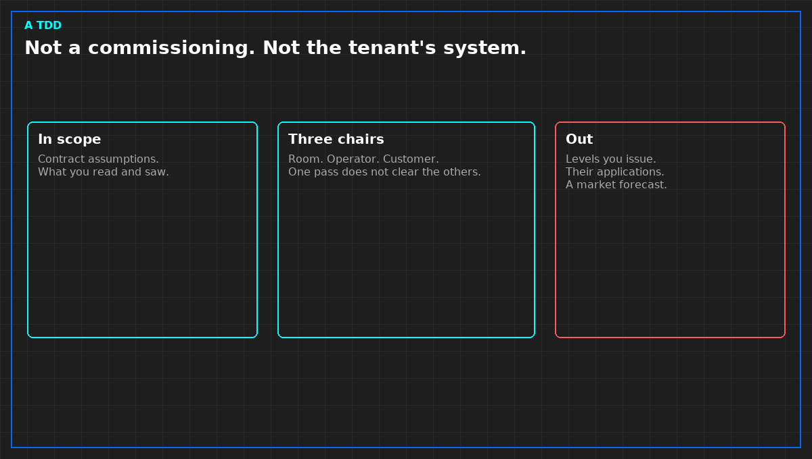

# A data center TDD is not a commissioning

A technical due diligence is a reading of risk against a contract, by someone who will not own the plant and will not operate it. The reader is a lender or a buyer. They need to know whether the papers' assumptions are evidenced. They do not need a second design, and they do not need a certificate that the hall was commissioned.

You do not issue levels. You may read a level map if one exists and say whether the words match the tests. You do not rerun the heat window. You do not audit the tenant's applications because a dashboard was on. Scope is a line written before the questionnaire: which layer is in, which layer is out. Crossing the line feels thorough. It makes the report wider than the access you had.

Three chairs stay separate. Someone provides the room. Someone operates the equipment put in the room. Someone specified it and may run the work. A service level often assumes all three. One chair's confidence does not clear another's missing test. Market language, a competitiveness adjective, a forecast, are not findings. If the engagement forces a market section, label it not a finding, and do not let the opinion cite it.

The sentence you sign is narrow, and the limits sit in the same section. A yes without the limits will be quoted without them.

*Original diagram. Not a site record.*

From *Walk a Technical Due Diligence*, Tristan, Data Center Field Guides. No store link until the Kindle edition is listed.

Related: [A handover signature is a sentence](07-a-signature-is-a-sentence.md).
