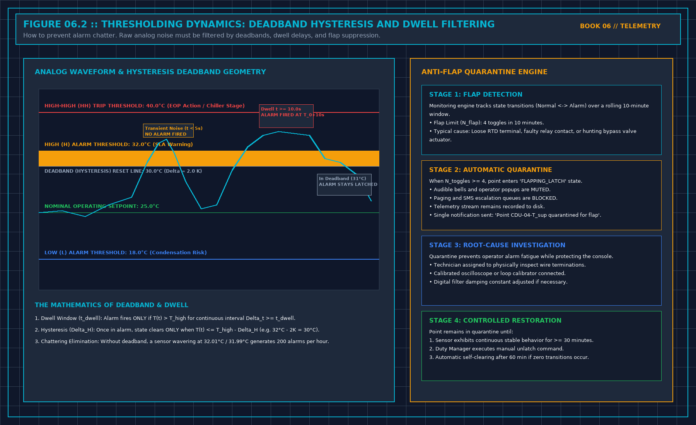

# Data Center Alarm Suppression & Handover Refusal: BMS Telemetry, SOE Timing, and 200% Escrow Clauses

> **Direct Answer Block**: Data center alarm suppression uses analog hysteresis deadbands, dwell time filters, and topological parent-child masking to prevent operator cognitive fatigue during electrical and mechanical transients. During facility commissioning handover, any unresolved alarm storm, unverified sequence of events (SOE), or Category 1 safety defect provides legal grounds for the operations director to refuse the handover signature or enforce a mandatory 200% financial escrow retainage on open punchlist items.

When an electrical feeder trips or a chiller compressor faults in a modern data center, the Building Management System (BMS) and Electrical Power Monitoring System (EPMS) frequently unleash an **alarm storm**: hundreds of simultaneous alerts flooding screens, sounding sirens, and burying the primary root cause under a mountain of secondary telemetry noise.

Faced with a deluge of blinking alarms, operations teams experience severe alarm fatigue. Crucial trip breakers are missed, and secondary cascading failures take down the entire whitespace. 

Even worse, general contractors frequently attempt to hand over these un-tuned, noisy monitoring systems to operations under commercial project deadlines.

---

## 1. Mathematical Telemetry Filtering: Deadband, Dwell, and Anti-Flap

To prevent alarm fatigue, every analog and binary telemetry point must pass through three rigorous mathematical filters before it is permitted to generate an audible or visual alert:

### 1. Analog Hysteresis Deadband (Δ H)
A temperature or pressure value fluctuating near a trip threshold will toggle repeatedly across the boundary line. A hysteresis deadband introduces asymmetrical trip and reset boundaries:

$$\begin{aligned}
\text{Trip Condition:} \quad & X(t) \ge T_{\text{set}} \\
\text{Clear Condition:} \quad & X(t) \le (T_{\text{set}} - \Delta H)
\end{aligned}$$

For a chilled water supply alarm set at T_set = 15.0°C with a deadband Δ H = 1.0°C, the alarm triggers when temperature reaches 15.0°C, but **will not clear until temperature falls below 14.0°C**. This eliminates high-frequency threshold bouncing.

### 2. Continuous Dwell Filter (t_dwell)
Transient electrical spikes, pump startup pressure waves, or valve opening surges must not generate false alarms. The signal must breach the threshold continuously for the full dwell window:

$$\text{Trigger Alert if:} \quad \min_{t \in [t_0, t_0 + t_{\text{dwell}}]} X(t) > T_{\text{set}}$$

Where t_dwell ≥ 5–15 seconds for thermal systems. Any momentary dip below T_set instantly resets the dwell integration timer back to zero.

### 3. Anti-Chatter Quarantine Gate
If a failing pressure switch or loose sensor wire toggles state more than N_toggles ≥ 4 times within a rolling 10-minute window, the telemetry point is classified as **chattering**:
- The point is automatically quarantined to prevent operator distraction.
- A single maintenance diagnostic flag is raised (`0x04 = FAULT`).
- The point's audible alert privileges are revoked until physical remediation is verified.

---

## 2. Electrical Sequence of Events (SOE) and Microsecond Synchronization

During an electrical short circuit or automatic transfer switch (ATS) event, mechanical circuit breakers operate within tens of milliseconds. Standard BMS Modbus polling loops (operating on 1–5 second scan cycles) completely scramble the chronological order of breaker trips.

To determine whether a trip was caused by an upstream utility fault or a downstream branch bus short, the EPMS must utilize **IEEE 1588v2 Precision Time Protocol (PTP)**:

- **Time Synchronization Accuracy**: Master grandmaster clocks synchronize all intelligent electronic devices (IEDs) and protection relays to within **≤ 1.0 μs**.
- **Hardware-Stamped SOE**: Digital inputs capture breaker state transitions with hardware microsecond timestamps at the relay terminal level, preserving the true physical chronology of the electrical disturbance.

---

## 3. The Handover Gatekeeper & Punchlist Defect Triad

Handover is not a ceremonial party; it is a legal transfer of custody, liability, and physical safety. The operations director acts as the sole gatekeeper:

Every open deficiency identified during commissioning is classified into the **Defect Triad**:

| Category | Defect Definition | Examples | Handover Impact |
| :--- | :--- | :--- | :--- |
| **Category 1 (Showstopper)** | Compromises human safety, electrical protection, or 2N redundancy | Failed ATS transfer, missing fire clearance, bypassed ground fault relays, un-reconciled CAD redlines | **SIGNATURE REFUSED**: Contractor retains sole custody and utility expense. |
| **Category 2 (Material Defect)** | Non-critical deficiency that does not jeopardize live operations | Minor pipe insulation damage, un-labeled secondary valves, telemetry trend logging gaps | **CONDITIONAL ACCEPTANCE**: 200% financial escrow holdback with 30-day cure deadline. |
| **Category 3 (Cosmetic Defect)** | Minor aesthetic or housekeeping defects | Paint scratches on panel doors, un-swept cable trenches, missing room signage | **ACCEPTED WITH PUNCHLIST**: 90-day contractor resolution window. |

### The 200% Escrow Retainage Clause
Never accept a verbal promise that the contractor will "come back next Tuesday" to fix Category 2 defects once the final invoice is paid.

The construction contract must enforce a **200% Escrow Retainage Clause**:
1. For every open Category 2 defect, the owner's engineer prices the full third-party cost of remediation (C_remedy).
2. An escrow holdback equal to **200% × C_remedy** is deducted from the contractor's final payment and locked in an independent escrow account.
3. If the contractor fails to cure the defect within **30 calendar days**, the owner has the unilateral right to draw down the escrow funds, hire an independent third-party contractor to complete the work, and retain the remaining balance as liquidated damages.

---

## 4. As-Built Redline CAD Custody Audit

The operations team must never accept "Issued for Construction" (IFC) drawings as handover documentation. 

Every single valve, breaker, cable tray, and sensor installed on the floor must be audited against certified **As-Built Redline Drawings**:
- **Field Re-Measurement**: Pull back raised floor tiles to verify pipe headers match drawing coordinates.
- **Valve Tag Audit**: Verify that physical brass valve tags match the piping P&ID numbers 100%.
- **Single-Line Reconciliation**: Trace breaker trip ratings in the physical panel against the electrical schematic. Any discrepancy between drawing and floor invalidates the drawing package.

---

## Frequently Asked Questions (FAQ)

### What is the difference between a BMS Alert and an Operational Incident?
A BMS alert is a software notification indicating that a telemetry point has breached a configured threshold. An operational incident is an actual physical degradation of service, life-safety hazard, or loss of redundant power/cooling capacity. Hundreds of software alerts occur during routine maintenance, but they only escalate to an incident if service level agreements (SLAs) or equipment safety boundaries are breached.

### How does topological alarm suppression work in data centers?
Topological alarm suppression models the physical hierarchy of electrical and mechanical systems. When an upstream master circuit breaker trips, the monitoring system immediately suppresses all downstream child alarms (loss of voltage on 50 sub-distribution panels, fan failure on 30 CRAC units), highlighting only the single upstream root-cause breaker trip on the primary operator screen.

### Who legally owns Lockout/Tagout (LOTO) custody during handover?
Until the formal handover acceptance certificate is signed by the operations manager, the general contractor holds 100% legal custody and safety responsibility under OSHA / national safety regulations. Upon handover signature, 100% of physical access keys and electrical padlocks must be transferred to operations. Dual custody is strictly forbidden.

---

## The Book Bridge

Managing telemetry integrity and holding the line against premature facility turnover requires uncompromising operational courage. The complete field manuals—including full alarm hysteresis configuration guides, Sequence of Events audit scripts, Category 1 punchlist registers, and legal handover refusal templates—are published in **When a Monitor May Speak** and **Refuse the Handover** by Tristan.

- **When a Monitor May Speak** — *Coming Soon on Amazon Kindle & EPUB*
- **Refuse the Handover** — *Coming Soon on Amazon Kindle & EPUB*
