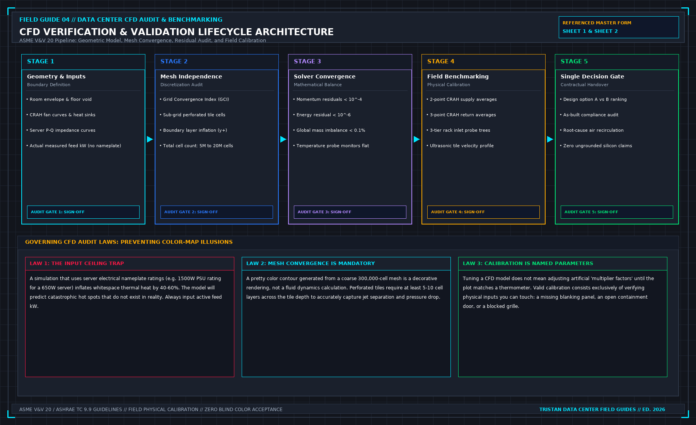

# Data Center CFD Verification Guide: Airflow Modeling vs Physical Whitespace Measurements

> **Direct Answer Block**: Data center CFD verification is the engineering audit process of reconciling computational fluid dynamics (CFD) numerical simulation models against physical airflow velocity, pressure differential ($\Delta P$), and temperature measurements taken on the live data hall floor. It validates whether vendor simulation promises match physical reality by enforcing a strict validation error bound ($\epsilon_{\text{CFD}} \le 10\%$), auditing underfloor plenum pressure distributions, and quantifying cold-aisle containment leakage through unsealed cable cutouts.

Engineering consultancies and equipment vendors love presenting colourful computational fluid dynamics (CFD) reports. A 3D isometric render showing smooth, laminar blue streamlines flowing elegantly from perforated floor tiles into server intake grilles looks authoritative on a conference room projector.

In the physical whitespace, air does not care about PowerPoint renders. Air follows pressure gradients, curls into turbulent shear eddies, bypasses loose containment brush strips, and recirculates hot exhaust into top-of-rack GPU nodes.

A vendor CFD report that has never been calibrated against on-site vane anemometer traverses and multi-point differential pressure transducers is not an engineering document. It is computerized animation.

---

## 1. The Governing Aerodynamic Physics: The Plenum Bernoulli Defect

The most common fatal flaw in uncalibrated data center CFD simulations is assuming uniform discharge velocity across all perforated floor tiles:

### The Momentum Recovery Phenomenon
When cold supply air discharges from a Computer Room Air Handler (CRAH) into a raised-floor plenum at high velocity ($v_{\text{discharge}} \ge 4.5\,\text{m/s}$), static pressure directly in front of the CRAH unit drops due to Bernoulli conversion:

$$P_{\text{total}} = P_{\text{static}} + \frac{1}{2}\rho v^2$$

As air travels toward the end of the aisle, friction and obstruction against structural pedestals and cable trays decelerate the flow ($v \to 0$), converting dynamic pressure back into static pressure (momentum recovery).

Consequently, perforated tiles located **closest to the CRAH unit often have lower airflow discharge—or even reverse flow (drawing hot aisle air down into the plenum)—while tiles at the dead end of the aisle experience high air jets**.

### Perforated Tile Discharge Equation
The actual volumetric flow rate through a perforated floor tile is dictated by the net static pressure differential ($\Delta P$) across the raised floor:

$$Q_{\text{tile}} = C_d \cdot A_{\text{open}} \cdot \sqrt{\frac{2 \cdot \Delta P}{\rho}}$$

Where:
* $Q_{\text{tile}}$ = Volumetric airflow rate ($\text{m}^3/\text{s}$ or CFM)
* $C_d$ = Discharge coefficient of the tile (typically $0.62$ to $0.74$, depending on hole geometry)
* $A_{\text{open}}$ = Net free open area of the perforated tile ($\text{m}^2$)
* $\Delta P = P_{\text{plenum}} - P_{\text{room}}$ = Static pressure differential ($15\,\text{Pa}$ to $35\,\text{Pa}$)
* $\rho$ = Air density ($1.204\,\text{kg/m}^3$ at $20^\circ\text{C}$ sea level)

**Verification Audit Rule**: If a vendor's CFD model assumes constant airflow across all tiles along a 20-meter row without modeling local plenum static pressure variations, **reject the CFD report immediately**.

---

## 2. Containment Leakage Aerodynamics: The Cold Aisle Gap Trap

Cold Aisle Containment (CAC) systems are designed to eliminate hot-air recirculation. However, numerical models frequently treat containment ceilings and end-of-aisle doors as perfectly sealed hermetic boundaries:

### The Leakage Mass Balance Equation
In physical reality, unsealed cable pass-throughs, brush grommets, missing blanking panels, and door perimeter gaps leak massive volumes of air:

$$\dot{m}_{\text{leak}} = \sum_{i=1}^{n} C_{\text{gap}, i} \cdot A_{\text{gap}, i} \cdot \sqrt{2 \rho \cdot |\Delta P_{\text{containment}}|}$$

If the cold aisle is over-pressurized relative to the whitespace ($\Delta P_{\text{containment}} > 10\,\text{Pa}$), expensive conditioned supply air escapes around rack perimeters without passing through IT heat sinks (bypass air). 

Conversely, if server fans draw more CFM than floor tiles deliver, the cold aisle enters negative pressure ($\Delta P_{\text{containment}} < -5\,\text{Pa}$), sucking hot exhaust air back through empty rack units ($U$-space gaps), triggering thermal throttle alarms on mission-critical GPUs.

### The Capture Index (CI) Benchmark
To verify containment effectiveness, the auditor calculates the cold-aisle Capture Index ($CI_{\text{cold}}$) for each rack:

$$CI_{\text{cold}} = \frac{\dot{V}_{\text{conditioned air ingested by rack}}}{\dot{V}_{\text{total air ingested by rack}}} \times 100\%$$

* **Target Tier 3 / AI Density Standard**: $CI_{\text{cold}} \ge 95\%$ across all rack heights ($1\text{U}$ to $48\text{U}$).
* **Unacceptable Infiltration**: $CI_{\text{cold}} < 90\%$ indicates severe recirculation requiring immediate blanking panel installation and plenum re-balancing.

---

## 3. The Physical Calibration Protocol: The 10% Error Threshold

A rigorous data center CFD verification audit follows a 4-step on-site calibration protocol:

### Step 1: Multi-Point Velocity Traverse
Never rely on a single anemometer reading in the center of a perforated tile. The auditor executes a **9-point grid traverse** across each sampled tile using a calibrated thermal vane anemometer:

$$\bar{v}_{\text{tile}} = \frac{1}{9} \sum_{j=1}^{9} v_j$$

$$Q_{\text{measured}} = \bar{v}_{\text{tile}} \times A_{\text{gross}} \times K_{\text{flow hood}}$$

### Step 2: Plenum Pressure Mapping
Install digital differential micro-manometers across three critical plenum locations:
1. Directly beneath CRAH discharge ($P_{\text{near}}$)
2. Mid-aisle plenum ($P_{\text{mid}}$)
3. Dead-end plenum boundary ($P_{\text{far}}$)

Verify that the simulated static pressure curve mirrors the physical pressure gradient within a tolerance of $\pm 2.5\,\text{Pa}$.

### Step 3: Numerical Validation Error Bound
Compare the simulated airflow ($Q_{\text{sim}}$) against the physical measured airflow ($Q_{\text{meas}}$) for every rack position:

$$\epsilon_{\text{CFD}} = \frac{|Q_{\text{sim}} - Q_{\text{meas}}|}{Q_{\text{meas}}} \times 100\%$$

| Validation Tier | Allowable Discrepancy ($\epsilon_{\text{CFD}}$) | Engineering Consequence |
| :--- | :---: | :--- |
| **Pass: Calibrated High-Fidelity** | $\le 10\%$ | Approved for whitespace load sign-off |
| **Conditional: Local Recalibration** | $10.1\% - 20\%$ | Model must adjust friction factor and re-run |
| **Fail: Invalid Model** | $> 20\%$ | Model rejected; physical flow balancing required |

---

## 4. The 8-Point On-Site CFD Verification Checklist

| Phase | System Under Audit | Physical Measurement Method | Acceptance Criterion | Common Vendor Deception |
| :---: | :--- | :--- | :--- | :--- |
| **01** | CRAH Supply Flow | Traverse across return/supply collars | Within $\pm 5\%$ of nameplate fan curve | Using ideal design CFM rather than measured RPM |
| **02** | Tile Velocity Profile | 9-point calibrated vane anemometer | $\bar{v}$ matches simulation within $10\%$ | Averaging an entire row with a single reading |
| **03** | Plenum Static Pressure | Micro-manometer ($\Delta P_{\text{plenum}} - P_{\text{room}}$) | $20\,\text{Pa} \le \Delta P \le 35\,\text{Pa}$ | Claiming uniform pressure across 30 m plenum |
| **04** | Cold Aisle Pressure | Differential probe inside containment | $+2.0\,\text{Pa} \le \Delta P \le +5.0\,\text{Pa}$ | Ignoring negative pressure under high server load |
| **05** | Air Intake Temperatures | Multi-point thermocouple trees ($1\text{U}, 20\text{U}, 42\text{U}$) | $18^\circ\text{C} \le T_{\text{inlet}} \le 27^\circ\text{C}$ (ASHRAE A1) | Measuring air temp 1 meter away from rack face |
| **06** | Cable Cutout Leakage | Infrared thermography + smoke wand | Zero cold plumes escaping into hot aisles | Modeling open cutouts as 100% solid floor tiles |
| **07** | Blanking Panels | Physical inspection of all unpopulated U | $100\%$ blanked with brush seals | Simulating half-empty racks as solid blocks |
| **08** | N-1 CRAH Failure Mode | Physical trip of CRAH unit during heat run | No rack exceeding $32^\circ\text{C}$ within 15 min | Running simulation only under 100% healthy N+1 |

---

## 5. Frequently Asked Questions (FAQ)

### Why do CFD simulations often underestimate rack inlet temperatures?
CFD models commonly suffer from **numerical diffusion** and grid coarseness. If the mesh cell size around the rack face is too large (e.g., $100\,\text{mm}$ rather than $15\,\text{mm}$), the software artificially blurs the sharp thermal boundary between the hot exhaust plume and the cold supply stream, predicting lower server inlet temperatures than the physical hardware actually experiences.

### What is the minimum mesh resolution required for an institutional-grade whitespace CFD model?
An institutional-grade data center CFD model requires a non-uniform structured mesh with at least **3 to 5 cells across perforated tile openings** and boundary layer refinement near containment walls, yielding typically **5 million to 20 million computational cells** for a standard 1,000 m² data hall.

### How does liquid cooling impact legacy air-cooled CFD models in hybrid data halls?
In hybrid whitespaces deploying liquid-cooled CDUs alongside air-cooled enterprise racks, approximately **15% to 25% of heat is still rejected directly into room air** from pump drives, power supply modules, and memory DIMMs. A CFD model must account for this residual heat load ($Q_{\text{air}} \approx 0.20 \times Q_{\text{total}}$); otherwise, ambient room temperatures will rapidly exceed allowable limits.

---

## 6. The Field Bridge & Operational Manual

This verification guide covers the aerodynamics of whitespace auditing. The complete operational protocol—including the multi-point traverse calculation spreadsheets, CFD recalibration scripts, and contractor refusal forms—is available in **[Judge a CFD: What the Picture Hides](https://datacenterfieldguides.com/book/judge-a-cfd)** by Tristan.

[Get the Complete Field Guide on Amazon →](https://datacenterfieldguides.com/buy)
