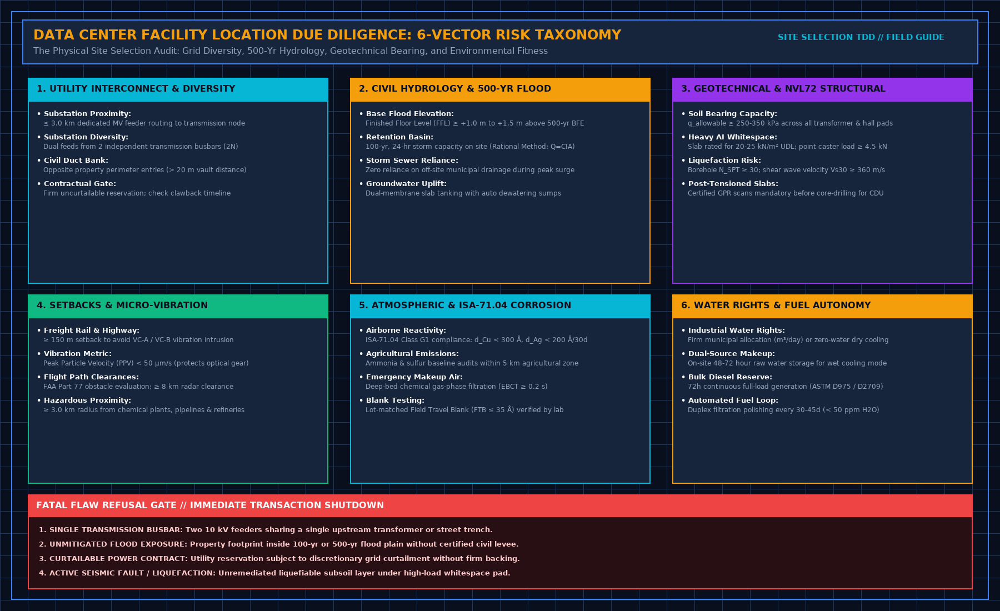
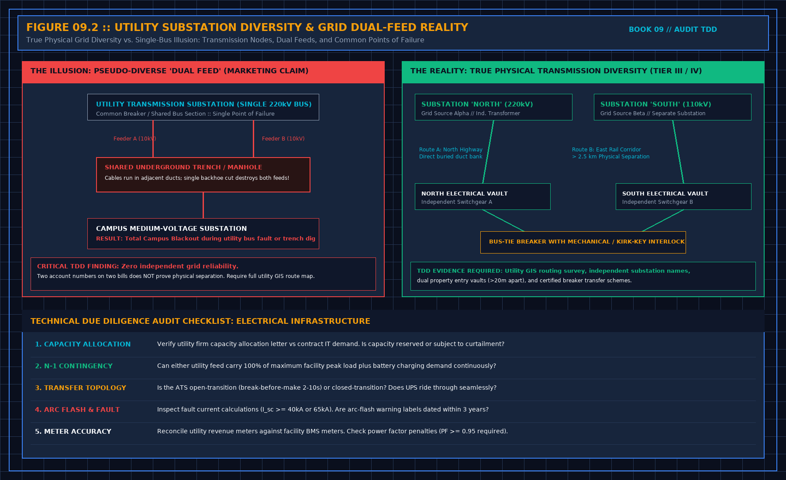
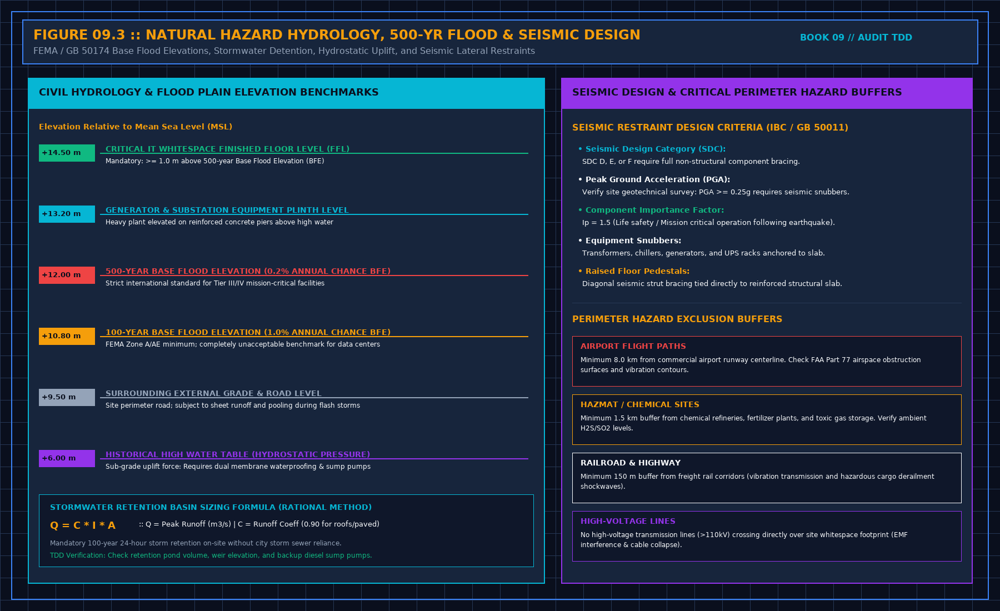

# Data Center Facility Location Due Diligence: The Complete Site Selection & Red-Flag Audit Checklist

> **Direct Answer Block**: A data center facility location due diligence checklist is a rigorous engineering framework used by infrastructure funds, hyperscalers, and lenders to physically verify the viability of a real estate parcel before capital deployment. It audits six non-negotiable physical vectors: transmission grid proximity and dual-feed diversity, 500-year civil hydrology, geotechnical soil bearing capacity for heavy AI racks, environmental ISA-71.04 corrosivity, micro-vibration setbacks, and uncurtailable water rights.

When an investment committee evaluates a 100-megawatt AI data center development, the commercial pitch deck always highlights "shovel-ready land," "adjacent power lines," and "strategic fiber corridors."

In the physical world, **marketing brochures sell megawatt headlines; real-world physics dictates facility survival**. 

A parcel situated 500 meters from a transmission corridor may require three years of right-of-way easement litigation to cross a single municipal railway. A site with "ample groundwater" may sit directly downstream from an agricultural ammonia plume that destroys copper heat pipes within eighteen months. And an unmitigated 500-year flood plain will cause commercial lenders to withhold debt syndication or demand prohibitive insurance premiums.

This guide provides the field-tested **Facility Location Due Diligence Checklist** required to uncover fatal flaws before closing land acquisitions or executing non-refundable power reservations.

---

## 1. The Six Core Physical Vectors of Site Due Diligence

A defensible location audit reconciles land title claims against physical terrain, local utility interconnect queue constraints, and multi-physics boundary conditions.

### Vector 1: Electrical Transmission Proximity & Diversity Physics
The single largest capital and schedule risk in modern data center development is the utility grid interconnection. An auditor must evaluate four physical criteria:

1. **Substation Proximity & Feeder Routing ($L \le 3.0\text{ km}$)**: Dedicated underground medium-voltage (MV: 10 kV to 35 kV) or high-voltage (HV: 110 kV to 230 kV) feeder runs must be verified. Voltage drop across the interconnect run must satisfy IEEE Std 141:
   $$\Delta V = \sqrt{3} \times I \times (R \cos\theta + X \sin\theta) \times L$$
   Where $I$ is rated line current, $R$ and $X$ are cable resistance and reactance per kilometer, and $\cos\theta$ is the operating power factor (typically 0.90 to 0.95). If $\Delta V > 2.5\%$, upstream transformer on-load tap changers (OLTC) cannot compensate during transient generator synchronizations.
2. **True 2N Substation Diversity**: As shown in Figure 2, developers often market "dual feeds" that actually pull from the same transmission busbar or traverse a single shared street trench. True diversity mandates feeds from **two independent transmission substations** separated by at least 1.5 km of public rights-of-way.
3. **Firm vs. Curtailable Power Reservation**: Audit the primary Power Purchase Agreement (PPA) or Interconnect Agreement (IA). A utility reservation subject to "discretionary economic curtailment" is a **Tier 1 Fatal Flaw**.

---

### Vector 2: Civil Hydrology & The 500-Year Base Flood Elevation (BFE)

Commercial real estate typically screens for the 100-year flood zone (1% annual exceedance probability). Mission-critical infrastructure requires adherence to the **500-Year Base Flood Elevation (0.2% annual exceedance probability)**:

- **Finished Floor Level (FFL)**: All critical whitespace slabs, UPS switchgear, and backup generator fuel points must sit **$\ge +1.0\text{ m}$ to $+1.5\text{ m}$ above the 500-year flood elevation**.
- **On-Site Stormwater Retention (Rational Method)**: The parcel must retain a 100-year, 24-hour storm surge entirely within on-site detention basins without relying on municipal storm sewers:
  $$Q = C \times I \times A$$
  Where $Q$ is peak runoff (m³/s), $C$ is the composite runoff coefficient ($C \approx 0.90$ for impervious roofs and concrete yards), $I$ is maximum rainfall intensity (mm/hr), and $A$ is the catchment surface area (m²).
- **Hydrostatic Uplift & Groundwater Depth**: If historical geotechnical groundwater is within 2.0 meters of planned slab depth, the foundation design must incorporate dual-membrane bentonite tanking and emergency-powered dewatering pumps.

---

### Vector 3: Geotechnical Bearing Capacity & AI Floor Loads

High-density liquid-cooled clusters (such as NVIDIA NVL72 architectures weighing up to 1,800 kg per rack footprint) impose unprecedented static and dynamic point loads on the soil subgrade:

- **Allowable Bearing Capacity ($q_a$)**: The subsoil must provide $q_a \ge 250\text{ to }350\text{ kPa}$ under footing pads to prevent differential settlement across continuous chiller piping headers:
  $$q_a = \frac{1}{\text{FS}} \left( c N_c + \gamma D_f N_q + \frac{1}{2} \gamma B N_\gamma \right)$$
  Where $\text{FS} \ge 3.0$ is the geotechnical safety factor, $c$ is soil cohesion, $\gamma$ is effective unit soil weight, and $N_c, N_q, N_\gamma$ are Terzaghi bearing capacity factors.
- **Liquefaction & Shear Wave Velocity**: Standard Penetration Test resistance must show $N_{\text{SPT}} \ge 30$, with average shear wave velocity in the upper 30 meters $V_{s30} \ge 360\text{ m/s}$ (Site Class C or better under ASCE 7-22).
- **Post-Tensioned (PT) Slabs**: If acquiring an existing shell, verify whether floor slabs are post-tensioned. Core-drilling through PT slabs for CDU coolant supply headers requires destructive x-ray or Ground Penetrating Radar (GPR) certification; severing an unbonded tendon destroys structural bay integrity.

---

### Vector 4: Micro-Vibration & Transportation Setbacks

High-frequency optical transceivers, silicon photonics, and precision hard disk arrays suffer degraded performance or premature laser misalignment when exposed to low-frequency ground vibrations from freight rail corridors or multi-lane highways:

$$\text{PPV}(r) = \text{PPV}_0 \times \left( \frac{r_0}{r} \right)^\eta \times e^{-\alpha (r - r_0)}$$

Where $\text{PPV}$ is Peak Particle Velocity ($\mu\text{m/s}$), $r$ is radial distance from the vibration source, $\eta$ is the geometric spreading coefficient ($\approx 0.5$ for surface Rayleigh waves), and $\alpha$ is the soil damping coefficient ($0.005\text{ to }0.02\text{ m}^{-1}$).

| Environmental Threat | Minimum Mandatory Setback | Governing Standards & Acceptance Corridor |
| :--- | :--- | :--- |
| **Freight Rail Corridor** | $\ge 150\text{ m}$ (500 ft) | Velocity Criteria VC-A ($\text{PPV} < 50\ \mu\text{m/s}$ RMS, 1–80 Hz) |
| **Multi-Lane Heavy Highway** | $\ge 75\text{ m}$ (250 ft) | Continuous ground vibration $\text{PPV} < 100\ \mu\text{m/s}$ |
| **Commercial Airport Runway** | $\ge 8.0\text{ km}$ (5 miles) | FAA Part 77 Obstruction Surfaces; electromagnetic radar interference |
| **Chemical Plant / Refinery** | $\ge 3.0\text{ km}$ (2 miles) | Toxic gas dispersion modeling; explosive blast overpressure ($< 3.5\text{ kPa}$) |
| **High-Pressure Gas Pipeline** | $\ge 100\text{ m}$ (330 ft) | Pipeline rupture thermal radiation buffer (API RP 1162) |

---

### Vector 5: Atmospheric Corrosivity & ISA-71.04 Environmental Chemistry

Modern server hardware utilizing lead-free solder (RoHS) and silver-plated immersion fittings is vulnerable to micro-corrosion in contaminated ambient environments.

- **Reactivity Monitoring**: A 30-day site exposure test using copper ($Cu$) and silver ($Ag$) corrosion coupons per **ANSI/ISA-71.04-2013**:
  - **Class G1 (Mild - Mandatory)**: Normalized corrosion film growth rate must satisfy:
    $$d_{\text{Cu}} < 300\text{ \AA/30 days} \quad \text{AND} \quad d_{\text{Ag}} < 200\text{ \AA/30 days}$$
- **Proximity Hazards**: A parcel located within 5 km of active agricultural livestock operations (ammonia $\text{NH}_3$), pulp mills, or wastewater treatment plants ($\text{H}_2\text{S} > 3\text{ ppb}$) requires multi-stage deep-bed chemical filtration with an Empty Bed Contact Time ($\text{EBCT} \ge 0.2\text{ s}$) for all emergency makeup air.

---

### Vector 6: Water Rights, Municipal Effluent, and CDU Heat Rejection

Even as AI facilities pivot toward direct-to-chip liquid cooling, the secondary heat rejection loop requires reliable thermal sinks:

- **Firm Industrial Water Allocation**: Evaporative cooling towers for a 50 MW critical IT load consume up to 1,500 to 2,500 m³ of water daily during peak summer wet-bulb conditions. The audit must inspect the municipal water supply utility permit for firm, uncurtailable industrial quotas.
- **On-Site Autonomy**: If evaporative cooling is utilized, the site layout must incorporate a minimum of **48 to 72 hours of on-site raw water storage tanks**.
- **Alternative Dry Cooling Footprint**: If municipal water rights are unobtainable, the parcel must have sufficient flat acreage to host massive adiabatic dry-cooler arrays without recirculating hot exhaust air into the building air intake louvers.

---

## 2. The Comprehensive Facility Location Audit Checklist

Use this field audit matrix during the initial desktop review (Phase 1) and physical site reconnaissance walk (Phase 2):

| Vector Category | Field Audit Checkpoint | Engineering Standard / Threshold | Fatal Flaw (Deal Breaker) Trigger |
| :--- | :--- | :--- | :--- |
| **1. Electrical Grid** | Dual transmission substation connectivity | IEEE 141; 2 independent substations, dual entries > 20 m apart | Single busbar or shared utility trench off-site |
| **1. Electrical Grid** | Firm uncurtailable capacity reservation | Executed Interconnect Agreement (IA) with confirmed delivery date | Curtailable service or speculative queue position > 36 months |
| **2. Hydrology & Civil** | FEMA / Civil 500-Year Flood Plain | Finished Floor Level (FFL) ≥ +1.0 m above 500-year BFE | Property footprint in 100-yr or 500-yr zone without levee |
| **2. Hydrology & Civil** | On-site stormwater detention volume | 100-year, 24-hour storm surge contained on site ($Q = C \times I \times A$) | Zero detention capacity with restricted city outfall |
| **3. Geotechnical** | Soil allowable bearing capacity ($q_a$) | $q_a \ge 250\text{ to }350\text{ kPa}$ under whitespace footings | Peat, unengineered fill, or collapsible subsoil layer |
| **3. Geotechnical** | Seismic liquefaction potential | $N_{\text{SPT}} \ge 30$, $V_{s30} \ge 360\text{ m/s}$ (ASCE 7-22 Class C) | Active fault trace < 200 m or high liquefaction susceptibility |
| **4. Vibration & Safety** | Freight rail / highway vibration setback | Distance ≥ 150 m; PPV < 50 μm/s RMS (VC-A) | Freight rail < 50 m with heavy axle vibration > 150 μm/s |
| **4. Vibration & Safety** | Hazmat & chemical plant proximity | Buffer ≥ 3.0 km; zero high-pressure gas lines on property | High-pressure transmission pipeline crossing parcel whitespace |
| **5. Environmental** | ISA-71.04 ambient air corrosivity | Class G1: Cu < 300 Å/30d, Ag < 200 Å/30d (lot-matched blank) | Class GX (> 2000 Å/30d) due to adjacent wastewater plant |
| **6. Water & Fuel** | Industrial water allocation / discharge | Firm municipal allocation or verified dry-cooler yard footprint | Groundwater moratorium with zero wastewater sewer capacity |
| **6. Water & Fuel** | Bulk standby diesel fuel autonomy | 72h continuous full-load generation on site (ASTM D975) | Municipal restriction limiting on-site fuel storage < 24 hours |

---

## 3. Four Fatal Flaws That Kill a Land Acquisition Deal

If an audit uncovers any of the following four conditions that cannot be mitigated by legal covenants or capital expenditure escrow holdbacks, the Independent Engineer must issue a **Refusal Memorandum**:

1. **The Shared Utility Transmission Bus**: Two 35 kV medium-voltage lines entering the campus from opposite gates but originating from the exact same primary 110 kV transformer or bus section at the utility substation. A bus failure shuts down both feeds simultaneously.
2. **The Unmitigated 500-Year Flood Basin**: A building footprint that encroaches into a documented 500-year alluvial floodplain where municipal zoning prohibits the construction of a certified perimeter levee or concrete floodwall.
3. **Curtailable Power Discretion**: A power supply reservation contract containing utility "call-back" or "economic curtailment" clauses where the data center can be forced offline during regional summer grid peaks.
4. **Active Fault Traces and Liquefiable Subgrades**: Unremediated marine clay or saturated silty sand subsoils within 200 meters of an active Holocene earthquake fault, where ground shaking would induce differential building settlement exceeding $1/500$ across structural spans.

---

## Frequently Asked Questions (FAQ)

### What is the difference between a Phase I ESA and Facility Location Due Diligence?
A Phase I Environmental Site Assessment (ASTM E1527-21) strictly audits historical contamination, hazardous chemical storage, underground fuel storage tanks, and Superfund liabilities. Facility Location Due Diligence (ASTM E2018 / IEEE 141) evaluates the entire operational physics of the site: electrical grid reliability, substation diversity, 500-year hydrology, structural soil bearing capacity, micro-vibration, and cooling water quotas.

### Why is the 500-year flood plain mandatory for data centers instead of the 100-year flood plain?
A 100-year flood plain represents a 1.0% annual chance of flooding, which translates to an unacceptable ~26% cumulative risk of flooding over a standard 30-year infrastructure financing loan term. The 500-year flood plain represents a 0.2% annual chance (~6% over 30 years), which aligns with the mission-critical uptime requirements demanded by institutional debt syndicates and hyperscale tenant SLAs.

### How do you verify true transmission substation diversity before ground-breaking?
Review the certified Single-Line Diagram (SLD) from the regional transmission system operator (RTO/ISO) and physically walk the utility rights-of-way. Trace the feeder routes from the data center property boundary back to the physical utility substations to ensure the cables do not share manholes, duct banks, utility bridges, or a single common busbar section.

### How does high-density AI rack deployment (e.g., NVL72) alter site selection criteria?
Legacy data centers were designed for uniform floor loads of 8 to 12 kN/m² with standard civil subgrades. An NVL72 liquid-cooled supercluster weighs up to 1,800 kg per rack, creating point caster loads exceeding 4.5 kN and requiring structural floor capacities of 20 to 25 kN/m². This mandates higher subsoil bearing capacity ($q_a \ge 250\text{ kPa}$) and strict avoidance of post-tensioned slabs that prevent core-drilling for liquid cooling headers.

---

## The Book Bridge

A technical due diligence site visit is where multi-million-dollar land acquisition terms are made or abandoned. For the complete physical audit protocol—including unannounced utility walk procedures, sample size calculators, single-line reconciliation sheets, and legal refusal templates—consult **[Walk a TDD: Technical Due Diligence Physical Site Audit](https://datacenterfieldguides.com/book/09-walk-a-tdd.html)** by Tristan.

Also explore our companion field guides:
- [Data Center Technical Due Diligence (TDD): The 6-Pillar Site Audit & Red-Flag Checklist](https://datacenterfieldguides.com/blog/data-center-technical-due-diligence-checklist.html)
- [Data Center Corrosion Monitoring & ISA-71.04 Coupon Placement Guide](https://datacenterfieldguides.com/blog/data-center-corrosion-coupon-isa-71-04-guide.html)
- [NVL72 Liquid Load Bank Testing: P&ID Hydraulics and Quick Disconnects](https://datacenterfieldguides.com/blog/nvl72-liquid-load-bank-testing-guide.html)
