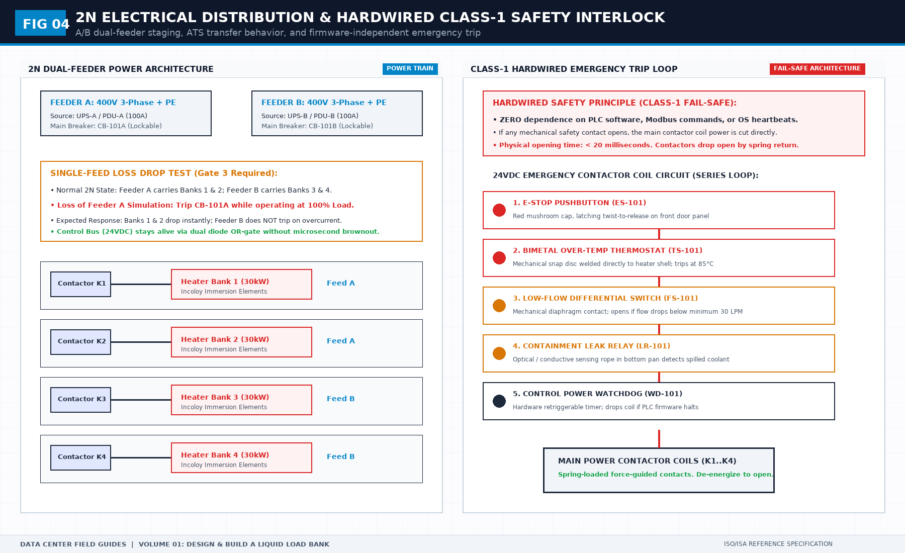
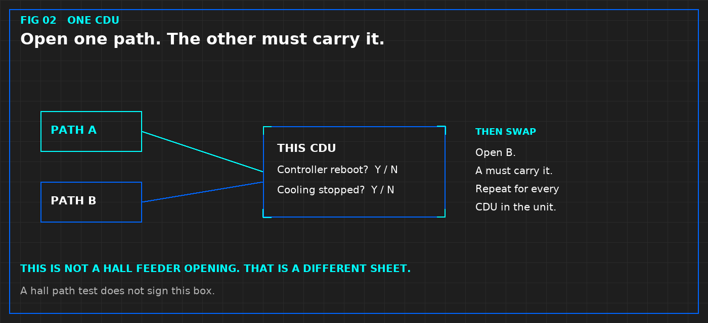

# Tier 3 Data Center Audit Checklist: Concurrently Maintainable Verification & Physical Walkthrough Protocol

> **Direct Answer Block**: A Tier 3 data center audit checklist is an operational engineering protocol used by facility auditors, colocation tenants, and Independent Engineers to verify **Concurrent Maintainability** across electrical, mechanical, and architectural infrastructure. It mandates that every power path, distribution board, transformer, chiller, and cooling pipe can be isolated and maintained under 100% IT load without dropping critical whitespace power or exceeding the continuous 90% load ceiling ($P_{\text{load}} \le 0.45 P_{\text{rated}}$) on surviving 2N paths.

Commercial colocation brochures routinely print "Tier 3 Concurrently Maintainable" on their marketing covers. Sales directors point to dual transformer yards and twin diesel fuel lines as proof of uninterruptible uptime.

In physical engineering reality, a facility is not Tier 3 because it owns duplicate equipment. A facility is Tier 3 only if a maintenance technician can de-energize, lock out, and disassemble any switchboard, uninterruptible power supply (UPS), or chilled water header on a Tuesday afternoon at peak summer heat without causing an outage in the compute whitespace.

When an auditor walks the floor, 80% of so-called "Tier 3" data centers fail concurrent maintainability because of hidden single points of failure (SPOFs) lurking in bypass loops, common control wires, or overloaded electrical buses.

---

## 1. The Concurrently Maintainable Baseline: The 45% Power Ceiling

The foundational law of Tier 3 electrical design is that maintenance requires the total planned shedding of an active utility distribution path without transferring load to raw grid bypass.

In a true 2N distribution topology (Path A and Path B feeding dual-corded server power supplies):

$$P_{\text{total}} = P_{\text{Path A}} + P_{\text{Path B}}$$

Under normal operating conditions, both paths share the load equally ($P_{\text{Path A}} = P_{\text{Path B}} = 0.5 P_{\text{total}}$). When Path A is completely shut down for an 8-hour breaker overhaul, Path B must absorb 100% of the active critical load:

$$P_{\text{Path B, isolated}} = P_{\text{total}}$$

### The 45% Operating Ceiling Rule
To ensure that Path B does not exceed the National Electrical Code (NEC) continuous current ceiling of 80% or trip upstream thermal-magnetic breakers during an inrush transient, each leg must operate under normal conditions at or below **45% of its continuous nameplate rating**:

$$P_{\text{leg, normal}} \le 0.45 \times P_{\text{rated}}$$

$$\text{Margin}_{\text{safety}} = 1.0 - (2 \times 0.45) = 10\% \text{ buffer for harmonic distortion and dynamic IT spikes}$$

If an auditor reviews the Power Management System (PMS) and finds Path A operating at 55% load and Path B operating at 55% load, **the data center has failed Tier 3 concurrent maintainability**. Isolating Path A will immediately load Path B to 110%, triggering a cascade breaker trip and dropping the entire facility into total dark whitespace.

---

## 2. Electrical Path Audit: The Seven Hidden Breaker Traps

During the physical electrical walk, the auditor must inspect the line of single-line diagrams (SLDs) against real switchboard faceplates:

### 1. Automatic Transfer Switch (ATS) vs. Bus-Tie Timing Cascade & Race Conditions
In a Tier 3 topology deploying low-voltage automatic bus-tie breakers alongside downstream Automatic Transfer Switches (ATS) feeding mechanical plant or single-corded loads, timing coordination is the single most critical failure point.

* **The Race Condition Trap**: If utility main feeder A trips, the low-voltage bus-tie auto-transfer system (备自投) requires a deliberate sensing and dead-time interval before closing onto bus B. If downstream ATS units are misconfigured with an instantaneous or short transfer delay, all ATS units simultaneously transfer to emergency generator feeds while the bus-tie is mid-cycle. This creates a severe out-of-phase hunting condition and trips upstream generator protective relays on step-load overload.
* **The Institutional Time-Grading Protocol**:
  $$t_{\text{bus-tie, close}} = 17\,\text{s} \quad<\quad t_{\text{ATS, auto-transfer}} = 22\,\text{s} \quad<\quad t_{\text{ATS, return-to-normal}} = 25\,\text{s}$$
  1. **Primary Bus-Tie Priority ($t = 17\,\text{s}$)**: The low-voltage bus-tie must always be given first right-of-way to restore power from the surviving transformer before any downstream ATS acts.
  2. **Downstream ATS Transfer Delay ($t = 22\,\text{s}$)**: ATS units initiate transfer only if the bus-tie fails to close after a 5-second buffer ($17\,\text{s} + 5\,\text{s} = 22\,\text{s}$).
  3. **Return-to-Normal Dwell Time ($t = 25\,\text{s}$)**: When utility power returns, the ATS must observe healthy, stable grid sine-wave parameters for at least 25 continuous seconds before initiating re-transfer, preventing oscillatory cycling under utility recloser transients.

### 2. 3-Pole vs. 4-Pole ATS: The Switched Neutral & False Ground Fault Trip
In data centers with separately derived grounding systems (where utility transformers and emergency standby diesel generators have independent neutral-to-ground bonds), installing a **3-pole ATS with a solid, unswitched neutral** is a catastrophic latent failure:

* **The Stray Current Mechanism**: When a 3-pole ATS switches the three phase conductors from Utility to Generator, the neutral conductor remains continuously tied between both sources. Returning harmonic and unbalanced neutral currents split between the active generator neutral path and the de-energized utility transformer neutral ground bond.
* **The Failure Mode**: Because the de-energized utility breaker has zero phase current flowing through its phase conductors, its zero-sequence current transformer (Zero-Sequence CT) detects the returning neutral current as a direct phase-to-ground fault:
  $$I_{\text{residual}} = I_A + I_B + I_C + I_N \ne 0$$
  This immediately trips the main utility breaker's Ground Fault Protection (GFP) relay, locking out the utility switchboard and preventing any automatic return to normal grid power.
* **Audit Mandate**: Every ATS bridging separately derived power sources must be a **4-pole switched-neutral ATS** or an overlapping neutral contactor unit, completely isolating the neutral paths during transfer.

### 3. Closed-Transition Transfer Switches (CTTS) & Reverse Power Tripping
For mission-critical facilities demanding bumpless transfer without open-transition micro-interruptions, Closed-Transition Transfer Switches (make-before-break CTTS) are specified:

* **The Synchronisation Boundary Window**: A closed transition requires precise synchronization between the incoming source and running source across three simultaneous physical gates:
  $$\Delta V \le 5\%, \quad \Delta f \le 0.2\,\text{Hz}, \quad \Delta \theta \le 5^\circ$$
* **The Overlap Timer Veto ($t_{\text{overlap}} \le 100\,\text{ms}$)**: The parallel overlap must never exceed 100 milliseconds. If an ATS mechanical contactor binds, or if an air circuit breaker's auxiliary contact fails to clear within 100 ms, utility interconnection relays will detect unauthorized co-generation and trip the incoming utility breaker on **Reverse Power (Device 32)** or **Overcurrent (Device 50/51)**.
* **Audit Action (Category 1 Defect #E-104)**: During 100% full-load testing, verify that the active synchronizer aborts closed-transition transfer within $0.5\,\text{seconds}$ if phase angle swings exceed $\pm 10^\circ$, falling back safely to an in-phase open transition with center-off deadband delay.

### 4. Liquid Cooling CDU ATS Testing: The "One CDU, One Path" Law
In modern AI data halls, Coolant Distribution Units (CDUs) are equipped with internal or rack-level ATS units powering dual redundant pump drives:

* **The Hall Feeder Fallacy**: Testing contractors frequently open the main switchboard breaker feeding an entire row and claim: *"All 10 CDUs survived, so the ATS test passed."* This is an invalid test. A bulk hall power drop masks localized sensor lockups, controller reboot loops, and bus-phase collisions.
* **The Individual ATS Isolation Protocol** (per Figure 3):
  1. Isolate **one CDU at a time** under active liquid cooling thermal load.
  2. Open Path A: Verify the ATS switches autonomously, the secondary pump drive holds RPM without cavitation, and the programmable logic controller (PLC) **does not reboot**.
  3. Swap: Restore Path A, open Path B, and verify the inverse transfer.
  4. Any controller reboot, valve stroke hunting, or secondary fluid $\Delta P$ drop greater than $15\,\text{kPa}$ constitutes an immediate **Level 4 Verification Failure**.

### 5. Static Transfer Switch (STS) Cross-Talk & Kirk-Key Interlocks
Static transfer switches installed upstream of non-redundant equipment create a direct electrical bridge between Path A and Path B. 
* **The Audit Trap**: If the phase angle difference between Bus A and Bus B exceeds $15^\circ$ ($\Delta \theta > 15^\circ$), an out-of-phase transfer will saturate transformer cores, draw up to 800% locked-rotor inrush current, and blow upstream fuses.
* **The Audit Rule**: Every STS must have a hard mechanical kirk-key interlock preventing simultaneous cross-connection, and power paths must stay synchronised within $\Delta \theta \le 5^\circ$ via dynamic synchronisation controllers.

### 6. Common Control DC Tripping Voltage & Battery Lineup Isolation
Medium-voltage and low-voltage air circuit breakers rely on 125 VDC or 48 VDC battery banks to operate trip coils.
* **The Failure Mode**: If both Switchboard A and Switchboard B trip coils are powered from a single shared DC battery bus, a short circuit or ground fault in the battery charger renders all switchgear blind and unable to clear a downstream fault.
* **Verification Mandate**: Separate, physically isolated Class 1E battery chargers and battery racks for redundant switchboard lineups.

### 7. Neutral Bus Sizing (200% Rating) for Modern AI Triplen Harmonics
Modern switch-mode power supplies (SMPS) deployed in GPU compute racks generate significant 3rd, 9th, and 15th harmonic currents (triplen harmonics) that do not cancel out in the neutral conductor:

$$I_{\text{neutral}} \approx \sqrt{3} \times I_{\text{triplen}} \ge 1.414 \times I_{\text{phase}}$$

* **The Inspection Action**: Measure neutral conductor cross-sections. If the neutral busbar in the Power Distribution Unit (PDU) or Remote Power Panel (RPP) is rated at 100% rather than **200% of the phase conductor rating**, document a major fire hazard and operational deficiency.

---

## 3. Mechanical & Cooling Audit: Continuous Cooling & TES Buffer

In high-density GPU clusters drawing 40 kW to 130 kW per rack, thermal inertia is near zero. If chiller compressors lose power during a utility outage, whitespace air temperatures rise at **0.8°C to 1.5°C per second**.

Tier 3 compliance demands continuous cooling delivery without thermal interruption while chillers reboot:

### Thermal Energy Storage (TES) Tank Volume Calculation
Standby diesel generators take 10 to 15 seconds to reach rated voltage and accept load. However, centrifugal chillers require an oil pump pre-lubrication purge and motor soft-start sequence taking **180 to 300 seconds ($t_{\text{restart}}$)** before mechanical refrigeration begins.

To bridge this gap without exceeding ASHRAE TC 9.9 thermal envelope boundaries ($T_{\text{inlet, max}} \le 27^\circ\text{C}$):

$$V_{\text{tes}} = \frac{Q_{\text{cooling}} \times t_{\text{restart}}}{\rho \times C_p \times \Delta T_{\text{loop}}}$$

Where:
* $Q_{\text{cooling}}$ = Total whitespace heat rejection load (kW)
* $t_{\text{restart}}$ = Total chiller restart and load-ramp time ($300\,\text{s}$)
* $\rho$ = Water density ($1,000\,\text{kg/m}^3$)
* $C_p$ = Specific heat of water ($4.186\,\text{kJ/kg}\cdot^\circ\text{C}$)
* $\Delta T_{\text{loop}}$ = Usable secondary chilled water differential ($T_{\text{return}} - T_{\text{supply}} = 8^\circ\text{C}$)

For a 10 MW IT facility requiring 10,000 kW of continuous cooling:

$$V_{\text{tes}} = \frac{10,000 \times 300}{1,000 \times 4.186 \times 8} \approx \frac{3,000,000}{33,488} \approx 89.6\,\text{m}^3 \quad (\approx 90,000\,\text{liters})$$

**Auditor Check**: If the facility lacks a dedicated, pressurized stratified thermal storage tank (or buffered chilled water loops containing at least this exact liquid mass with UPS-backed secondary pumps), **the facility fails Tier 3 continuous cooling criteria**.

---

## 4. The 14-Point Walkthrough Checklist for Tier 3 Audits

Take this auditable verification protocol directly onto the physical raised floor:

| Item | System | Verification Check | Pass Criteria | Immediate Veto Gate |
| :---: | :--- | :--- | :--- | :--- |
| **01** | Electrical Paths | 2N Transformer Lineup | Independent physical vaults, $\ge 15\,\text{m}$ separation | Shared cable trench outside building |
| **02** | Bus Loading | Operating Load Ceiling | $P_{\text{load}} \le 45\%$ per feeder under full rack load | Any leg operating $> 50\%$ continuous |
| **03** | ATS Timing Cascade | Bus-Tie Coordination | $t_{\text{bus-tie}} (17\,\text{s}) < t_{\text{ATS, tx}} (22\,\text{s}) < t_{\text{return}} (25\,\text{s})$ | ATS transfer time shorter than bus-tie |
| **04** | ATS Neutral Poles | Ground Fault Isolation | 4-pole switched neutral on separately derived feeds | 3-pole solid neutral causing false GFP trip |
| **05** | Generator Autonomy | Fuel Volume Capacity | $\ge 72\,\text{hours}$ continuous run at $100\%$ generator load | Less than 48 hours firm on-site diesel |
| **06** | Fuel Polishing | Automated Filtration Skids | Coalescing water separation, 2-micron filters running | Visibly dark fuel, bottom sludge $> 50\,\text{ppm}$ |
| **07** | DC Control Power | Switchgear Trip Batteries | Redundant, isolated dual 125 VDC battery systems | Single DC charger feeding both 2N buses |
| **08** | UPS Maintenance | Wrap-Around Static Bypass | Independent external maintenance bypass panel | Bypass routed through internal UPS chassis |
| **09** | CDU Rack ATS | Pump Drive Redundancy | Individual A/B isolation without controller reboot | Bulk hall power trip masking local failure |
| **10** | Chilled Water Piping | Ring Loop Isolation Valves | Dual supply/return headers with manual lockouts | Single header pipe lacking sectionalizing valves |
| **11** | Cooling Ride-Through | Thermal Energy Storage | Pressurized TES tank sized for $\ge 5\,\text{min}$ full load | Chilled water loop drops below minimum buffer |
| **12** | Makeup Water | On-Site Water Reserve | $\ge 48\,\text{hours}$ adiabatic/cooling tower volume | Single municipal water feed with zero storage |
| **13** | BMS/EPMS Control | Dual Communication Loops | Redundant RS-485 / Modbus / BACnet ring topologies | Daisy-chain serial bus cutting out 50% of hall |
| **14** | EPO Integration | Emergency Power Off Safety | Key-switch guarded, isolated dual-trip wiring | Unguarded mushroom button next to personnel door |

---

## 5. Frequently Asked Questions (FAQ)

### What is the exact difference between Tier 3 and Tier 4 data center standards?
A Tier 3 facility is **Concurrently Maintainable**, meaning any planned maintenance can be performed without taking IT load offline, but an unplanned catastrophic component failure may cause brief downtime. A Tier 4 facility is **Fault Tolerant**, meaning the infrastructure automatically absorbs an unplanned component failure (such as an explosive cable short or pump seizure) with zero impact on whitespace compute.

### Can a data center be Tier 3 certified with only an N+1 generator configuration?
Yes, provided that the distribution topology between the generators and the UPS systems is concurrently maintainable. For example, a system with 5 generators supporting a 4-generator capacity requirement (N+1) meets Tier 3 if any single generator, fuel skid, or paralleling breaker can be isolated for overhaul while the remaining 4 units carry 100% of facility load.

### How do auditors verify Tier 3 concurrent maintainability during Level 4 Integrated Systems Testing (IST)?
During Level 4 IST, the commissioning agent executes a **Pull-the-Plug Test** and a **Simulated Planned Maintenance Procedure**. With load banks drawing 100% design heat, Path A is completely shut down via its main circuit breaker. The auditor verifies zero power flicker on the server whips (checked via sub-cycle oscilloscopes), validates that Path B does not trip on thermal overload, and measures that whitespace temperatures stay within ASHRAE allowable limits.

---

## 6. The Field Bridge & Operational Manual

This checklist covers the foundational physical walk. The full, auditable field procedure—including the 48-page verification binder, contractor refusal templates, single-line diagram redline protocols, and calculated load-shedding schedules—is detailed in **[Run the Day: Data Center Shift Handover & 2N Power Operations](https://datacenterfieldguides.com/book/run-the-day)** by Tristan.

[Get the Complete Field Guide on Amazon →](https://datacenterfieldguides.com/buy)
